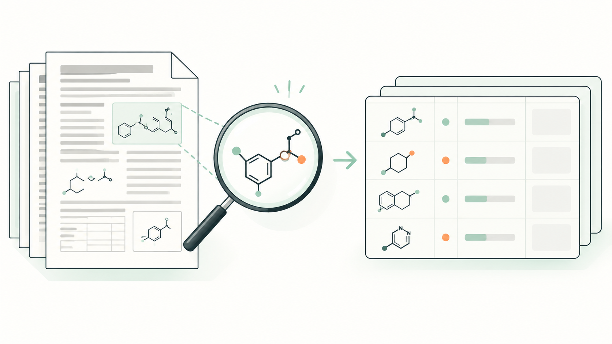

# X-PatentSAR

**从专利原文到可追溯的结构—活性数据。**

X-PatentSAR 是独立运行的专利化学结构、活性数据提取与 SAR 研究软件。上传 WIPO 专利 PDF，在同一工作台中对照原文、检查化合物结构与活性、修正结果，再开展结构—活性比较。

概念插图，非真实产品界面；图中的分子、图形与数据条仅作示意，不代表真实结构、实测结果或科学验收。

[开始使用](docs/getting-started.md) · [许可证与第三方组件](#许可证与第三方组件)

## 从一份专利开始

### 提取结构与活性

软件定位并分割结构图，绑定原文编号，提取活性表，使用 DECIMER 识别 SMILES，并执行严格 QA。编号、结构、读数与各自的原文出处一起保留。

### 在原文旁完成复核

原文与结构—活性表并排显示，可以从记录跳回来源页，检查结构裁图、表格和单元格证据，并使用本地结构编辑器修正分子。人工修订具有独立审计，不覆盖原始观察。

重复测量、删失值、原始等级、单位和实验上下文分别保留，不自动平均、补值或混为同一实验。界面支持 English / 中文，语言切换不改写科研数据。

### 比较结构改造

从已有提取项目或 CSV 建立独立 SAR 数据集，选择参考分子、比较改造位点，或自动寻找单点变化。结构比较需要严格图匹配；活性仅在可比较的实验、单位和方向下分析。

结合计算理化描述符与 ADMET 预测安排后续研究。项目级自动 Lead 推荐仅使用当前已通过来源验收、具备足够合格结构和活性证据的提取集合。

### 带走结果，保留依据

导出 Excel 工作簿、合格分子的 SDF、结构裁图、JSON 与 QA 报告。工作簿可以保留待复核记录，SDF 仅包含合格分子。任务与历史结果持久保存，中断后可以按有效检查点继续提取。

## 开始使用

X-PatentSAR 支持 Linux / WSL2 x86-64，在自己的环境中运行。按[快速开始](docs/getting-started.md)启动工作台、准备科学运行环境，再上传原始 PDF；模型权重需单独安装。

## 使用边界

- **保留不确定性**：当前为 Alpha 阶段研究软件，面向 WIPO 专利 PDF，不承诺任意版式或低质量扫描均可自动正确提取。结构归属、SMILES 或最终 QA 不满足规则时，结果保持失败或需复核
- **区分数据与判断**：实测值、计算描述符和模型预测分开保留。Lead 排序与 ADMET 预测用于研究，不代表分子有效、安全或具有临床价值；大分子和 PROTAC 尤需独立验证
- **明确外发权限**：常规解析不调用外部 LLM。可选局部证据复核默认关闭，需明确授权外发并确认费用；模型不能补造化学数据或替代正式 QA

## 许可证与第三方组件

第一方源码采用 [Apache License 2.0](LICENSE)。专利、用户数据、模型权重和第三方库保留各自权利与许可证，完整说明见 [NOTICE](NOTICE)。

PDF 引擎 **PyMuPDF/MuPDF** 使用 Artifex 的 **AGPL 或商业许可**，本项目的 Apache-2.0 不替代其条款。DECIMER、MolScribe、ADMET-AI、Ketcher 及其依赖也需分别遵守上游许可；分发或商业使用前应审阅实际组件的全部许可证。
