# X-PatentSAR architecture

## Responsive checkpoint preparation

The extraction queue reserves one durable attempt before returning its queued
response. Its existing single consumer prepares verified source checkpoints
outside the HTTP request and outside the SQLite writer transaction. The
producer cannot claim that attempt until its preparation is ready. Original
source ownership is rechecked at preparation time, while cancellation and
shutdown retain their own terminal state. Interrupted preparation can be
resumed from its declared original parent. A verified resume-parent identity
allows the interface to reconcile an uncertain submission without replaying a
write or inferring success from unrelated tasks.

## Raster title ink attached to original ruling

When retained title pixels are connected to a proved original table rule, the
system keeps the entire original pixel evidence and records an explicit
`crossing_title_ruling_ink` refusal. The caption role remains unresolved and
replayable; neither the attached stroke nor the rule is erased to infer a
title. Malformed ruling or pixel evidence remains invalid, not an uncertainty
that can admit a structure. Downstream declaration coverage continues to
withhold unsupported structures and reports the original title for review.
Binder and binding artifact epochs advance; old original observations and manual
revisions remain unchanged and require current-proof evaluation before reuse.

## Original catalogue frame association

Declaration capture retains the complete original grid inventory, including
duplicate observations, so existing geometric evidence remains replayable. It
associates an exactly repeated frame with its caption scope once. Duplicate
outer frames with different internal grid axes remain an explicit error; no
source geometry, role or identifier is selected by guesswork.
The binder epoch and binding artifact schema are advanced for the changed
catalogue-role semantics. Historical bindings are not retagged; existing
source and manual-audit history remain available for review. The activity
checkpoint depends on the binding artifact, so its reuse follows the new
binding identity rather than replacing raw observations.

## Reference and comparator catalogue roles

A qualified catalogue heading that explicitly describes reference, control,
comparator or comparative compounds/examples is not sufficient evidence that
those entries are this patent's final products. Its source role is retained as
a conflict for review, including mixed product/reference headings; it is not
silently excluded as an intermediate or promoted as an accepted product.
Unnumbered category headings still nominate source pages. Changes in this role
must invalidate affected derived proofs and preserve historical source and
manual revisions; earlier role decisions are not silently rewritten.

## A completed Lead tail does not certify a rejected core

The existing job stage is a producer observation, not proof that candidate
selection is valid. `reviewedCoreStage` derives a review-only presentation for
an explicitly core-rejected completed Lead tail, using the same rejection gate
as the other core stages. Task details and workflow groups show that the tail
executed while core acceptance failed; tooltips direct candidate eligibility to
the actual result. The review icon replaces the green completion icon without
changing the recorded status, progress, selection, scientific inputs or policy.
Missing/technical-error history and accepted/independent runs retain their own
recorded states; no candidate count is invented for historical data.

## Staggered physical catalogues retain one complete source family

`title_context_grids` retains the entire original page-grid inventory and
rederives the parallel peers from it. `title_family_geometry` gives each physical
column its own preceding-frame fence; the saved title source covers the complete
family envelope, not the intersection of successful local crops. Earlier body
cells and title regions can be partitioned only by actual closed frames with
paired original rule pixels. Narrow frames cannot hide exterior ink. Crossing,
competing, missing or over-budget owners refuse rather than choosing a neighbour.
Native words and complete glyph operations remain conserved. The same source
contract supports native, outlined and raster staggered catalogue controls;
logical parallel headers and paired raster-blankness proof remain separate gaps.

`source_paint_paths` adapts original PDF form paint ownership in the existing
paint view. Consistent engine sequences are kept. If embedded forms disrupt
sequence identities, only a unique exact single axial-stroke envelope may map;
duplicate/complex/unmapped paints remain unknown. No nearest-box or sequence
offset repair exists. Paired source pixels and ordinary ruling validation still
decide whether the original path is a usable table boundary.

The existing `structure_declarations` producer retains version2 source pages,
including complete grids and the SAME observed `catalogue_scopes` from the
caption binder. `structure_declaration_catalogues` derives physical declarations
from those scopes, not another text reader. The complete page inventory is
cross-checked against every retained family by `title_source_inventory` through
writer, saved-reader, formal and Web consumers. Current admission cannot downgrade
that page to version1 or erase its catalogue scopes and merely recompute digests;
version1 remains available for historical review. Wrapped identifier-free category
lines may be literal title references only with their actual qualified source
and original-page echo, never a reason to skip a molecular identifier.

`title_geometry_memo` shares only pure serialized geometry within one synchronous
validation call. Every lookup rehashes its complete input; results are defensively
copied and at most the existing128 source entries remain until the outer finally
clears the context. Mutation, exceptions and independent requests cannot inherit
acceptance. Actual PDF/paint/pixel replay is NOT memoized. There is no new persistent
cache, model, role authority or execution path. A proved empty native family with
no image paint can report an unknown title and proceed to the ordinary independent
continuation proof; a400dpi raster locator or contradictory raw title cannot.

## Catalogue titles conserve their complete original source

`title_source_capture` uses the same `paired_text_observation` and physical-cell
SDK as heading capture. `title_source_proof` owns typed geometry, all retained
native words, both complete optical observations and their frames;
`title_original_replay` reopens actual native/paint/pixel facts without acquiring
a model. The former isolated `caption_title_refinement` path is removed.
Catalogue role, table identity, subset/reprint and continuation consumers use the
same complete source, not successful page-token fragments or saved role flags.

If both word locators miss a title, a proved catalogue/column context can nominate
rows through `title_ink_geometry` and `title_ink_source`. These retain the complete
original paint/native inventory and only separate table ruling supported by the
caller's actual first-row cells and paired closed-cell pixels. Every unknown row
must be read; all native words remain anchors. Missing rows, crossing paint,
ambiguous parallel owners and row/height/pixel budgets refuse before model work.
Full-page declaration inventories do not become title OCR requests.
`title_raster_source` can also nominate complete physical rows from the existing
owned context when an original image has no usable word nominations. A bounded
400dpi full-context pixel witness with3pt boundary support uses the SAME
`cell_header_lines.physical_row_bounds` partition as physical text reads. Every
row then needs the ordinary complete400/600dpi text observations; the400dpi
locator alone never proves a title or blankness. The existing8M-pixel/1MiB
evidence limits and8row/128pt bounds stay in force, before model acquisition.
The same paired closed-cell SDK projects only actual original boundary pixels;
unknown attached or crossing ink cannot be cut away. Complete native anchors,
paint inventories, confidence and actual-original replay remain mandatory.
Over-budget, ambiguous, missing or conflicting sources remain explicit refusals.
This is not universal optical detection or molecular-accuracy acceptance.

`title_context_grids` owns both the existing prefix contract and actual parallel
grid families. Missing-word title discovery may partition complete physical rows
only by independently closed, aligned original table columns. Full-width marks
outside those columns stay global; no ink is discarded in the intervening gap.
`title_parallel_rows` preserves all row marks and `title_parallel_members` selects
one literal table member only after every required row has qualified. Independent
members need original table keys; same-key contradictory titles cannot disagree
silently. The existing shared-caption validator still owns truly global titles.
Missing peer readings, weak/conflicting text, changed original pixels, open grids
and malformed/null peer inventories refuse. Staggered physical families use the
complete-page contract above; logical parallel layouts remain unsupported rather
than guessed from proximity.

The existing caption binder and physical-header page loop pass bounded call-local
title observations through `title_source_reuse`. Only readings for the identical
physical window are reused, after actual original-source/pixel replay; every
consumer rederives its role. Weak attempts are retained too, never retried until
a preferred answer appears. Native-complete sources remain zero-OCR. No global
cache, persistent admission flag, competing reader or additional model exists.

Ruled and unruled column contexts share the existing bounded prefix and literal
last-caption/adjacent-wrap selector. A wrapped category cannot erase its printed
table marker. Whole unnumbered category noun phrases may declare a role but never
invent a table identifier; narrative mentions and mixed/negative categories do
not gain final-product admission. Raw observations remain unchanged.
`title_source_inventory` extends the existing explicit role-source ledger for
captions, columns, declarations and rejected proposals. Worker, raw reuse and Web
consumers replay those same original sources before numbered OCSR. There is no
new recognizer, queue, store, raw writer or acceptance path.

The shared grid detector separates observed closed frames even when their gap
fits the old short-row heuristic; continuous outer edges still keep a table's
rows together. This nominates geometry only. Native empty identifier cells use
the existing complete paired empty-grid witness to avoid futile OCR, while the
missing identifier remains an unresolved gap, never a fabricated record.

Binding73/binder84 and Activity51/extractor63 refresh affected derived admission.
Coverage25/source4/role6, raw observations/original assets/manual audit/history,
SMILES/OCSR/model preparation, API-v1/SQLite and SAR numerical policies remain
unchanged. Historical source review is not current acceptance.

## Project identity survives rejected saved-result reads

`WorkspaceService.project` delegates only metadata formatting to
`web/project_views.py`. Both the project catalogue and single-project metadata
retain the original identity/PDF reference when a known saved-source validation
or bounded-file refusal prevents rebuilding results. Additive `read_error` is an
explicit unavailable state: acceptance is failed, summary is not available, and
no retained compound projection or acceptance stamp is published or rewritten.
Visibility and unchanged source/snapshot ownership are rechecked after the
failure; unknown implementation failures,
authentication/visibility errors and concurrent projection conflicts propagate.

Scientific result/correction paths still use strict `_current_project`; the SAR
source adapter rejects this metadata before any snapshot work. A 300-character
field limit remains 300, not an invitation to truncate or extend raw headers.
One shared UI issue marker distinguishes a saved-data problem from task state.
Run/resume/import stay disabled for that source; verified live-job cancellation
is independent. Source titles and scientific strings do not change with locale.
No queue, model, scientific epoch, persistence schema or source fallback is added.

## Exact numeric literals survive source intake into SAR

`measurement_literals` is the shared pure scalar/censored/interval authority,
extracted from the existing SAR parser. It owns exact Decimal endpoints, open/
closed bounds and the unchanged 256-character/exponent limits. `sar.values`
keeps its public Value/error/grade/missing adapters and comparison semantics;
the former competing numeric parser is removed, not left as another path.

`activity_identity` uses that same syntax/validation for source values and full
text-row tokenization. Bracket commas, range separators, leading decimals,
comparators and explicit inline units cannot split across adjacent endpoints.
`table_cells` uses the same numeric predicate instead of a digit-prefix gate.
Original strings and physical cell positions are retained. Legacy decimal-comma
and uncertainty forms remain extraction-only literals, not scalar SAR values;
their temporary resource checks do not publish a conversion or midpoint.

Activity44/extractor56 invalidate affected derived extraction/cache admission.
Raw PDFs/OCR/structure assets, manual audit/history, Binding63/binder74, API/SQL,
SAR numeric/direction/tenth-strongest/percentage policies and models/dependencies
stay unchanged. Unknown/malformed/reversed/over-budget values stay unresolved;
unpositioned missing/extra cells cannot shift field assignments. The same source
and original-pixel replay gates still apply. Generated original-PDF checks are
engineering evidence, not all-format or private-patent acceptance.

## Recovery preflight reuses existing retained-claim constraints

`text_ocr.recovery_primary.primary_constraints_conflict` is a necessary-constraint
check, not another source/semantic validator. The existing `compatible_primary`
freezes each qualified primary part and its part count; `effective_recovery_cells`
requires identical recovered part vectors at both resolutions. Mutually
incompatible fixed vectors cannot be accepted by those rules, regardless of a
model's output. Unknown, malformed and oversized observations are not promoted
into known conflicts. Whitespace-only equality preserves character identities.

The shared source wrapper checks before auxiliary runtime acquisition or original
re-rendering; direct complete-pair callers check before physical-row/model work.
Both retain `not_attempted/conflicting_retained_primary_claims`. Raw primaries,
all previous failed attempts and their original evidence remain; repeated exact
diagnostics do not mutate shared history lists or erase prior failures.

No acceptance set, original replay, row/model budget, scientific epoch, API/SQL,
model/dependency, activation, SAR or numerical policy changes. Weak/compatible
sources still traverse the same paired recovery and actual-original replay.
Generated controls test resource/contract behavior, not model recall or patent
acceptance. Native isolated text comparisons cannot by themselves authorize
spelling repair, confidence votes or replacement of a retained known claim.

## Heading typography belongs to the same original source throughout recovery

`heading_title_scope` captures the original native seed and complete same-row
paint/native inventory BEFORE a heading may use its native fast path. Its pure
`heading_title_geometry` replays the same existing48pt native-row grouping,
including outlined ink instead of only successfully extracted words. One native
owner with orphan ink reads the whole row; multiple possible owners refuse
instead of choosing by distance. Independent native groups remain separate.
Crossing/over-budget source refuses before model acquisition. The original
nomination is unchanged, not replaced by a recognized-word crop.
Retained native text that is unqualified, invisible, covered or crossed cannot
be repaired by outvoting it with OCR; the same original visibility/claim gate
now stops that unsatisfiable work before primary or auxiliary model acquisition.

An independently proved closed cell owns its complete text window, but its box
cannot exempt adjacent outside role ink. The full row inventory stays in the
same packet; only actual boundary segments supported by the existing complete
paired cell-pixel proof may be separated as ruling. Solid and literal dashed
axial paths share that SAME pixel closure requirement; large gaps and attached
unexplained ink still refuse. Native dotted activity cells therefore refresh
derived Activity47/extractor59, not values, relations, units or conditions.
The existing rule authority also owns finite typed segment validation for both
cell admission and title replay; malformed/NaN geometry is invalid source, not
an arithmetic crash or a confirmed title.

Capture, pure heading status and mandatory actual-original replay share this
one scope. Native-bearing packets cannot remove the scope or crop it back to
the original narrow nomination. Replay re-observes all retained row ink and
closed-cell pixels, including ink outside the former word box. Call-local page
paint facts are reused by heading discovery; no persistent cache, second OCR,
writer/store/queue, fuzzy identifier repair or graphic-to-product rule exists.
Binding69/binder80 refresh derived source admission. Earlier binding epochs
below are history. This proves the tested title scope, not every source-role
interpreter, all-format discovery, native OCR accuracy or scientific acceptance.

The native fast path proves complete original-window paint coverage, not only
visibility of a recognized subset. `native_window_coverage` shares the existing
call-local `source_paint_visibility` inventory and records every intersecting
paint. Visible native glyphs are selected by their actual original geometry;
one PDF text operation spanning several rows does not merge those rows or require
OCR. Unread outlined role words, comparator paths, hidden/raster/unknown ink and
unexplained interior marks cannot disappear behind a readable native number.
Only simple axial boundary strokes with the existing paired closed-cell pixel
proof can be treated as ruling, never arbitrary rectangles or inset erasure.
The native capsule pins that complete paired boundary observation by its existing
content digest; it does not serialize duplicate raster payloads for every native
cell. Mandatory actual-original replay regenerates the strict witness and exact
digest before admission. A saved digest/flag alone grants no source permission.

Heading, scalar/identifier, role and declared-text cells use the same native
window envelope and `cell_source_status`; actual-original replay reconstructs
it without OCR. `heading_native_claims` conserves every qualified native word
when that SAME window has additional outlined source ink. Both existing complete
optical observations must add the missing text, preserve the whole-word native
sequence uniquely and keep its exact declared members. Unknown paint may not
intersect the retained native words. A complete native title remains an exact
literal veto; echoing only the known subset is not a complete optical read.
All native/optical observations remain unchanged, and qualified earlier optical
conflicts, detector conflicts and actual-original replay are still mandatory.
A locator-edge fragment that was unqualified is not promoted into a known veto
of a subsequently proved complete original cell; its raw packet stays retained,
and that whole cell must independently conserve all of its qualified native text.
A native locator equal to that partial layer cannot independently veto the
whole observation; a different locator ID remains refused. No spelling, suffix
or identifier repair, new OCR/model or successful-word crop exists.
Current native source windows are bounded to4096paints/20000retained
primitives, below the unchanged page/source/render bounds; exceeded work retains
an explicit refusal, not a successful prefix. No model pass is required for a
complete native source. Binding68/binder79 refresh heading admission; the earlier
native-window release introduced Activity46/extractor58, unchanged by this
heading-only repair. Raw observations, original assets, manual/history,
source/role/coverage/chemical models, API/SQL and SAR policies are unchanged.
This is bounded original-window completeness, not all-page detector recall,
automatic recognition of every outlined glyph, or real-patent acceptance.

The existing heading observer passes `MAX_HEADING_ROWS` and
`MAX_HEADING_HEIGHT` to both primary capture and on-demand auxiliary recovery.
Both retained primary views carry the existing typed `text_scope`; the same
cell/recovery proof and actual-original replay reconstruct that scope. A large
or wrapped heading must not inherit the short assay-header default midway
through the chain. No new recognizer, spelling/ID repair, vote, parser or store
is introduced. Qualified primaries still use only the existing400/600dpi reads
and do not acquire the auxiliary runtime.

The scope is subordinate to the trusted caller: a heading packet cannot enlarge
an assay cell's row height. Missing/changed scope, differing IDs, qualified
primary/native conflicts, changed actual pixels and source/model limits still
refuse. Recovery of a title does not prove a drawing or terminal-product role;
the normal binder continues to reject a heading without its proved structure.
The unchanged auxiliary256px row limit can still reject larger rendered text.
No implicit resize, source crop or limit increase is licensed by this fix.

`replay_auxiliary_cell` has the same fail-closed boolean contract for current
and historical packets. A changed or unavailable actual original returnsfalse;
callers still emit an explicit source failure. Legacy windows no longer leak a
rendering exception where current recovered windows already returnfalse.
Historical parsing/display and complete-source admission remain distinct; this
reader consistency change admits no previously rejected source or saved flag.

The same literal heading authority retains an explicit role-only title row
before its numbered row. `Intermediate` or an existing assay-title phrase cannot
disappear simply because the number is printed on the next physical line.
Capture and replay share one bounded join: the first role-to-number gap may be
at most one observed row height; subsequent continuation rows keep the ordinary
half-height gap. Column, source, eight-row and128pt limits are unchanged.
An unjoined role-only title immediately followed by a numbered nomination
remains an unresolved source occurrence, never an implicit terminal-product
declaration or an invisible completeness exemption. A non-numbered section title
followed by ordinary procedure prose does not invent a molecular declaration;
the independent activity-source inventory still owns experimental completeness.

Single-line and wrapped versions use the same existing literal vocabulary and
paragraph-locator authority; raw titles and identifiers remain unchanged.
Detector fragments of a fully qualified nonfinal title are interpreted only in
that same complete original title. Different IDs, extra/conflicting text and
independently qualified native/primary contradictions still refuse. Conflicting
assay and synthesis declarations remain ambiguous. Original replay and saved
row geometry prevent dropping the role row; this does not certify a drawing.

The same `table_geometry` detector gives explicitly requested single-column
caption frames a physical12pt rule-span/kernel, independent of blank page width.
It no longer applies a multi-column assay's80pt/page-relative horizontal gate
to a narrow numbered frame. Default multi-column detection is unchanged.
Every enclosing edge, closed-cell ink witness, literal role/ID and actual-original
replay is still required. A small chemical rectangle is geometry only, never a
terminal-product catalogue; missing edges and unexplained marginal ink refuse.
The heading reader selects the existing whole cell before its normal two primary
reads, not a successful token crop or an extra model pass.

Binding65/binder76 and Activity45/extractor57/coverage25 refresh affected derived
source interpretation. Source4/role6, raw originals, manual/history,
OCSR/SMILES6, API/SQL, environments/models, activation and SAR numerical
policies remain unchanged. Controlled generated
checks prove source/caller contracts, not model accuracy or private-patent
acceptance. Earlier binding-version entries below document release history.

## One physical caption owner for imperfect location nominations

`caption_label_roles` has one page/source index for exact-label and physically
proved locator references. The existing literal path remains unchanged. A raw
page-OCR single compound-label nomination may instead reference exactly one
current confirmed caption when its COMPLETE closed cell equals that caption's
original cell and the original catalogue role is compound. The locator's text
stays raw; the identifier comes only from the existing confirmed binding. No
prefix/parent/suffix, nearest-neighbour or same-ID occurrence inference occurs.
Native contradictions, prose, unruled/unknown/open/crossing/competing/foreign
sources, different original positions and oversized proof remain unaliased.

`caption_locator_proof` is the pure typed scope reader. `caption_locator_source`
adapts the same full closed-cell SDK for capture and actual-original replay;
grid/render work begins only after a possible proved parent exists. The single
source ledger keeps the physical packet and original nomination. The ordinary
source plan carries `caption_references` alongside its other original role
owners. Worker preflight and Web source observation reads feed that inventory
into the SAME `original_binding_source_errors` gate before model access. Removing
model work cannot remove a required original source replay. No second binding,
recognition, parser, data store, queue or acceptance path is added.

Binding62/binder73 refresh derived ownership; Activity43/source4/role6, raw
observations/PDF/assets/manual audit, OCSR/SMILES6, API/SQL, environments/models,
activation and SAR numerical policies remain unchanged. A shape-valid digest is
not a source proof: changed original pixels still fail the real replay. Generated
controls validate these contracts, not private-patent or all-format accuracy.
Earlier Binding61 entries below document release history.

## Physical characterization claims, not competing literal votes

`activity_text_sources.text_source_owners` is the same call-local resolver used
by declared-text capture, partition validation and saved proof. Its bounded
`activity_text_roles` adapter links a nonliteral negative claim only to one data
cell in a complete current characterization grid. Both high-quality400/600dpi
line reads must be literal contiguous word runs in that SAME cell's respective
DPI readings. It cannot borrow the other DPI, another row/cell, a role label,
native witness, header, identifier or preparation column. No winning string is
selected, corrected, combined or used as an activity value.

Every line, raw nomination, differing reading and original frame remains in the
existing catalog. The single partition only projects already-owned characters
to whitespace barriers for the existing text planner. Full original role/cell
and actual grid-axis replay remain mandatory; a changed/missing/foreign source,
unqualified reading, unresolved role or competing/crossing owner still refuses.
Unknown sources cannot be removed, and an empty or missing result stays open.

`activity_grid_roles.characterization_conflict` reuses the existing metric and
literal-context authorities. Scientific conditions/results in the title, full
role matrix or independent native hints refuse a characterization role, even
when an NMR label is present. This applies to the binder/worker/Web/SAR readers
of the existing role proof as well as activity extraction. No new classifier,
recognizer, row writer, store, queue or scientific threshold is introduced.

Current derived contracts are role6, declared-source4, Activity43/extractor55/
coverage24 and Binding61/binder72. Old derived proof remains historical; raw
PDF/OCR/OCSR, structure assets, manual audits, SMILES6, API/SQL, model/environment
activation and SAR strength/percentage/log policies are unchanged. Earlier
contract entries below are release history, not current alternate authorities.
Controlled generated readers prove these engineering contracts, not OCR recall,
chemical correctness or actual private-patent acceptance.

## Mixed-page source ownership

Coordinate `owned_pages` nominates pages; it no longer excludes the other text
on a page. `activity_text_partition` is the single projection shared by the
existing declared-text producer, planner and saved proof reader. Every original
line, read, location and nomination remains in the physical inventory. Only a
qualified line wholly inside one recorded grid, or an exactly qualified caption
owned by that grid's existing source snapshot, may be annotated as consumed.
Overlapping/competing owners remain ambiguous and fail source qualification.
The obsolete internal page-blocklist arguments are removed, not retained as a
competing way to skip sources. Missing-page and physical-barrier controls remain.

The sole text planner sees character-position-preserving whitespace projections
and explicit barriers, not a second set of grid measurements. A physically
intervening grid is also a barrier when native PDF object insertion order differs
from page geometry. Native original word order is retained; columns are not
arbitrarily sorted or conditions borrowed through a removed source. Independent
unruled tables above/below a grid remain parsed with their own context.

Coverage recomputes owners against the same physical region inventory. Original
readback checks every retained native/optical reading and the actual grid axes;
removed rules with identical native text are not equivalent evidence. No line,
unknown source, empty grid, source conflict or completeness gate is waived.
Every nominated/coordinate page requires its complete text catalog even when its
projection is blank, so removing an outside table and its entire catalog together
cannot turn partial extraction into complete acceptance.
`activity_text_sources.required_text_page_keys` is the shared page-selection
authority for capture and original replay: every observed physical grid page is
included regardless of parse/ownership status. The facade populates each required
page through its existing cached reader before the initial text projection.
A newly discovered but unsupported grid cannot omit its page or hide an
independent literal result below it. Unknown grids remain rejected; no row,
metric, condition or page role is fabricated to complete the inventory.
The mixed-page release introduced source3 / Activity42 / extractor54 / coverage23;
the current role6/source4 contracts are recorded above. Both refresh derived
proof only. The mixed-page change left raw originals, manual corrections,
binding, OCSR/SMILES6, API/SQL, SAR and
potency policies stay unchanged. Native checks do not construct OCR runtimes.

## One literal nonfinal-label admission guard

`source_role_terms.intermediate_source_label` is shared by the binder record
filter, numbered-product result views, pre-model admission and SAR source scope.
It recognizes literal singular/plural, supported abbreviated and Chinese labels,
ignoring only outer presentation whitespace without changing retained originals.
An I-prefix, a longer namespace or a reference inside a product title is not an
intermediate declaration. Unknown ownership still needs the existing original
source proof; passing a lexical guard never proves that a drawing is a product.
SAR also applies its existing anonymous-source guard to a stripped, case-folded
source-ID namespace projection. C0 controls in the source identity refuse even
when a separate display label looks numbered. Retained source IDs are unchanged.
Original assets, stored IDs, manual edits and historical artifacts
are not rewritten or deleted; no new recognition, queue, parser or policy path.

## One paragraph-locator and original table-boundary authority

`source_paragraphs` owns paired, bounded literal paragraph metadata. Original
headings, table nomination, activity context windows, result-reference spans and
saved-row comparison use it without changing source characters or molecular IDs.
The last literal or uncertain table boundary scopes the original observation;
only a proved caption supplies table identity. A different valid paragraph
locator does not break an otherwise proved, explicit same-table continuation.
Malformed/overlong numeric bracket prefixes stop prior condition/role ownership
without becoming captions or corrected identifiers. The same boundary grammar
serves discovery, physical header wrapping, local/parallel title projection,
declarations and saved-source consumers. Unknown boundaries retain all original
facts while ending trusted prior ownership; they cannot trim the source inventory
or exclude later diagrams as intermediates. Prose/isotope labels are not numeric
paragraph metadata. Unproved current context remains a computed review conflict,
including a saved raw context whose caption fields were omitted.

Literal boundary matching gives numeric prefixes a single trailing-whitespace
owner. Overlapping whitespace quantifiers must not amplify negative source lines
into quadratic backtracking. Generated long-prefix controls enforce a bounded
worker check and retain the complete original span for valid and unknown titles;
they neither trim evidence nor grant an uncertain caption a positive identity.

Biological readout classification owns metric keys, not a second experimental
context parser. Method words remain in keys/raw captions; missing assay, target
or cell-line conditions cannot be filled from that classification. Known literal
target disagreements remain review findings. The obsolete inferred-assay field
has no remaining consumer and is removed from the internal readout descriptor.

Current boundary2 retains each borrowed header's local native/parallel/adjacent
prefix, not only its parent's header. The existing original activity source
inventory replays complete native words/paint and positive-claim visibility.
Raster boundaries additionally retain the shared `cell_raster` full, untrimmed
400dpi frame/window and compare them with the actual original; no recognition,
spelling repair or confidence vote occurs. The existing8M-pixel budget refuses
with an explicit diagnostic and unresolved grid instead of a partial frame.
Omitted/downgraded boundaries cannot inherit a parent source. No new parser,
recognizer, source store, queue, model activation or scientific-value writer.

The boundary-only release introduced Activity41/extractor53/coverage22 and
Binding60/binder71. The combined activity authority is source3/Activity42 above.
These versions invalidate affected
derived proof only. Original PDF/raw OCR/OCSR/manual audits/history, SMILES6,
default recognizers, environment/dependencies, API/SQL and strict SAR/tenth-strong
potency rules stay unchanged. Historical data is not rewritten or retagged;
generated controls do not prove scientific correctness or all-format coverage.

## Short source headings retain their menu space

`resultColumns` owns the shared source-column default/minimum96px and existing
maximum180px. This keeps the short English/Chinese source label intact beside
the existing menu at default, pointer/keyboard minimum and reset widths. Other
columns retain their own widths and scientific-title wrapping; no locale/task
special case, global no-wrap or replacement label is introduced. The existing
resize state, source navigation and language authority remain unchanged. The
browser spec uses the existing read-only fixture only. No scientific epoch,
API/SQL, original artifact/manual audit, model or dependency changes.

## Existing-pane review navigation

`WorkspaceLayout` owns source/results scroll and focus refs, not another route
or task state. Its one source render callback exposes Back to results to the
embedded `PdfPane`; standalone readers omit that control. Narrow View original
opens the existing source only when needed and focuses it after that mount.
An already open original keeps its component, page draft and resource identity.
Returning or late page reads do not change the route or move focus again.
Narrow fullscreen keeps both flex items at their content height inside the
existing scrolling split, so table contents cannot overlap the PDF. Desktop
split/collapse/resize, source jumps, route persistence, API/SQL/scientific epochs,
original data/manual audit, model policy and dependencies are unchanged.

## Closed original header-cell boundaries

`activity_header_boundary` is the existing column reader's optional geometric
adapter. A raster page locator that overlaps a cell edge is retained verbatim in
`boundary_source`; it may cease to block that column only when the SAME full
original cell has a proved isolated four-sided text frame. It never changes
source words, scores, boxes, physical rows or pixels. Qualified centre-owned
endpoint/unit/context claims and native witnesses still constrain the full-cell
read. Unproved/open/attached frames and malformed sources remain unresolved.

Column contract5 compares each leaf witness with the projection of the existing
original header snapshot. JSON/rehashed flags, omitted witnesses or a downgrade
to an older contract cannot manufacture boundary authority. Ordinary and
optional auxiliary observations retain the same frame and original-pixel replay;
no additional recognizer, inference pass or evidence store is introduced. Activity39 and
extractor51 refresh affected derived evidence; old raw observations, original
assets, manual audit, Binding57/SMILES6/coverage20 and SAR policies are unchanged.
Confidence remains an admission gate, not a calibrated correctness guarantee.

## Activity table execution follows original source dependencies

`activity_context_geometry.table_dependency_order` is the single visitation key
for the coordinate producer and saved table-family reader. Existing same-page
header edges require a disjoint left source; cross-page edges require the prior
page. Page/left/top therefore visits every possible parent before its child,
including slightly staggered raster grid edges. This key is not source evidence
and cannot qualify a caption, column, unit, condition, unknown header or value.
The existing full original observations, unique source and context guards remain.
Human-facing coverage retains its original page/top order; nothing edits source
coordinates or uses source order as potency rank. Extractor50 refreshes derived
activity admission; Activity38/coverage20/Binding57/SMILES6, raw assets and manual
audits stay unchanged. No extra OCR, model, parser, cache, queue or fallback path.

Native declared-text source2 keeps neighbouring overlapping native lines in one
complete source window only within the same original block, the existing512word
packet budget and identical physical/original word order. No nominal boundary or
original paint is shrunk and no token is removed. Nonoverlap, different blocks,
order disagreements and oversized groups retain their separate original windows;
all still require the same complete source/visibility/readback guards. Native raw
text keeps its original extraction order and spelling. The sole `native_page_lines`
authority feeds observation and original replay; no second text parser or model.

## Complete original reaction routes

`reaction_steps` retains every local arrow, drawing and unresolved input/output
port before the sole `reaction_graph.reaction_route` validates the whole
declaration. A missing endpoint is not a node, an edge or a product. Ordinary
native/pixel source2/3 readers use this same graph without additional role/layout
permissions; the obsolete terminal-only wrapper is removed.

`reaction_reactants` may group inputs only with a literal original addition
witness before the shaft. Native vector crosses must have complete perpendicular
axis-aligned source strokes. A literal native `+` uses `reaction_operators` and
the existing complete-cell/paint/visibility authority. All original strokes,
glyph cells and corridor blockers remain; raster/hidden/overpainted/unknown
marks and an unlabelled drawing beside or above an arrow prove no role. Source4
retains the complete reactant-group and operator inventories, not model scores.

`reaction_layout_components` retains all local components, and `reaction_layout`
may resolve only a unique open horizontal row port to the adjacent complete
source component under the same proved declaration. Source5 explicitly separates
`layout_joins` from the observed local ports: those ports still have a missing
endpoint. Consecutive-page joins cannot skip empty/original pages, independent
regions or arbitrary unowned gap ink. Complete gap work is bounded to2M original
primitive/region checks, on top of existing arrow/drawing/proof limits. Closed
independent routes, overlapping rows, mutually missing ends, cycles, ambiguity
and exceeded bounds refuse rather than choosing a position or omitting a node.

Explicit alternative/independent scheme titles stop the declaration as
incomplete, including literal bounded paragraph locators and role-word
boundaries. One shared grammar/projection serves headings and catalogue roles;
raw labels and scientific source text stay unchanged. Malformed/over-bound
paragraph prefixes are not repaired into metadata. Ordinary procedure boundaries
and independently proved columns/panels retain their existing authority.

The existing original heading reader re-observes the complete packet, including
operators and layout joins, before worker/checkpoint/final QA/Web admission.
Rehashing, deleting or downgrading a saved packet cannot supply original truth.
Binding58/binder69 invalidate derived source admission only; raw originals and
observations, manual audit, historical attempts, activity/SMILES/coverage epochs,
models, dependencies, optional activation, API/SQL and SAR rules are unchanged.
No second parser, queue, recognizer, store or chemical writer is introduced.

Generated original-PDF, pixel, bounded-work and controlled-worker regressions
are engineering evidence, not proof of chemical transformations, all-format
detection recall or real extraction/SAR acceptance. The exhausted60OCSR and
40RxnScribe native evaluations do not authorize new inference or default model
integration; unproved above/below-arrow molecular roles remain unresolved.

### Native and raster direction observations

`reaction_page_source` selects native or retained-pixel observation from actual
original image geometry, never from recognizer votes or product ranking. Both
adapters feed the same complete directed graph and original-source replay.
Native painted primitives remain version2. Pixel observations retain complete
200dpi nonwhite masks, original RGB/window identities and400/600dpi whole-arrow
support windows. Their version3 binary primitives contain geometry only: no
invented RGB, opacity or stroke fields. Bare binary geometry is not authority.

`raster_reaction_pixels` conserves every connected component: proved direction,
independently owned drawing, literal enclosing rule or blocking/unknown ink.
`reaction_pixel_frame` reuses only the caller's already-proved original panel
edges and existing rule/joint policy, never its interior or an arbitrary edge
band. Unknown marks attached to rules, clipped components, disconnected/cyclic
routes, multiple terminals and missing/budget/source contradictions refuse.
Protected drawing crossings cannot disappear through crop suppression.

`raster_reaction_shapes` accounts for the complete shaft/head pixels and requires
continuous original support; `raster_reaction_heads` proves open or solid heads.
The actual original image pixel axes bound directional information. Source and
device pixel supports compose for paint coverage, not for invented resolution.
Derived uncertainty propagates through `reaction_connections` as a widening
analytic corridor: chosen-drawing interior, rivals, source limits and blocking
ink must all agree. The complete declaration ray replaces the old one-shaft-
length connection cutoff for both adapters. It does not choose the nearest ID.

Source/detail observation stays bounded to8M pixels,20k components,100k pixels
per proposed arrow and4096 image instances, with the existing1MiB proof limit.
Full source replay re-observes the same original window/frame without OCR/model
agreement shortcuts. No second graph, queue, writer, recognition model or
scientific acceptance authority is added. Binding56/binder67 refresh affected
derived admission; raw PDFs/OCR/OCSR, human audits, activity/SMILES/model/rescue/
LLM/environment/API/SQL/SAR and potency policy remain unchanged. Generated
source/worker/browser checks do not prove all-format recall or chemical truth.

## Physical enclosure owns its declaration window

`heading_panel_scope` shares the existing grid observer and call-local page memo;
it never invents left/right page lanes. A unique closed original content cell
larger than the text-heading window carries both400/600dpi complete original
pixel packets, the same four-edge/gap policy and8M-pixel/1MiB proof bounds.
This is enclosure, not a text inset: every raw pixel survives, with no new OCR,
ink removal or model. Short heading decorations keep the ordinary source path.

The one `declaration_window` policy is used by observation and saved readback.
Panel declaration4 bounds one actual page/cell; ordinary declaration3 is the
unchanged no-panel adapter. Complete page line/drawing inventories stay in both.
Only the geometric declaration window is narrowed; outside candidates are not
deleted. Crossing lines/crops, multiple unconnected own-cell drawings, ambiguous
or unproved/over-budget frames remain explicit refusals. Actual panel pixels are
replayed against the original without re-OCR. Pixel memoization is immutable,
call-local only, not another persisted source or acceptance cache.

If complete panel pixels exceed the unchanged serialized region budget, the
existing digest raises typed `SourceEvidenceLimit` (still a ValueError). The
index refuses that entire panel proof with `refusal: region_budget`, retains
the original PDF/full page inventory, releases its cached pixel payload and
does not re-render it. It cannot trim evidence into a singleton; independent
qualified panels can still be processed. Other malformed evidence is not
downgraded, and an oversized page inventory still obeys its original hard bound.

Native reaction roles use the same panel bounds. `reaction_frame` can recognize
only the exact opaque unfilled rectangle stroke of that already proved frame,
within one240dpi grid pixel. It never excludes an interior rectangle, its area,
extra path item, fill, transparency or unsupported/raster ink. The same original
vector observation/terminal/replay authority remains; scanned reaction roles
are not inferred from a panel boundary.

The original panel release used Binding55/binder66; current raster admission
uses Binding56/binder67 and the same normal cache identity.
Original PDFs/OCR/OCSR assets, Activity38/extractor49/coverage20, visible26,
SMILES5, manual audit, model/rescue/LLM/environment/API/SQL/SAR and potency policy
are unchanged. Old records remain history, never retagged as new acceptance.
These controls do not close all-format recall or chemical-recognition defects.

## Reference structure workspace

`MolecularImage` is the single passive image/load/focus boundary shared by
`StudyImage` and `StudyRegionMap`; the latter retains its original graph-validated
drawing request and atom coordinates. A reference overlay mounts only after that
same image loads. A failed image removes both its overlay and open chooser; a
deactivated or unvalidated resource cannot authorize selection or magnification.
Enlargement reuses the exact safe SVG URL and existing `MolecularFocus`, with no
second drawing read, graph normalization, result write or model call.

Wide comparison workspaces keep the reference and complete region legend beside
the matrix, with a bounded sticky reference viewport. Tablet/mobile views stack
these areas and retain the existing paired matrix. Search width uses page-scoped
specificity rather than overriding the shared form authority globally. Original
IDs, region membership, normalized coordinates, complete matrix members and
scientific/API/SQL/epoch contracts are unchanged.

## Lossless catalog wire pooling

`StudyResults.catalog` still uses the sole receipt-bound current projection.
The frontend opts into `?compact=true`; `study_catalog_wire` pools complete
fragment entries and exact ordered member lists in a request-local typed
`catalog-pooled`/wire1 envelope. Same IDs with different fields never coalesce.
Every region/reference remains in order. Inherited DTO fields prevent a second
metadata allowlist; the additive serializer retains legacy output when pooling
would be larger. Default GET clients keep the original `catalog` format.

`sarCatalogWire` accepts only the known identity, validates indices and counts
projected UTF-8 bytes against the existing32MiB report bound before expanding
uses. The existing catalog domain decoder then applies the same source/context/
membership conservation checks. No analysis, scientific normalization, result
cache, queue, model, raw asset, SQL/scientific schema or epoch changes. This is
read-side transport optimization, not evidence of extraction or SAR accuracy.

## Passive study drawing reads

`StudyResults.drawings` validates one receipt-bound report for at most32 distinct
selectors. `study_drawings.draw_one` is the sole molecule/scaffold/fragment
renderer, also used by the retained single-drawing GET. Per-item404/422 errors
stay explicit; report/source/receipt failures reject the entire request. A6MiB
response budget refuses with413 rather than silently truncating SVGs.
`sarDrawingBatch` combines pending same-job/kind/region frontend reads into
groups of32 with at most two active GETs, deduplicating pending selectors only.
Subscriber cancellation does not cancel other consumers; all-abandoned cohorts
abort. No result or large-report cache, scientific queue, renderer, analysis or
model path is added. Only explicit response-budget refusals subdivide into
strictly smaller batches; singletons and other errors remain errors. Existing
API client session recovery, source identity and safe-SVG display remain intact.
This reduces repeated parsing but does not certify extraction/SAR accuracy or
solve large catalog payloads. Numerical/scientific/raw/environment contracts
and historical/manual assets remain unchanged.

## Generated-token completion is separate from chemical correctness

The sole printed DECIMER adapter retains the bounded original token stream,
including actual outer start/end sentinels and incomplete-generation reasons.
Only those outer sentinels are removed before the unchanged installed SDK
decoder. Confidence uses the actual content slice; a missing end sentinel must
not discard the final chemical token's score. The literal SDK digit alphabet,
including its non-ASCII digit symbols, remains in the raw token inventory.

`ocsr.generation` owns bounded grammar and literal decoded-output readback.
Native JSONL, the converter, exact-image/model cache transport, saved source QC,
Web currentness and the research-only adapter share this contract. A parseable
prefix is not a completed generation. Valid incomplete observations retain raw
SMILES and tokens with failed execution; they neither supply accepted molecules
nor enter restricted stereo rescue. Malformed/mismatched metadata refuses.
The owned child checks literal raw/token agreement for both complete and
incomplete replies before resetting its existing restart budget. A corrupt
incomplete packet stops that child; it cannot masquerade as healthy truncation.
Only a protocol-valid, literal missing-end reply may reuse the converter's
existing single normalized-image retry. Both raw attempts remain; missing or
forged packets, broken start/control tokens and other engine failures cannot
request this recovery. A second incomplete result is still failed, never fixed
by editing a SMILES string or increasing the existing retry budget.
Internal reserved tokens take precedence over a missing end sentinel: a
combined malformed generation cannot masquerade as retryable truncation.
Rescue proof2 retains the complete primary generation separately from the
MolScribe candidate; the original eight-item/graph/source rules remain in force.

Adapter2, raw observation3 and SMILES schema5 invalidate affected reuse. Legacy
raw/derived results remain historical at their original sources, never retagged
with fabricated tokens or a new fingerprint. Original assets and human audit
are untouched. Generation completion is not evidence of correct atoms, bonds,
stereochemistry, terminal-product role, source recall or scientific acceptance.

Binding54/binder65, Activity38/extractor49/coverage20, tail3 and visible26 stay
current. Earlier implementation sections retain their release-time epoch labels;
this section and `contracts.py` own the current combined contracts.

## Current structure-column header text recovery

Ruled/unruled original structure-header producers capture exact original cell
frames and then call the same unresolved-only paired text recovery used for
roles. `refine_role_text` accepts trusted caller limits; characterization keeps
its32-row/32pt defaults, while column headers retain the existing8-row/12pt
validator and disallow chunks. Neither caller can widen its scientific role
proof with a saved flag. Complete primaries and native text require no auxiliary
runtime; unknown/low-score/conflicting reads remain unproved. The existing binder
phase owns optional child cleanup through `owns_auxiliary_text`.

`role_text_sources` explicitly includes structure-column anchors and unruled
regions. A carried scope points to its original anchor page, not the current
body page; identical original claims deduplicate. The shared native/ordinary/
auxiliary source replayers independently reopen original pixels and word paint
without recognizing text. Worker-plan admission, QA and Web/SAR source gates
consume this same inventory. Missing owners, inconsistent frames and foreign
page claims refuse rather than disappear. Binding54/binder65 invalidate derived
admission; original PDFs, raw observations, chemical outputs/manual audit and
Activity38/extractor49/coverage20/visible26/API/SQL/model/environment policies
remain unchanged. Prior release sections below retain historical epoch labels;
this section and `contracts.py` own the current contracts.

## Current later-column ownership and original replay

The single heading source index retains every later-page structure. A validated
independent continuation may exclude only its complete proved identifier/diagram
rows, using the same source role, row pairing and ancestry validators as the
catalogue. Missing/unread cells, own-identifier overlap, unknown roles, changed
parents and outside/unowned drawings cannot supply exclusion. A borrowed header
is not a fresh local title or procedure boundary. `heading_column_captions`
therefore does not project an earlier title onto a continued page.

`heading_column_replay` inventories the explicit original anchor and current
continuation sources on their own pages, with no arbitrary JSON traversal or new
recognizer. The existing `HeadingPageReplay` rechecks actual page geometry, printed
grid axes, native words/visibility, optical/auxiliary cells and current rows.
Physical and captioned logical continuations share this readback; the old
original-header-only block is removed rather than retained as another path.
Unknown or changed original proof remains a refusal, not a fallback reader.

Binder64 refreshes derived binding work and existing source/project fingerprints.
Binding schema53, heading/declaration schemas, Activity38/extractor49/coverage20,
raw PDF/OCR/OCSR, source assets, human audit, API/SQL/SAR, model/environment and
numerical potency policies are unchanged. Historical producer evidence is never
retagged. This proves ownership within the observed inventory, not arbitrary
patent recall, chemical correctness or completion of real extraction-to-SAR.

Earlier implementation notes below describe their release-time contracts;
`contracts.py` and the current section above own current versions.

## Physical grid cells compose multi-row headers

`activity_header_columns` reads each physical cell of a two/three-row header
through the existing ordinary observer. `activity_header_cells` owns a bounded
column composition, not a fabricated whole-band OCR frame. It retains every
child's original coordinates, raw text, quality, detector/native constraints and
source window. Empty children require paired original absence: the existing
closed-grid proof or an entirely white complete unruled rectangle. The latter
uses the same retained-pixel codec/replayer, forbids all nonwhite ink and does
not widen count-metadata admission. Empty OCR text alone never proves a blank.
A weak unit/qualifier child cannot disappear when the column is assembled.

The existing header parser/context/field gates consume that literal composition.
`activity_header_pair` refines only unresolved physical children through its sole
paired auxiliary adapter. Complete primaries/proved blanks do not acquire a model,
and known conflicts cannot be rescued by agreement. The same explicit leaf
inventory feeds original primary/auxiliary/empty-cell replay and serialized header
validation. No arbitrary nested traversal, new recognizer, parser, queue or writer
is introduced. Readback loads no OCR model and rechecks changed original pixels.

Activity38/extractor49 invalidate affected derived proof; coverage20, binding53/
binder63, visible-label26, raw PDF/OCR/OCSR, human audit, models/dependencies and
activation stay unchanged. Existing larger/unproved layouts retain their prior
bounded unresolved behavior; the new composition does not waive the three-row
proof limit or claim merged-cell/all-format coverage. Narrow generated cases are
not a complete real-patent scientific acceptance result.

## Unresolved caption text keeps a separate physical boundary proof

The existing caption writer can retain a physical-only last-row owner when a
layout word box crosses a closed rule but the original glyph pixels do not.
`caption_cell_scope` validates this bounded proof independently of identifier
quality. `caption_cell_pixels` reuses the ordinary original raster renderer and
literal rule-band/joint authority: both400/600dpi views must show a closed cell,
and every nonwhite pixel outside it must belong to observed original rules.
Support extends at most the existing4pt caption padding and2,000,000pixels per
view; a budget refusal leaves the source unresolved, not silently accepted.

Physical owners have no label or bare-ID claim. They conserve complete original
readings and may resolve only their exact same-origin boundary witnesses. Actual
outside text, new tables/nonfinal roles, unknown body context, page/column gaps
and changed source remain blockers. Caption identification, structure assignment
and annotation interpretation retain their existing independent quality gates.
`caption_original_replay` composes the same model-free source inventory and
recomputes support pixels/rules, rather than trusting a saved scope hash. The
ordinary/auxiliary observation replayers remain the sole text-source authorities.

Tail3/Binding53/binder63 refresh derived ownership. Known tail2 identity owners
remain readable as history but cannot become current continuation proof; physical
owners are never accepted under tail2. Raw visible-label observations26, activity,
OCR/OCSR, original assets, manual audit, dependencies and activation are unchanged.
No second reader/model, parser, queue or scientific writer is introduced. Narrow
generated-source checks do not establish complete real-patent scientific recall.

## Background task reads preserve presentation, not write authority

The existing `useResource` retains `readConfirmed` only while an ordinary
same-key poll is pending after a successful response. Initial/explicit reloads,
source changes and errors revoke it; automatic read recovery cannot restore it
before a successful response. `useJobs.presentationVerified` composes the list
and matching current detail for workspace/history presentation. Existing
`verified` checks still disable task mutations while any required read is pending
or failed. No new poller, retry, session/authentication policy or job writer exists.
The same JobRecord/StageStrip views render the confirmed server observation.
Workspace forwards that existing presentation confirmation to ResultsPane's
read-only pending-row message too; the stricter mutation flag still belongs to
JobActions. A routine detail poll cannot turn a known active unpublished result
into an unconfirmed-product empty state. Unknown/foreign/terminal tasks, actual
read errors, filters, and genuinely empty originals retain their separate states;
none is converted into running, success, invented rows or permission to run.

## Declared text shares the unresolved-only auxiliary source path

`activity_text_capture` submits its two ordinary physical line observations to
the existing `text_ocr.source_capture.refine_source_text`, retaining independent
native text as a contradiction witness. Complete primary readings and native
fast paths do not load auxiliary models. The existing text qualifier, sole
parser/writer and original-pixel/auxiliary inventories remain authoritative.
Extractor48 refreshes derived work; source/activity schemas and admission quality
rules are unchanged. A correctly spelled low-score auxiliary reply still does
not satisfy the current quality gate or become a scientific measurement.

## Caption-tail v2 identity owners (release history)

`caption_tail_owners` composes exact original neighbour witnesses with the
existing qualified closed-cell identity reader; `caption_tail_sources`
inventories only those explicit owners along bounded caption-role links. The
ordinary caption/pixel and paired auxiliary replayers remain the single
original-read authority. Raw window status is never rewritten and no new
inference path is added. That release used derived source contracts
Binding52/binder62/visible-label26; older epoch notes below remain history.

## Declared text tables share actual original-source admission

The sole `activity_text` planner/parser now receives a physical `text_sources`
catalog from `activity_text_capture` before parsing. Native pages retain original
extraction order and complete native line membership, including display rotation.
Located scan/mixed page-cache lines nominate rectangles only. The existing
400/600dpi text observer supplies agreeing qualified literal text; every cache
nomination and differing reading stays in the catalog. Unknown coordinates,
partial inventories, weak/conflicting reads and invisible native text remain
unqualified. Bad parent headers also keep continued rows in review.

`source_page_lines` reuses the shared physical-row geometry; no second chemical,
activity parser, page OCR, model selection, queue or artifact writer is added.
`activity_text_sources` conserves complete nominations and the actual parser text.
Its native/ordinary optical readings join the same `measurement_text_cells`
inventory and original replayers as grid cells. Readback reopens only the
caller-owned original PDF, never starts OCR, and cannot use saved strings as a
substitute for changed source pixels/geometry/native membership.

Activity37/extractor47/coverage20 invalidate affected derived evidence. Original
PDF/raw OCR/OCSR, binding51/binder61/visible-label25, manual audit, SQL/API/SAR,
models, dependencies and activation stay unchanged. Raw cache files are not
rewritten by this adapter. This proves source attachment within the observed
inventory, not universal model recall or chemical/scientific acceptance.
Earlier epoch entries below describe prior releases unless explicitly updated.

## Native measurement, header and context admission

`native_cell_replay` is the shared original native-cell authority for activity,
roles, captions and later-page readings. Current primary native text requires
its complete original observation, actual native ownership and paint visibility;
empty primary cells additionally require original closed-grid absence. A
`native_role: witness` observation retains an independent native layer without
claiming exclusive raster-free ownership or another recognition vote. Literal
contradictions remain vetoes. Such a witness alone cannot prove an identifier,
measurement, metadata count or missing value.

`activity_native_sources` inventories the same generic/transposed header and
context owners. Generic layouts retain `capture_header_sources` once; native
conditions and endpoint identities reuse the existing header/conflict/context
selectors, then actual original replay. A saved internally consistent target or
endpoint cannot rename original evidence. Native words that supply conditions
must be visible; an independent layer that supplies no condition remains a raw
constraint, not another positive claim. No new condition parser is introduced.

`NativePaintView` keeps bounded call-local facts from the caller's immutable
original page, never a serialized/global cache. Different document/geometry or
contents refuse reuse; edited documents rebuild even after same-xref writes.
Repeated ordinary native cells share the same capture/readback inventory.

`cell_empty_proof` reuses the closed-grid mask/frame replayer for blank metadata.
It preserves both400/600dpi original views, requires complete source windows
and the pixel codec's explicit `nonwhite` mode. The existing paired closed-grid
noise bound has one owner in `source_cell_pixels`; faint ink is not discarded
by the ordinary plot's unchanged dark-ink policy. Known blank count metadata is
missing/unknown, never zero or potency. Raw reads remain alongside this proof.
Original readback loads no OCR or other scientific model.

`activity_region_proof` owns region shape/identity/role validation while
`activity_coverage` constructs and reconciles the same inventory. The moved
validator retains its original identities and gates; no competing writer exists.

Current derived proof: Binding51/binder61, Activity37/extractor47/coverage20 and
visible-label25. Raw PDF/OCR/OCSR2, preparation12, role5/recovery4, SQL/API/SAR and
model/environment policies are unchanged. Old proof and manual audit stay
historical, not retagged. Earlier epoch notes below describe prior releases.
These controls do not certify universal chemical accuracy, unanchored declared
text, model recall or completion of real frontend extraction-to-SAR acceptance.

## Complete cell geometry and retained boundary witnesses

The shared `cell_raster` captures the complete original cell once, with separate
source and reading-view hashes. `cell_window` defaults to preserving every pixel.
Only an explicitly text-owned caller may exclude a disconnected, fully witnessed
closed ruling frame. Chemical/pixel callers retain complete rectangles. Attached,
faint, irregular or unexplained edge ink prevents exclusion; no fixed inward crop,
paint repair, recognition vote or confidence change establishes a text boundary.
`cell_rule_pixels` is the single literal rule-band/joint implementation shared
with existing closed-grid conservation. Source windows record device geometry,
purpose and read bounds; exact original replay does not invoke OCR or qualify text.

Ordinary cells, role/header/heading readers, word-caption evidence, auxiliary
recovery and plot point projections consume this same window. Historical unmarked
frames have explicit bounded historical replay, never a new production fallback.
Current saved window metadata is validated before use and replayed against both
the full original source and its retained view.
Current ordinary, heading/caption and auxiliary admission requires complete-cell
window provenance; the historical inset renderer is a read-only display adapter,
not a way to retag old optical proof. Native role/caption replay also retains and
rechecks its complete current source observation and original paint visibility.

`native_paint_geometry` may retain a uniquely matched complete original filled
text-paint envelope alongside the unchanged metric word box. Only whole-paint
containment resolves metric padding; it never changes centre ownership or uses
small-glyph metric guesses. Stroked/artificial-bold/hidden/nonopaque companions
and ambiguous memberships cannot select a convenient smaller envelope. Original
native replay and paint-order visibility remain independent requirements.
For a neighbour whose metric centre is outside, a complete original paint
envelope disjoint from the cell also proves a metric-only overlap. It does not
move the word into another cell; an owned centre contradicting disjoint original
paint remains unqualified.

For connected400dpi text-owned ruling proposals only, `cell_frame_support` may
use the same original600dpi renderer to prove a disconnected closed frame and
conservation of every high-resolution nonwhite content pixel in the lower window.
No OCR/model result chooses the region. Both full/view source hashes are retained
in `source_window.support`; original replay repeats the paired geometry. A pixel
budget refusal retains the full lower source and records `support_limit`, so
readback cannot silently apply a larger budget and choose a different window.
Unknown/pixel/chemical rectangles remain complete and no unbounded DPI search
is introduced. The existing literal rule and confidence policies are unchanged.

`source_observations` schema2 additionally retains `boundary_tokens`: positive
intersections whose centres do not belong to the cell. They cannot become owned
text, identifiers or activities; they keep the observation unqualified and survive
serialization and subcell projection. Touching/disjoint neighbours do not qualify
as intersections. Schema1 remains readable as historical evidence, not permission
to remove schema2 witnesses from a current producer.

Axis coverage uses the original physical window length for current full-source
packets, not outward-rounded device padding; the existing80% rule is unchanged.
Historical unmarked packets retain their original device denominator.

Binding50/binder60, Activity35/extractor45 and visible-label24 refresh affected
derived proof, never raw observations, original assets or manual audit. Earlier
epoch descriptions below are retained historical notes; `contracts.py` owns
current versions. Installed/browser delivery follows the project release gates.
Pixel conservation alone does not prove chemical accuracy or full source recall.

## Complete ordinary activity source replay

`activity_auxiliary_replay.measurement_text_cells` owns one inventory for final
and discovery headers plus accepted/unresolved row cells. Every ordinary optical
entry uses the existing model-free `original_cell_frame_matches`; paired
auxiliary packets and role cells retain their existing independent replay paths.
Optical markers cannot disappear through a method-only relabel. Equal repeated
observations replay once in the call-local bounded inventory (1,000,000 ordinary
cells, independently of the sparse auxiliary/model-request budget). Native/page-token
observations are not fabricated into optical crops. This reuses recorded frames
and does not recognize text, write scientific outputs or certify literal accuracy.

Activity34/extractor44 refresh affected derived proof through normal frontend
resume. Binding49/binder59, role5/recovery4, coverage18, raw OCR/OCSR/preparation,
manual audit, API/SQL/SAR numerical/graph rules and environment policy remain
unchanged. Existing runtime/source identities invalidate derived Web admissions
and project SAR snapshots; no competing cache/layout epoch is added. Old producer
evidence remains historical, never retagged or supplied with invented frames.

## Auxiliary text quality is not runtime availability

`recovery_rows.UnqualifiedRecoveryRow` identifies a protocol-valid source-owned
reply that fails the existing nonempty/quality rule. The single capture adapter
records a rejected attempt with partial observations instead of calling it an
unavailable runtime. Other source/protocol errors, timeout and cancellation retain
their paths. Primaries, bounded retries and scientific acceptance are unchanged;
this is diagnostic provenance, not an additional recognition chain or a reason
to retag historical attempts.

## Caller-owned typography for complete characterization text

`cell_text_scope` owns the bounded physical typography claim. Characterization
grids and their open-row fragments use 32 rows per work chunk and a 32pt ink-row
extent, rather than borrowing the ordinary assay-header 12pt limit. The generic
cell observer still defaults to 12pt; plot literals and ordinary assay headers
do not acquire the larger scope. Existing heading-title policy is unchanged.
New optical role cells retain `text_scope` with exact integer limits. Capture,
qualification and original replay consume the same claim, bounded by the trusted
caller's authority. It cannot be stripped or enlarged to bypass role validation.

`cell_text_frame` is the sole model-free physical-row frame replayer for marked
whole cells and chunk children. Complete source pixels, crop, rows and hashes
stay conserved; no border/glyph masking, ink deletion or confidence reduction is
introduced. Complete qualified primary text cannot load an auxiliary model to
vote. Recovery4 records its row-height limit and deterministically replays the
same complete observer/request inventory. Legacy recovery1/2/3 remains bounded
read-only; an old packet is not rewritten to claim new typography.

Only a fully proved whole-table characterization role makes its label a table
reference instead of a procedure heading. Unknown content, weak/contradictory
text, biological endpoints and missing reference IDs still refuse. This neither
exempts unknown tables nor solves raster reaction-product or chemical identity
ambiguity. Binding49/binder59, Activity33/extractor43/coverage18 and role5 refresh
derived evidence; projectionv7/project-scope-v4 refresh disposable read views and
project SAR snapshots. Raw OCR/OCSR2/preparation12, original assets, manual audit,
API/SQL/SAR schemas, numerical SAR/graph rules, models and activation are unchanged.

## Rejected text observations are not changed original pixels

`cell_text_chunk_pixels` owns original pixel replay for the existing chunk
carrier. It recomputes full-cell physical rows, every deterministic complete
slice, hashes, ink extents and child row frames without loading an OCR/model.
An unsegmentable original region or weak complete transcript remains a retained
unresolved observation, not a false pixel-tampering failure. Missing, reordered,
changed or invented slices still refuse. `cell_frame_proof.valid_ink_extent`
is the common crop/coordinate authority for ordinary and child pixel frames.

Text qualification remains exclusively `cell_text_proof` / `valid_text_chunks`:
source identity is not permission to use rejected text for IDs, activities or a
characterization role. Binding plans retain these sources separately from
molecule work; binding/activity/QA/Web use the same original replay. There is
no new fallback, source cache, inference or scientific writer. Existing derived
schemas/epochs, raw observations, accepted-role rules, manual audit, numerical
SAR policy, models and OCR activation are unchanged; history is not rewritten.
Generated source-conservation checks are not private-patent/scientific acceptance.

## Literal repeated conditions on continued measurement tables

`activity_continuation_policy.continued_context_prefix` is the shared live-grid,
saved-family and text-plan rule for genuine continued measurement tables. A
literal continued title may repeat explicitly labelled conditions only when every
claim is already known and literally equal to its immediate proved parent. The
single declaration reader consumes the whole suffix; unknown labels, trailing
prose, new chapters, empty/conflicting/over-limit clauses and newly introduced
conditions refuse. The existing duration alias applies without time conversion.
Raw text, physical header origins, original cell proof and confidence/geometry
limits are unchanged; it neither guesses a missing header nor erases a section.
Same-page panel rules and structural-characterization fragment rules are unchanged.

Every adjacent physical carry, including plain/running/continued boundaries, now
retains `continuation_context` from the SAME native/raster boundary observer and
validator used by parallel panels. Known source text must remain qualified in
its actual owned caption window; partial native hints cannot outvote primary
text. Missing/malformed packets, weak current declarations and altered prefixes
refuse both live carry and saved-family replay. Parallel/adjacent captures reuse
one packet when their source window is identical, without OCR/model calls.

Ordinary and text continuations use the same parent context, preserving one SAR
namespace with distinct measurement pages. Source plans and saved-family replay
recompute that relationship; a changed raw declaration cannot borrow the original
parent. Activity32/extractor42/coverage17 refresh affected derived evidence;
projectionv6 and project-scope-v3 refresh disposable views/datasets. Binding48/
binder58, raw PDF/OCR/OCSR/preparation, manual audit, API/SQL/SAR schemas,
numerical bands/strict graphs, models and activation remain unchanged. Historical
proof is retained, not retagged. Generated source conservation is not real-patent,
universal recall or chemical/scientific acceptance. Earlier epoch notes are history.

## Literal scientific declarations, not narrative assay names

`activity_context_values` is the single bounded reader for eight literal context
fields (target, assay, cell_line, construct, duration, treatment_duration,
timepoint, batch). `context_from_text` keeps the existing last-owned-caption
boundary and all raw caption/body/window text; arbitrary title prose is not an
assay name. Label values retain original language and full multiword text, with
adjacent labels, Chinese punctuation and one immediately following value line.
Conflicting/repeated-empty/over-limit declarations remain unresolved rather than
selecting the first/last reading or truncating a name. Named-cell token extraction
is shared with the biological interpreter; generic modifiers are not cell lines
and multiple different named cells cannot become the final one in a paragraph.
An explicit assay name is not overwritten or deemed contradictory merely because
a recognized biological readout uses a different method name in its metric keys.

All known fields share header/source/parallel conflicts and original-value
preservation. Qualified partial runs own literal prefixes, not absent words or
empty-value contradictions; complete known source claims remain strict. Only a
qualified PRIMARY native-owned window can prove a declaration absent. Native
hints in a raster-owned window cannot close the whole context. A complete native
window owns its actual wording; matching OCR cannot add unprinted fields.

Ordinary grids, delimited text and transposed grids call the same scientific
field transport. Optional undeclared fields are omitted, not added as unknown
dimensions. Text context comes only from its owned pre-header window; literal
adjacent continuations keep the same complete original parent context. Transposed
layouts retain context plus the existing bounded header/source snapshot; their
row replay checks all context fields and all original merged header rows. Neither
a changed row nor a self-rehashed context can replace the original declaration.
The shared existing treatment-duration alias and unknown-marker policy is used
by source validation, project SAR and native CSV, preserving raw carriers and
rejecting differing known values without time/unit conversion.

Current derived proof is Binding48/binder58, Activity31/extractor41 and coverage16.
Projectionv5 refreshes disposable read views and the project-scope-v2 input digest
makes old project datasets stale. Old originals, OCR/OCSR2/preparation12, human
audit and reports are retained, not retagged; APIv1/SQL/SARDB2, numerical band
policy, strict graphs, runtime/models/providers and on-demand activation stay
unchanged. Earlier proof-version statements below describe previous releases,
not permission to accept their history under current rules. Controlled source
conservation is not universal OCR/chemical or real extraction-to-SAR acceptance.

## Original experimental context namespaces from results to SAR

`web/activity_scope` derives one project-local namespace from an existing original
grid header anchor or text continuation origin, original document digest when
available, coordinate frame, literal table
identifier and recorded condition pairs. It is provenance transport, not source,
chemical or scientific acceptance. A continuation keeps its original root;
independent tables and differing known conditions never merge because endpoint,
assay prose and values happen to match. Malformed present anchors refuse; legacy
missing anchors remain absent rather than inferred from titles or body pages.

The shared additive `ActivityScopeFields` carries source_scope, source_table,
source_context_page and source_conditions through activity DTOs, complete-project
columns, sorting/filtering/strength scales/Lead, original-cell focus, project SAR
metrics, study contexts and exports. Legacy column/metric hashes retain their
four-field bytes; scoped identities append the namespace. This prevents unrelated
tables from sharing a tenth-strongest population without changing the numerical
band policy. Raw observations, exact condition text and missingness are conserved.
Manual values may use an existing project context, but readonly context metadata
must match original read-model cells, never another overlay. Stripping an existing
scope cannot turn a numeric edit into an unscoped measurement.

Native result CSV appends these four fields (conditions as JSON). Its exact native
header signature owns identifier_label and activity_page defaults: original IDs
are not internal compound IDs, and molecule source_page remains distinct from the
measurement page. Import preserves namespaces/known conditions, rejects malformed
or conflicting metadata, and always remains imported evidence, not original proof.
Generic ambiguous CSV aliases remain explicit. No second parser, execution queue,
scientific writer or dependency is introduced. The frontend uses one decoder and
short literal table/page labels; opaque IDs do not become user-facing names.

Read projection v4 and a project-input policy digest refresh derived views and
invalidate old project datasets. SARengine15/input8 prevent new requests from using
old admission receipts. Historical reports stay readable; raw artifacts, human
audit, extraction epochs, APIv1, SQL/SAR database versions, numerical/strict graph
rules, models and on-demand OCR policy are unchanged. Existing manual overlays
remain retained; a changed source fingerprint requires explicit review/re-entry,
not silent rebasing. Generated integration/browser checks are not private patent
or universal extraction/scientific acceptance.

## One original-role inventory for native, optical and auxiliary observations

`role_text_sources` enumerates only the existing characterization-region,
coverage-region and rejected-role owners, including their explicit top/bottom
open-row carriers. It never recursively searches JSON, invents a cell, merges
different pages/DPI views or grants a role. Auxiliary pairs retain the existing
model/request validation and deduplication. Ordinary cells use the same bounded
source inventory; malformed/foreign/excess work refuses rather than truncates.

Characterization-role4 requires a complete source frame for every optical cell.
The existing cell observer attaches that digest from its already-rendered image,
only when the complete-role caller requests it. Native roles keep literal native
words. Existing fragment frames are adapted into the same call-local cell shape,
without rewriting their saved carriers or changing partial-row qualification.
`source_grid_edges` consumes the SAME whole-grid shape authority instead of a
competing97-axis limit;96cell work units,64columns/4096whole cells and actual
top/bottom rule/ink requirements remain authoritative.

`role_original_replay` reopens caller-owned original pages: native words and
raster ownership are checked against the original source layout once per page;
ordinary optical cells use `original_cell_frame_matches`, including complete
chunks. Existing auxiliary replay remains its sole authority. Binding plans
carry all these sources separately from molecule work. Coordinator/worker/QA/
safe Web and activity acceptance compose the SAME original gate, without model
loading, supplied artifact paths, a new queue/store or a saved-success shortcut.
An unchanged pure-qualified transcript can still fail actual original replay.

Binding47/binder57, Activity30/extractor40 and characterization-role4 refresh
affected derived proof. Old roles1/2/3 stay historical; raw PDF/OCR/OCSR2,
preparation12, human audit, API/SQL, numerical SAR, dependencies and activation
policy remain unchanged. The existing read-model snapshot avoids rerunning source
verification for ordinary result pagination; no new persistent verification
cache or weakened invalidation is introduced. Generated source/consumer checks
are not private-patent, universal recall, chemical or full SAR acceptance.

## Complete auxiliary text recovery and original-role replay

The optional `text_ocr` adapter now produces recovery3 through one row-only
`RecoveryRowEngine` and the SAME `observe_text_cell` geometry. Trusted role
callers allow32rows per chunk; ordinary scalar/header callers retain8rows and
no chunks. Existing128chunk,8Mcell-pixel,1Mrow-pixel and2048session-request
bounds remain. Missing/extra/conflicting rows, budget exhaustion and cancellation
cannot publish partial success. Complete qualified primary text never loads the
adapter to vote. Qualified native/detector/primary claims and source metadata
cannot be replaced; unknown column semantics remain unknown.

Qualified detector runs assert literal fragments, not complete absent header
prefixes. The SAME shared header identity authority projects additional prefix
words for fragment comparison only when the entire known prefix remains a
contiguous, ordered token-boundary match. Complete original/native identities
retain strict comparison. Endpoint order, per-endpoint units and every known
suffix/construct/time qualifier remain protected. Comparison-only qualifier
extraction ignores exact unit tokens and empty wrappers, never numbers or
unknown words; nM-at24h cannot silently become nM-at48h. Raw observations,
confidence floors, paired physical/source proof and numerical values do not
change. All producer and read-side auxiliary/header/source consumers share this
authority; no extra parser, repair engine or model vote is introduced.

`recovery_capture` retains both400/600dpi primary views, full frame digests,
selected complete observations and every literal row response. A well-formed
response below the unchanged0.99 auxiliary threshold may use exactly one
compact blank-padding alternative from `row_preparation`, governed by the SAME
original row-border rule. No resizing, rotation, text substitution, unit repair
or confidence inflation occurs. First-qualified responses never trigger voting;
two weak responses remain rejected. Malformed/foreign replies abort rather than
retry. Every actual request, including weak/cached replies, spends the unchanged
2048session budget. Each logical row retains its original pixel/shape/ink bounds
and both raw observations when used; the global inventory checks losing replies
for request/model conflicts too. `recovery_proof`
replays the same physical observer with recorded pixel-keyed responses, without
a model or SDK on reads. The existing auxiliary physical marker remains even
if outer packet fields are stripped. Recovery1/2 have only bounded historical
readers; neither has a live producer. Original replay reconstructs every compact
pixel view without a model, and missing/extra/reordered requests refuse.
No new recognizer, dependency,
installer, queue or source store is introduced.

`role_text_capture` composes this unresolved-only pass into the normal complete
grid producer before positive role classification. Characterization-role3
admits its proof, not arbitrary extra metadata. `role_text_sources` inventories
only explicit accepted/rejected role owners. Binding plans carry these sources
separately from molecule work items, and candidate/worker/QA/Web and activity
readback conserve them through the same original replay. Role diagnostics allow
six additional envelope links only at physical-cell recovery/attempt paths;
unrelated nesting, node/array/scalar/catalog budgets remain unchanged.

Binding47/binder57 and Activity30/extractor40 refresh affected derived evidence.
Original PDF/raw OCR/OCSR2, preparation12, structures, human audit, numerical SAR,
API/SQL, model files and activation policy remain unchanged. Old role1/2 and
recovery1 evidence remains historical, never retagged as current acceptance.
Generated controlled/native checks establish integration, not universal patent
recall, structure correctness or successful real extraction-to-SAR acceptance.

## Complete closed-grid role coverage with bounded work units

`role_grid_windows` owns one physical grid inventory and deterministic continuous
row windows. `role_grid_capture` invokes the SAME `activity_grid_role_observation`
cell observer with at most96cells per window, all physical columns intact. It
conserves the original whole-grid native/raster source decision, paired optical
views and native hints; blank child windows cannot invent a different source.
The sole returned source carrier remains complete ordered matrices/cells, so
binding references, open-row links and activity coverage consume one authority.
No separate extraction, parser, queue, scoring or role-voting chain is added.

Characterization-role2 records the exact `work_windows`. The pure shared validator
reconstructs that partition and requires every row/cell, exact bounds, full column
roles, native contradictions and each complete optical view. Missing/duplicate/
reordered windows, omitted tail observations and source/method/score corruption
remain invalid. Unknown tail cells and measurement/assay contradictions cannot
be sampled away or classified from a successful earlier window. Failed rendering
retains all completed/partial observations in the existing diagnostic carrier;
it never publishes a whole-grid role.

The original96cell work limit and pixel/text bounds remain. A complete closed
grid is separately bounded at4096cells and64columns; exceeding that inventory
remains explicit unresolved work, never truncation. Observations still use the
existing artifact byte/node and worker/process lifecycle bounds. This is complete
partitioned work, not a raised single-render budget or a guarantee of text/model
accuracy. Optical text recovery and unsupported column semantics remain separate
acceptance obligations.

Binding43/binder53 and Activity26/extractor36 invalidate affected derived
ownership/exclusion checkpoints. Historical role1 proof remains readable only
within its original96cell whole-grid bound; it cannot assert a large grid or
promote a historical task. Original PDF/OCR/OCSR2, preparation12, human audit,
model/runtime policy, numerical SAR, API/SQL and dependencies stay unchanged.

## Unresolved numbered cells and original synthesis headings

`table_cells.read_cell` and `heading_observation` compose the same optional
`text_ocr/source_capture` only after their primary original views remain
unresolved. The bound producer phase owns the lazy runtime and always releases
it; viewing results never loads a model. Complete qualified primary cells,
including conflicting qualified reads, never trigger auxiliary voting.
Both400/600dpi primary observations stay inside the paired proof. The fresh
literal text is not spelling-corrected or assembled from fragments. ID grammar,
original native/page carrier conflicts, detector claims and nonfinal roles
remain authoritative. An auxiliary caption must cover exactly one complete
physical row. Synthesis headings retain their separate original declaration,
native visibility, scope and reaction-role gates.

`text_ocr/source_inventory` is the single bounded paired-packet/request inventory
for binding and activity source readback. It conserves cached requests once and
rejects conflicting outputs under one identity. `binding_original_replay`
includes bare numbered cells as well as captions/headings. Activity readback
includes accepted and unresolved row cells, not just headers. Worker plans,
QA/export and safe Web consumers reopen the caller-owned original PDF and replay
row/frame pixels; saved paths, flags or model scores cannot grant acceptance.
Literal prefix normalization for the existing activity ID key does not change
the raw observation or measured values. Unknown/conflicting auxiliary output
and request failures stay in the original source diagnostics.

Binding39/binder49, Activity25/extractor35 and preparation12 refresh only these
derived observations and consumers. Bind cache fingerprints include the same
explicit text-runtime/model policy as activity. Raw PDF/page OCR/OCSR2, visible23,
manual revisions, default DECIMER, numerical SAR, API/SQL and dependencies stay
unchanged. Historical derived proofs remain historical; normal frontend task
regeneration is required. Controlled and native generated-source tests are not
held-out patent accuracy, complete recall or chemical acceptance.

## Original occurrence role is independent of successful binding

`structure_binder` retains rejected spatial proposals in the SAME bounded
`source_role_observations` catalogue before discovering synthesis headings.
`caption_pending_roles` independently replays their existing positive compound-
catalogue title/grid/cell evidence and original native/page-OCR carrier. A
missing drawing or unread label does not turn that exact cell into a new
synthesis title. The role is `unresolved_structure_label_reference`, always
unresolved, with all matching diagnostic references and NO admitted identifier
or molecule. Raw source text, proposed values and failed readings stay intact.

The call-local index uses document, page, carrier and literal locator text plus
the existing half-open cell ownership rule. It does not skip a page/ID, choose
a rejected attempt or repair a character. The same label outside that cell
remains an independent heading. Unknown/nonfinal/conflicting context cannot
borrow this role. Positive source-role evidence is rederived; a rejection flag
alone is never evidence. Whitespace/case compaction aliases only a raw locator,
not a scientific ID. Prefixes, leading zeros and suffixes remain verbatim.

`binding_source_references` conserves both qualified and unresolved occurrence
IDs, validates their actual diagnostic carriers, and regenerates unresolved
issues even if saved flags are removed. References cannot acquire confirmed
status or an identifier field. Missing/foreign/mutated/downgraded proof refuses.
One writer/catalogue/QA remains authoritative; no extra OCR/model, cache/store,
queue or acceptance path is introduced. Binding38/binder48 refresh derived
occurrence semantics only. Original PDF/raw OCR/structures/OCSR/manual audit,
activity24/extractor34, numerical SAR, API/SQL and dependencies stay unchanged.
Controlled occurrence accounting does not certify full patent or chemistry
acceptance, and unresolved scientific data still blocks the formal result.

## Cache-order-independent original cell rendering

`table_cells.cell_image` retains the sole source-cell inset, requested DPI and
eight-million-pixel admission cap. After admission, `cell_rendering` opens a
call-local decoder over the complete original PDF context and renders exactly
that clip. MuPDF can reuse a prior full-image or partial-image decoded tile;
on controlled one-bit CCITT scans this changed the same400dpi cell's pixels
after a full-page observation. Producer and replay now use the same fresh
decoder, not a hash tolerance, image resize or cache-dependent warm-up.

Unmodified file sources reopen lazily, without serializing the whole PDF or
writing a second source. Immutable stream inputs reuse their bytes. An edited
in-memory/authenticated source serializes its current context only in memory.
The complete context preserves optional-content visibility, annotations/forms,
crop/MediaBox and rotation; a simple single-page graft would lose hidden-layer
configuration. A changed geometry/OCG context refuses. All temporary documents
close on success and exception. Closing alone does not reclaim every image-tile
store entry: a controlled192cell repeat retained about79MiB. After each decoder
closes, the same renderer reclaims the current Python process's recoverable
MuPDF store. Returned pixels/live references remain valid. This deliberate
resource ownership does not evict disk/OS caches, change rendering settings,
delete sources or affect another process. No extra model, persistent decoder
cache, queue or result writer is added.
Encrypted-source detection reads inert trailer metadata, never a password probe
on an already authenticated decoder. Controlled protected-source replay verifies
that both the isolated clip and the caller's original remain readable.

Caption, heading, activity-header/value, plot-reference and label-preparation
observers/replayers continue through the shared cell renderer. Actual original
pixels/ink remain mandatory and modified frames still refuse. Current derived
contracts are Binding38/binder48, Activity24/extractor34, visible23 and
preparation11. Earlier epoch numbers below record their feature's historical
delivery, not competing current authorities. Original PDF/raw OCR/OCSR2,
scientific assets/manual audit, numerical SAR, API/SQL and dependencies stay
unchanged. Resource reclamation preserves exact pixels without a new scientific
epoch. Historical source frames are not rewritten or relabelled. Controlled
rendering/replay correctness is not real-patent extraction or chemical acceptance.

## Optional auxiliary literal-text runtime boundary

`core/text_ocr` implements one optional, finite ordinary-text observation SDK.
It reuses the existing owned `JsonLineWorker` transport and offline native-worker
bootstrap; it is not a parser, second queue, LLM, page OCR replacement, or
scientific acceptance authority. The packaged adapter is disabled until a managed
operation verifies and publishes both components. It covers unresolved physical
activity-header columns and the bounded first-three-row locator when initial
roles/units are unread. Other compound-caption roles are not silently rerouted.

`activity_header_layout` keeps BOTH primary locator clips even on failure. When
enabled, the same original-column reader can observe each of the first three
physical rows; `activity_header_layout_proof` only nominates matching ID columns,
literal fields and a header boundary. Blank merged-header continuations require
their actual empty original pixels. Known endpoints/units/context are protected.
The final entire header is independently reread through the existing two-view
column authority; locator body text never becomes activity data. Primary,
blank and auxiliary scout cells all replay against the actual original, including
ink extent. `table_cells.observe_original_cell` is the shared scalar/text frame
producer; no private duplicate image renderer or value parser is added.

`activity_header_pair` captures both complete original400/600dpi columns through
the existing primary observer. Only unqualified, noncrossing/nonconflicting
columns may request auxiliary rows. `text_ocr/cell_*` keeps complete row geometry,
primary observations, immutable model identity and uncalibrated scores. The .99
auxiliary quality filter is not a calibrated accuracy probability. Two views
must agree literally apart from whitespace; qualified original/native roles,
endpoints, units and conditions still veto changes. Rejected/disagreeing reads
and partial failed observations stay beside the unresolved primary; cancellation
propagates, without an automatic request replay or scientific success flag.

`activity_auxiliary_replay` composes the one shared activity evidence gate for
the producer, deterministic QA, final export and safe Web authority. It rerenders
the original physical cells and compares all source/row pixels without inference.
Missing actual originals, altered pixels or stripped version4 evidence refuse;
no artifact-supplied path is opened. The existing shared JSON catalog retains
both DPI views once. Cache-hit occurrences share their immutable native request
identity, so they do not incorrectly consume the2048new-model-row allowance;
conflicting replies under one request refuse. Each original replay inventory
is separately bounded to16384sources. An explicit producer phase owns the lazy runtime; readback
cannot acquire one, and a refused concurrent phase cannot release another owner.

The same transactional environment manager now owns optional `text-ocr` and
`text-ocr-models`, pinned75-wheel CPU requirements and the fixed three-file model.
Only one operation actually verifying both may publish `paddleocr_mode:on_demand`;
runtime-only publication leaves it off. Recipe/model selection enters the task
cache fingerprint without loading an SDK. Native model checks generate their
own text and do not prove recognition accuracy. No new parser/store/queue or
LLM provider is introduced; DECIMER remains primary. Installed native/browser
checks on controlled inputs do not certify held-out source accuracy or real
frontend extraction-to-SAR acceptance.

The same environment operation contract also accepts explicit `reuse` of the
complete text pair. `text_ocr/reuse_sources` validates captured source paths;
`workers/text_ocr_reuse` reuses the native inspection authority and copies only
the pinned model files into a fresh private managed prefix. Mounted model
directories are read-only copy inputs, never execution roots or published model
bindings. Runtime/SDK mismatch, missing/hash-changed files, cancellation or
probe failure stop without falling back to a dependency installer or download.
The existing queue/owner acknowledgement, settings revision, request identity,
configuration fingerprint, result validation and atomic publication all remain
authoritative. No scientific contract, data model or recognition rule changes.

The parent accepts only explicit runtime/model/workspace paths. It submits
bounded original RGB rows (at most4096x256 and1million pixels) through an owned
private directory. PNG size, original pixel digest, request identity and fixed
model fingerprint are validated on both sides. The fixed PP-OCRv6 small recipe
checks all three model files and the actual installed SDK against reviewed
official-wheel hashes before native imports. `text-ocr-sdk.json` is generated
from those exact wheels by `tools/build_text_ocr_resources.py`, not handwritten
SDK code or bundled weights. Minimal child environment, offline sockets and
isolated bytecode/cache paths prevent parent credentials/package leakage.

The result is literal text with an explicitly `uncalibrated_model` score, never
an acceptance flag. Exact model/pixel-bound reuse is bounded to128independently
returned observations. One owner serializes calls; request deadlines include
queueing/startup/admission, the child is supervised at1024MiB RSS, and actual
low-headroom admission cannot start a model. A native process serves at most256
rows, expires after30seconds without a complete request, and has bounded partial
input. Task-owned sessions stop after2048new observations or two consecutive
faults. Infrastructure failures are not automatically replayed. Cancellation,
including between reads before a cache hit, releases the prior loaded worker.
The shared `worker_lifecycle` kernel parent-death guard also prevents a killed
owner leaving this model (or the existing HTTP carrier) alive outside its group.
No other application's process or environment is modified.

`ocsr/resource_budget.process_peak_resident_mb` is the common native memory
reporter for DECIMER, the constrained MolScribe pass and literal-text OCR.
It reads the current address space's kernel `VmHWM`: Linux `ru_maxrss` can retain
the much larger parent's pre-exec high-water mark and falsely reject a small
child after long source processing. Missing or malformed telemetry refuses;
neither zero nor inherited rusage is a fallback. Existing live `VmRSS` supervision,
headroom admission and memory caps stay unchanged. Adapter fingerprints bind
this helper; historical raw observations are retained, not relabelled.

Public/synthetic SDK/identity/lifecycle checks do not certify OCR accuracy on a
patent. Repeated views or model agreement cannot replace independent source
proof, role/condition checks or chemical QA. Original observations, labels,
default DECIMER and protected scientific artifacts remain unchanged at this
integration. Derived compatibility is Activity23/extractor33;
previous derived activity stays historical, not retagged. Binding36/binder46,
original PDF/raw OCR/OCSR2/manual audit and numerical SAR remain unchanged.
Release/build/deployment receipts are external operator evidence, not scientific
acceptance flags. Cold full setup and source accuracy require separate validation.

## Quantized original text-row coverage

`cell_text_limits.row_pixel_limit` is the single integer raster-envelope
authority for capture and saved replay: `ceil(height_pt * dpi / 72) + 1`.
The final pixel accounts for an unknown fractional render-origin phase;
it is not a confidence tolerance. Exact12pt native intervals can cover68pixels
at400dpi or101at600dpi. Comparing an integer height directly with66.67/100,
or merely rounding that length upward, can discard an entire valid text cell
before OCR. Native exact-point/phase controls establish this boundary.

Physical header/heading rows, long text chunks, single-row/padding replay,
caption coverage and caption words share this same cap. The original row-gap,
ink conservation, coordinate/digest, .85 confidence, literal identity and
known-conflict rules do not change. One pixel beyond the integer envelope still
refuses, without repair inference. There is no image resize, semantic spelling
repair, data-dependent row extent or confidence winner. Characterization-role
and primary/method reference consumers use the existing complete source proof;
an analytical table never proves a missing chemical structure.

Binding36/binder46, activity-extractor32, visible-label22 and preparation10
refresh derived observations. Raw PDF/page OCR/OCSR2, original assets, manual
audit, activity schema22, numerical SAR, API/SQL and model/dependency authorities
remain unchanged. Earlier derived proofs stay historical, not retagged. Synthetic
source recovery is not full real-patent or chemical accuracy acceptance.

## Caption location and actual reading window

`caption_source_windows` is the single geometry contract for current captions.
`exact_caption_evidence.bbox` remains the printed locator/ownership anchor;
the required `reading_bbox` is the actual original window seen by EVERY retained
reading, including weak attempts, native shadows, optical and word-form evidence.
The normal loose-caption producer records its existing4point padded window,
clipped against the actual original page. A ruled caption reads its exact cell,
so both boxes coincide. A chosen reading cannot invent/resize either scope.

Pure admission rejects missing, mixed, malformed or impossible windows. Original
replay verifies exact actual-page clipping, native text/token geometry and the
same full optical frames without another OCR pass. The original ownership
relation is unchanged: padding cannot acquire a rival structure or enlarge an
identifier locator. Source-reference aliases and isolated OCSR label cleanup
continue to use the TIGHT anchor, through the same source-reading gate; the
padded window is never an instruction to erase extra molecular pixels.

Binding42/binder52 refresh this derived contract. Old bindings without an explicit
window stay history and cannot be upgraded from a stored success flag. Raw PDF/
page OCR/OCSR2, activity25/extractor35, preparation12, manual audit, numerical SAR,
API/SQL and dependencies are unchanged. The shared cell observer now conserves
its known input bbox even for untyped legacy token carriers, without inventing
source-token confidence or native/raster provenance. Legacy text remains legacy.

## Original caption word form before identifier ownership

Binding35/binder45 add a bounded word-form source witness. A closed caption
catalogue's page token can merge a role word and ID into a syntactically valid
bare series code. That nomination cannot alone choose a bare reading mode.
`caption_cell_reading` reconciles only the already-read original cell, under a
proved compound-catalogue role. The ordinary shared cell reader remains the
first path; no spelling correction, digit substitution, nearby-ID sequence,
confidence winner or alternative OCR service is introduced.

`caption_word_geometry` retains every eligible positive white-column partition,
up to four per original400/600dpi cell within one million pixels. A narrow digit
can have an internal gap as wide as the word space; a fixed cap-height ratio or
largest-gap choice is not source evidence. `caption_word_observation` records
all partitions' role/ID words through the SAME existing RapidOCR, at most16word
reads for a previously unresolved cell, without changing any source pixels.
`caption_word_proof` requires exactly one literal role/complete-ID partition at
each scale, aligned original coordinates and both complete-cell readings.
All original ID/series/suffix characters must survive. Only a single page OCR
token physically spanning both words can be classified as that merged form;
native, known prefixed, nonfinal and different-ID claims still veto. Unknown,
malformed, ambiguous or over-bound observations remain explicit and retained.
The word witness qualifies form, not a new identifier or chemical identity.

Every optical cell observation now retains its exact original RGB source frame.
`binding_original_replay` is the one normal source entry: existing heading replay
plus `caption_original_replay` for ALL caption bindings. Coordinator/worker,
checkpoint reuse, final QA and safe Web reads use it. Native captions must match
visible literal original text; raster captions must match their actual rendered
cell frames. Word masks/partitions and every crop hash replay against the original
PDF without OCR at read time. Stripping a word packet cannot disable the general
caption source requirement. Call-local frame facts are reused, not a second
source store, parser, queue or model process.

Older Binding34 and preparation8 proofs remain historical. Preparation9 lets
the existing source-owned label mask consume the SAME caption reading selector
and observation budget, not a competing three-reading limit. Unmodified inputs
keep exact-image/model raw-cache reuse. Raw PDF/page OCR/OCSR2, manual audit,
activity/SMILES/QA shapes, numerical SAR, API/SQL and default DECIMER are unchanged.
Word-form1 is an internal source contract,
not scientific certification: repeated views of one OCR engine are not
independent ground truth. Controlled real-OCR source recovery and pipeline
protocol tests do not prove all-patent extraction or chemical graph accuracy.

## One source-preserving recognition default

`smiles_converter.DEFAULT_EXTRA_PREPROCESS` is the shared/standalone default.
It preserves the model-source pixels after any separately proved caption mask;
the verified DECIMER SDK performs its own required input transforms. The formal
coordinator and existing-record completion already explicitly selected this
policy. The constructor and standalone worker now agree with them instead of
silently adding a second Otsu/resize transform. The unused OCSR `config.yaml`
template was not loaded by any consumer and has been removed; it is not another
configuration authority. Operator `--preprocess` remains an explicit extra lossy
presentation transform, mutually exclusive with `--no-preprocess`. Existing
same-engine bounded normalization retry and exact-input raw-cache keys remain
unchanged. Neither path edits atoms/bonds or chooses a graph from expected data.

No raw/model/source/manual/acceptance epoch changes: the formal path already
preserved these pixels, and actual derivative images have separate exact hashes.
The real opt-in halogen oracle in `test_ocsr_gold` detects the former duplicate
normalization regression. Its original six-molecule exact-graph oracle still
contains an unresolved ethanol failure. Orthogonal image rotations also cause
real element/ring/stereo errors on that controlled corpus; rotation voting is
not a correction policy. These controls are not all-patent accuracy, detector
recall or proof that a syntactically valid SMILES matches its original image.

## Native reaction direction before product ownership

Binding35/binder45 retain this derived heading-role/source upgrade. SMILES4/QA6
separately version complete-image accounting. Raw OCSR2, original assets, model
weights, manual audit, numerical SAR and API-v1/SQL are unchanged; preparation9
uses the shared caption reading budget described above;
older Binding33/native-vector1/native-route1 and earlier proofs remain history,
never retagged as current.

`reaction_vectors` conserves bounded original native paths in rendered PDF point
coordinates. `reaction_heads` conserves an opaque, dark, literal three-vertex
fill and its actual outline. Other fills, curves, clipping, text, raster content
and unsupported strokes remain blockers; they cannot become missing ink.
`reaction_arrows` requires an explicit shaft and either two joined opposite-side
head strokes or a geometrically attached original triangular fill, outside
chemical drawing bounds. It does not rank figures by rightmost/last/largest
position, model confidence or a known molecule's presence. Endpoint rays require
one local unobstructed drawing. `reaction_graph` includes EVERY declaration
candidate and observed arrow; orphan/cross-boundary figures, competing strokes,
unconnected routes, cycles and multiple sinks refuse product ownership.

Native-vector2/native-route2 retain every qualified fill, including chemical
wedges in protected drawings and unattached symbols. A triangle alone supplies
no direction. Unused ink still blocks intersecting arrows and connectors without
vetoing an unrelated complete route. Exact separately painted/closed outlines
and repeated identical fills conserve all original paint observations under one
arrow; differing geometry and foreign strokes are not merged. PDF implicit fill
closure never supplies a missing reaction shaft. Rendered-page rotation is the
same coordinate authority for every original point.

`heading_reaction` composes the same complete original declaration scope with
this source packet. A qualified single literal compound heading and one complete
native route with a unique terminal may supply the existing heading source claim.
The common heading evidence5 supports both standalone and native-route assignment;
old packets remain historical, never upgraded by a rule name or saved flag.
Catalogue namespace/primary/reprint policy and full chemical QC remain unchanged.
A matching graph may be a reactant: recognition identity is not a role witness.

`heading_original_replay` checks literal native source plus visible paint order,
or the captured original raster frames without repeating OCR. The shared
`source_paint_visibility` uses actual line/rectangle/quad stroke ink, not a cell
frame's filled bounding box; hidden/covered headings and strokes across text
remain rejected. Standalone and reaction headings share this original gate.
The normal source plan, checkpoint reuse and final QA reopen the original native
ink and recompute the source packet. Web snapshot and source-epoch assessment use
the SAME replay through the existing verified `open_pdf` attachment reader; a hash
argument alone, missing original, self-rehashed packet or foreign native ink cannot
supply acceptance. This is bounded source interpretation, not another model,
execution queue, raw cache, API/SQL migration or scientific correctness claim.
Bounds are256 diagrams per route,512 arrows,2048 triangular fills and20000 segments/10000 blockers per
page within the existing64-page/one-MiB declaration evidence limits. Overflow is
explicit refusal, not truncation. Curved/dashed or raster reaction arrows,
unproved page connectors and unsupported reaction roles remain unresolved. Native
synthetic controls do not establish real patent coverage or chemical accuracy.

RxnScribe remains a separately authorized experimental role candidate, not an
installed default dependency or source-proof authority. Its public/synthetic
CPU evaluation is external to this repository, including exact upstream/model
revisions, dependency/wheel hashes and the isolated lazy-loading changes. Those
controls show useful role proposals but also missed/extra steps and unaccounted
isolated drawings. A model cannot replace the independent complete source
inventory, literal identifier association, original chemical graph checks or
final acceptance. No model weight, public evaluation image, private patent or
derived scientific product is committed here. DECIMER remains primary OCSR;
there is no new default queue, resident model or local LLM.

## Complete drawing inventory, product-only model admission

`candidate_inputs` composes one source plan from the original PDF, the complete
segmentation metadata/worker manifest and the existing proved recognition plan.
`candidate_inventory` conserves all original page observations, including pages
with zero detected crops. Each detected crop names its original document, source
ID, page, geometry and image digest. Exact raw asset/page/geometry identity can
reuse one already-scheduled proved source observation; equal labels, similar
graphs or row order cannot. Missing assets remain explicit unavailable inputs.
This is declared producer/input provenance, not independent detector-recall or
chemical-identity certification.

Only the existing original-source catalogue's proved numbered product images
enter the SAME bounded serial DECIMER worker/cache, whether or not activities
exist. Its proved reprints retain the same original and whole-graph checks.
Unassigned drawings remain complete source inventory, explicitly deferred with
`not_processed`, no raw/canonical SMILES, no engine and no model fingerprint.
An empty proved catalogue loads no model even when the document contains many
drawings. This is not success: missing ownership still fails binding/completeness
QA. A crop, graph parse, I-prefix, size or model agreement cannot establish a
terminal product. General reaction-role/continuation ambiguities stay unresolved.
No second recognizer, store, execution queue or resident model is introduced.
Existing exact-image/model raw cache identity remains unchanged; current original
ownership, source pixels and chemistry must be revalidated before reuse.
The owned batch cleanup also encloses input/option validation: a preflight refusal
cannot leave an already-owned primary child resident or start candidate inference.

SMILES schema6 and inventory2 declare `proved_numbered_products_only`. Formal,
supplemental and reprint groups retain actual model observations; the existing
`candidate_records` group retains exact no-execution records, not predicted
molecules. `recognition_selection` is the shared admission/deferral boundary;
the existing `candidate_scope` and `candidate_observations` validate complete
saved accounting and original inputs. All asset identities, including deferred
ones, must match. Mutated, omitted, extra or falsely modelled deferred records
refuse. The coordinator, worker, reuse, Web and final QA share these validators.
Source-only component artifacts lack whole-inventory scope. Previous complete-
image inference outputs remain historical; no raw asset/model result or manual
audit is rewritten or retrospectively certified under the new policy.

The Web adapter uses the same replay through existing `SafeFiles` no-follow,
bounded reads. Its stat-bound digest memo exists only during one read, is not a
scientific result cache, and ignores ordinary access-time changes. Projection
and cached source-epoch assessment share `ArtifactView.assessment`. Unassigned
rows retain original images and accurate observation status without a usable
molecular field, guessed original ID, measurement or automatic property input.
`product_records` is the shared view predicate for product queries, filters,
CSV/JSON exports and downstream project SAR/property/Lead selection. It does not
replace original source-role proof. Anonymous, explicitly intermediate and
activity-only ledger rows cannot become table products through a name/graph
overlay. Proven numbered products without activity or usable SMILES stay visible
for review. All raw ledger rows, source images, annotations and audits remain;
the existing original annotation selection no longer searches for an anonymous
source in the product table. Empty product views distinguish unproved ownership
from an empty original document, in English and Chinese.
Original annotation labels shorten only the application's exact internal source
namespace; literal patent labels and underlying route/join keys stay unchanged.
The shared structure detail shows two previews only when a redraw is usable;
otherwise the original remains the single preview with a compact withholding
status. Empty not-run property blocks are omitted, but actual values, warnings,
progress and failures remain available. Only registered application-owned
confidence messages are localized; unknown source/scientific text stays literal.

Complete observations alone are a prerequisite, not a solved general reaction-role layer.
A graph matching a known catalogue may occur as a reactant inside a route; graph
presence alone cannot discharge a product declaration. Existing ownership errors
and historical observations remain retained until complete current source/role
proof is independently revalidated. Native/controlled protocol checks do not
establish real OCSR accuracy, all-format terminal coverage, chemical correctness
or accepted real frontend extraction/SAR. Raw OCSR2, preparation8, Binding32/
binder42, manual history, API-v1/SQL, scientific model dependencies and numerical
SAR policies remain independent and unchanged by this observation format.

## Preparation depictions in the one source-claim decision

`binding_catalog` now resolves the complete proved primary/additional collection
through `binding_source_claims`, the same authority used by spatial capture and
saved replay. Caller placement is not a second ownership decision. A proved
standalone preparation heading can repeat one qualified primary catalogue's
original label only when the original PDF and literal identifier namespace agree.
`catalog_title_namespace` uses the existing title-role/case-boundary projection;
`caption_namespace` uses the existing whole-caption grammar. Qualified cell prefix
contradictions veto a header-derived namespace. Example17 and Compound17 are not
aliases merely because the numeric part matches. Generic/mixed/unknown titles
and incompatible preparation occurrences cannot grant
that relation. Known physical catalogue anchors stay retained; the separate
unresolved heading diagnostic and exact occurrence gap still block final QA.
Two competing complete catalogues retain their existing conflict policy.
An explicitly selected catalogue remains eligible as its own primary when the
same existing policy has not classified it as a reprint of another catalogue;
the heading relation does not invent a requirement for an absent larger table.

The accepted preparation depiction remains an `additional_sources` observation,
not a second compound or a source-selected winning molecule. Every retained
depiction goes through the same bounded DECIMER/raw-image/source-QC worker and
complete isomeric graph comparator. Missing execution, connectivity, stereo,
isotope, charge and component differences remain refusals. No confidence vote,
salt stripping, alternate-model winner, copied molecular result or QA waiver is
introduced. `recognition_inputs` now also compares both original-heading packets
and the PDF identity against the canonical source before execution.
Heading capture/replay also requires the qualified original declaration's actual
compound role and complete text; locator/ledger metadata cannot rename an assay
or rewrite the observed heading while keeping the same numeric ID.

The selected-title qualifier reuses the same literal case-boundary projection;
raw titles/IDs are unchanged, and unknown joined lower-case text is not guessed.
Binding32/binder42 refresh derived ownership only. Raw source/
chemical observations, manual audit, activity/SAR numerical policies, API/SQL and
dependencies remain unchanged. Controlled source/graph-record checks are not a
real recognizer benchmark, multi-step terminal-role solution or real-patent
scientific acceptance. Old products stay immutable historical evidence.

## Complete original heading declaration windows

`heading_declaration_index` captures a call-local shared inventory from an exact
proved heading through the first literal procedure/other-heading boundary,
including consecutive original pages. `heading_declaration_scope` is the sole
capture/replay policy. Every detected structure participates, including candidates
reserved by other spatial interpreters and candidates crossing the boundary.
Empty continuation pages cannot disappear. One genuinely standalone drawing can
belong to a preceding-page heading; a multi-page reaction scheme cannot become
unique merely because only its first page was considered. Parallel titles without
a proved column scope and spans exceeding64pages remain unresolved. The existing
one-MiB regional proof and25000structure bounds are unchanged; excess is refused,
never silently truncated into an accepted singleton.

Heading/structure proof4 retains the heading page separately from the drawing
page, the complete declaration window, exact original/crop identity and every
candidate's geometry. The same packet is referenced by the original heading
ledger and the accepted binding. Saved completeness replays that exact occurrence
and scope, not an equal ID elsewhere. The old page-only proof2 and cached-label
`heading_range_fallback` producer no longer confer current source authority;
old artifacts remain retained/readable as history. Current Binding32/binder42
refresh only derived ownership. Raw OCR/segmentation/chemical observations, manual audit,
activity/SAR numerical policy, API/SQL/dependencies and DECIMER remain unchanged.

This inventory is a prerequisite, not a solved reaction graph. It neither chooses
the rightmost/last/largest molecule nor identifies an unlabelled terminal product
inside a multi-step route. Such routes still require source-bound reaction roles
and complete chemical/identity verification in the one extraction chain. Native
and controlled scanned-source checks are not arbitrary-patent, molecular-graph
or real frontend scientific acceptance. No additional OCR/model or private-data
processing is started by the declaration index.

`heading_column_sources` replays the existing registered ruled/unruled role and
complete body-boundary authorities. Declaration scope3 retains full raw page
inventories plus original column witnesses. Only a positively trusted independent
column active alongside this same-page heading can exclude its own contained
drawings/lines; no page half, y cutoff or ownership flag is guessed. Foreign
closing procedures remain an ambiguous stop, never manufactured singleton proof.
Packets retain exact original document/page/full-diagram inventory and registered
source hashes. Missing/changed witnesses, own-column rivals and crossing drawings
cannot acquire exclusion authority. No column is projected to another page or
beyond its trusted body extent. Each later page instead has its OWN registered
column sources, existing complete numbered-cell observations and locally qualified
catalogue title. `heading_page_columns` delegates to the same numbered-cell matcher
and source-reference validators: every physical row/pair and contained diagram
must be accounted for, with no own identifier, unresolved cell or rival. An exact
local title must agree in non-whitespace characters and have at least80% mutual
physical coverage with the page line. Only that line, header and trusted body
can be excluded, never the intervening prose or a guessed page half. Borrowed
continuation headers and unproved full-width logical columns confer no new lane.

`heading_column_captions` retains original title400/600dpi frames without another
model. `heading_page_replay` checks original native line inventories, printed grid
axes, native source/cell observations and optical cell/title frames. Saved OCR
observations remain observations, not a fresh independent recognition or proof of
semantic correctness. The call-local index/replayer memoizes page inventories and
proved source frames, and groups existing cells by source identity; no second
parser, store, queue or model is introduced. Heading-structure6/Binding42/binder52
invalidate derived ownership. Scope1/2 and heading-structure1–5 remain immutable
history, not current admission. This bounded layout relation is not a reaction graph.
Closed historical columns supply an ambiguity veto only; they never claim later
drawings or extend body ownership. Unproved new full-width/continued flow remains
explicit rather than assigning a new left-column title to a sole right-column crop.

## One lossless binding-artifact transport

### Single source-record authority

Bindings43/binder53 store complete current records only in
`compound_catalog.entries`. The obsolete root `final_bindings` and returned
`bindings` copies are removed, not replaced with another store or lazy object.
`core.binding_records` owns bounded shape selection and exact integer count
checks. Current artifacts containing either competing root collection refuse,
even if it is empty. `final_bindings_count` remains a scalar diagnostic, not a
second record collection. One original catalogue supplies binding statistics,
header ID hints, recognition, cache identity, exports, QA, Web and resume.

The accessor does not qualify scientific records. Original source claims,
declaration/reference completeness, geometry and original-pixel replay retain
their independent gates. Removing a catalogue row cannot erase its original
reference obligation. Recognition still compares saved results with the entire
source plan, including unmeasured owners, reprints and raw candidates. Every
Web owner uses the same current recognition status before its graph can feed
drawings, descriptors or predictions; raw rejected/history observations remain
available in their immutable artifacts.

Explicit historical/diagnostic readers can select old flat records, but formal
processing requires current identity and original proof. Older binding caches
are not relabelled or rewritten. The ordinary producer recreates derived
bindings under the new epoch while independently verified raw checkpoints and
manual audit remain intact. API-v1/SQL, raw PDF/OCR/OCSR2, Activity25/extractor35,
preparation12 and numerical SAR policies do not change.

### Bounded lossless wire format

`artifact_catalog` and `artifact_nodes` own shared JSON version1, independently
of scientific schema/implementation epochs. The sole binding writer opts into
the same atomic artifact writer: substantial repeated source/catalogue values
are content-addressed within `bindings.json`, not copied per row and per view.
There is no external reference, second source store or extra scientific path.
Ordered typed Merkle identities preserve literal JSON values, original order,
numbers and proof packets; reserved-looking literal objects are escaped, not
interpreted as references. Hashes establish transport integrity, not chemistry.

`read_artifact_json` is the one native/Web parser. Before existing source and
scientific validation, it verifies catalog version, references, identities,
cycles, duplicate wire keys and complete reachability. It restores ordinary
independent mutable JSON containers; editing one row cannot mutate another
row or its catalogue proof through an interned Python alias. Legacy plain JSON
keeps its previous parsing behavior. Web reads retain strict finite numbers.
Binding policy/cache, activity-header catalogue, OCSR input, export, QA and
SafeFiles delegate to this decoder rather than implementing private readers.

The wire bound remains32MiB. Independent guards cap unique nodes500k, traversal
edges2M, shared entries100k, expanded nodes2M, logical bytes512MiB and depth256.
The latter retains the already-supported208-level rejected source diagnostics
plus their artifact envelope, without qualifying their scientific meaning.
Subtree memoization rechecks full height at every occurrence; amplification is
rejected before materialization. Over-budget publication leaves prior bytes
intact and cannot truncate rows or evidence. Oversized legacy binding caches
are not reusable; the ordinary producer must regenerate a new bounded output.
Current readable plain caches still require the unchanged identity, manifest
and complete scientific acceptance. No original artifact is rewritten in place.

Verified checkpoint relocation uses the same shared writer for binding and
recomputes its existing manifest dependency bytes. It cannot re-inflate shared
proof into an unreadable ordinary file. Only binding uses the256-depth transport
budget; unchanged checkpoint families keep40. A no-follow regular-file size
preflight declines an oversized legacy binding before parsing or copying it,
so earlier verified raw/structure checkpoints can seed a fresh producer binding
pass. Unsafe files remain errors, not cache misses or approved proof.

Binding27/binder36, Activity22/extractor31, raw/model/manual data, API-v1, SQL,
numerical SAR and dependencies are unchanged. Older binaries cannot consume
shared-wire artifacts; rollback preserves newer state separately and deliberately
uses its compatible pre-upgrade state. Controlled transport/binder/consumer/UI
checks do not establish complete real-patent extraction or chemical correctness.

## Literal unit fragments and reserved header roles

`activity_header_metrics.normalize_metric_text` uses the existing complete
`explicit_unit` grammar equally for standalone wrapped and unwrapped unit lines.
The comparison projection of `((%)` is `(%)`, without altering any original
detector/text/source packet. A qualified complete physical row is not rejected
just because overlapping detector pieces duplicated an otherwise-transparent
unit wrapper. Unknown strings, context words and inline scientific labels are
not completed or repaired. Per-endpoint unit, target, assay and condition
conflicts keep the same independent guards. There is no additional OCR view,
model call, threshold change or numeric/chemical data transformation.

`activity_header_identity.schema_requires_review` remains the single unresolved
field policy. A legacy value column named exactly `compound_id` needs review,
as does its already-supported collision-renamed form; neither can substitute
for the original ID column. Values and the original identifier remain lossless.
The same policy serves header carry, rows and saved source replay.

These shared header semantics feed activity fields and binding source-table
roles. Binding27/binder36 and Activity22/extractor31 refresh only derived
ownership/observations. Raw OCR, classifier, crop/OCSR/visible-label observations,
manual audit, numerical SAR, API-v1, SQL and dependency authorities are unchanged.
Historical products remain historical, not retagged accepted. Native/raster,
serialized/writer/Web and installed/CI/deployment checks remain distinct from
complete private-patent extraction/SAR and scientific correctness. Truly unread
words, units and chemical depictions still require their own evidence.

## Physical heading source before text recognition

`heading_cell_source` selects a heading window from the existing original grid
inventory, not from identifier content or the nearest cell centre. The whole
locator must belong to one unique adjacent cell; crossing or ambiguous grids
cannot choose an owner. Production reuses the binder's call-local grid cache.
The existing detector's bounded 1.5pt axial-gap policy is shared, not replaced.

`source_cell_pixels` verifies all four edges at the existing 400/600dpi using
the lossless `plot_reference_pixels` codec. Only actual axial rule pixels and
one-pixel corner joins with independent original ink in both rules belong to
ruling context. Unexplained inset ink prevents refinement. The full original
cell interior and its complete ink envelope must survive the existing renderer
and text-cell SDK. This does not erase blank/weak OCR rows, paint missing edges,
strip negative text, guess characters, or raise the 8M-pixel/128pt-heading bounds.
The same replay decodes each original mask once, without a second source store.

Native-qualified headings retain their original version1 path and do not start
OCR. For a raster heading with a proved closed cell, physical selection happens
before recognition: one complete cell is read at each existing resolution, not
an arbitrary padded word window followed by a second OCR pass. This avoids
manufacturing competing digit claims from nearby ruling strokes. Without a
proved cell the original window path remains. Version2 retains that original
native/locator window, complete grid axes and original pixel witness. Existing
prior text observations, if present, remain intact: qualified full text, native
conflicts, independent ID claims and literal elution annotations cannot vanish.
The shared `heading_detector_identity` reuses the existing exact literal boundary
guard only for an already-proved whole-cell context, never a foreign-ID waiver.

`heading_source_proof` replays both source versions; plotted-source versions3/4
remain independent. `heading_evidence` requires the audit locator and primary
heading/structure proof to name the identical original occurrence, label, text
and bounds. The one binder/writer/catalog reader supplies recognition, formal
coverage, export and Web consumers.

`heading_group_scope` resolves literal plural declarations against independently
proved local caption/cell owners, never by diagram order or ID hits elsewhere.
It retains the existing complete native/raster page-token window in the same
source ledger, reusing the call-local token cache without another OCR. The
same pure scope replay serves capture and saved completeness: an anchor must
follow this exact declaration on its original page, with no intervening
procedure, assay, independent heading/table or unknown/weak source words.
Original caption literals are checked before their windows are recognized as
references; native contradictions are not outvoted. Missing captions cannot
acquire a leftover title identifier. Simultaneous independent columns without
a proved boundary stay unresolved. Original declarations still remain in the
ledger, including every unmatched member. Binding26/binder35 refresh derived source
ownership; raw OCR/crops, Activity21/extractor30, chemical engines, manual audit,
numerical SAR, API-v1, SQL and dependencies are unchanged. Historical products
are not retagged current. Native/raster synthetic binder/serialized/consumer
checks do not prove complete private-patent extraction or chemical accuracy.
Small-header word/percent fidelity and real frontend extraction/SAR remain open.

## Literal catalogue typography and binding work observations

`caption_role_semantics` remains the one original catalogue role authority for
caption grids, numbered/unruled columns, declarations, continuation and saved
replay. It exposes only literal case-delimited word boundaries in a temporary
title projection, including acronym/title-case transitions. Original characters,
source packets, table IDs and compound identifiers remain unchanged. Unknown
unsegmented strings are not dictionary-completed. Nonfinal modifiers and mixed
categories keep their distinct roles. Negated categories remain conflicts, even
beside an unqualified second observation; neither prefixed labels nor a clearer
reading can bypass a known original veto. The shared table-caption nominator
also supplies logical activity column scopes, so both derived consumers refresh:
Binding25/binder34 and Activity21/extractor30. Raw OCR/crops/model observations,
manual audit, numerical SAR and API/SQL schemas remain independent. Old derived
products remain historical, never rewritten or retagged as accepted.

The existing binder's optional `binding_progress.observed_items` emits a phase
start and counts an item only after its loop body returns. No observer preserves
the identical sequence and scientific path. Eight bounded source passes use the
same observer; page counts and heading-item counts are work, not accepted
compounds, accuracy or estimated time. Application `BindingProgress` resets only
the owned stage telemetry, validates monotonic phase/counters, and atomically
publishes at most twice per second plus phase/completion transitions. Failures,
early exit and cancellation do not complete unobserved work.

The existing stage reader loads `structure_bindings/progress.json`. API-v1 adds
optional `source_phase`, leaving the old recognition/property/lead `phase` enum
unchanged; the two cannot coexist. Old clients ignore the additive field and old
servers omit binding telemetry. One bilingual formatter serves both existing
task presentations. Source counter/phase changes do not reload scientific rows
or create another poller, queue, store, request replay or acceptance authority.
The compact summary uses a non-interactive polite/atomic live `span`, preserving
complete status announcements without Chromium's form-control interception of native details
activation. Redundant stage names stay in the full detail/hover caption, leaving
room for complete workflow group labels; pointer/keyboard disclosure remains native.
The compact badge has one non-wrapping text owner and a complete hover caption;
a failure pictogram remains visible when the text must be ellipsized.
Technical failures put the observed failure before the stage in the short badge;
the original complete status and processed counts stay in its hover/full detail.
Unavailable stage history and unverified observations use neutral unknown presentation, not
a borrowed failure color, stopped prefix or review counter.
All compact group icons follow that same verification gate. Retained full stage
records are accompanied by an unknown-state notice while their current observation
is unverified. Recorded state, scientific counters, raw history and the full
disclosed stage list remain unchanged.
Workflow group visibility follows the actual600px status-container budget rather
than viewport width. Small absolute disclosures align to their available edge;
mobile viewport-fixed detail explicitly disables size containment on its parent.
The native open disclosure owns its overlay stacking, focus and Escape behavior.
Full pass counts still leave an actually running task running. Controlled
native/raster/serialized/writer/browser checks are not full-patent or chemical
scientific acceptance; unknown formats, original ink/ruling ambiguity and real
extraction/SAR acceptance remain independent open gates.

## Lossless OCR canvas safety

`rapidocr_adapter` owns the source pipeline's one optional RapidOCR constructor,
shared by page/thread workers, original cells/headings/words and diagnostic
excerpts. The pinned SDK remains the only inference, confidence and resize/box
authority. Before its normal preprocess step, the adapter detects exactly the
floor-then-nearest-32 dimension collapse that makes extreme horizontal/vertical
source strips fail. Only those otherwise-fatal inputs receive trailing white
padding, within the existing 8M-cell-pixel budget. Original pixels and top-left
origin are unchanged; the SDK records/inverts its own resized padded dimensions
and clips to the original input bounds. Ordinary inputs retain the exact object,
including already-valid full pages above that additional-padding budget.

No source line, underline, unknown result or low confidence is removed. The same
physical-row proof retains every row and later text; unqualified content still
refuses. There is no additional inference/view/retry, resampling before the SDK,
model/weight installation, SDK modification or threshold change. Unsafe resource
requests and unrelated engine failures remain explicit errors. Constructor policy,
thread limits, lazy optional imports and the independent environment probe remain.

This corrects previously-fatal execution, not any previously-successful raw or
derived semantics: unchanged SDK pixels/outputs/scores/coordinates are checked.
Scientific epochs, original assets, manual audit, source/chemical acceptance,
API/SQL and dependencies are unchanged; failed tasks are not retagged successful.
Controlled SDK/source tests do not establish complete real-patent extraction.

## Truthful unpublished-result presentation

`Workspace` passes its existing verified job observation to `ResultsPane`.
The pane reuses the shared `activeJob` predicate and exact project ownership;
cached, unknown or foreign task facts do not claim active result preparation.
An empty restricted query, an empty page within a nonempty result set and an
unpublished extraction have distinct localized messages. Known active empty
results announce that rows appear when ready, using the existing stage-fact
refresh only. The native status output is sized to the visible scrollport and
stays readable during horizontal scrolling, independent of the full column width.
The inline-size container applies only while that empty status exists, so actual
row/column geometry keeps its existing authority without another resize observer.
Existing rows remain visible as delivered. No row, count, stage,
acceptance, filter, source identity, retry or polling rule is manufactured.
This client-only state distinction changes no scientific epoch, API, SQL,
queue, model, dependency or original/manual artifact.

Generated candidate references use the existing `generatedCompoundReference`
authority. Their primary cell reads Unassigned with a separate Candidate marker;
the internal tracking token is not presented as an original patent identifier.
Full accessible labels, stable keys, callbacks, copy/export and correction values
remain unchanged. Literal source/manual identifiers, including similar-looking
S-number or status-like text, remain verbatim and never use prefix heuristics.

## Bounded original text-row refinement

`cell_text_row_readings` owns the same physical-cell reader's blank-border
policy and pure saved replay. Qualified first observations remain byte-for-byte
unchanged. A weak, empty or malformed row receives at most one compact-border
view of the identical complete original ink rectangle, using the existing OCR
engine. The margin is derived from that row's pixel height; no source pixels,
characters, font labels, endpoints or units are invented or rewritten. This is
not a model ensemble, highest-confidence vote or retry loop. Normal rows need
no extra recognition, and the same8M rendering/8header-row and32body-row limits
remain. Every malformed row still preserves later original rows rather than
publishing or retaining only a successful prefix.
Short-header responses pass through that same typed row boundary before any
positional component access; malformed scalar/dictionary/short-tuple results
stay invalid observations within the same two-view limit, not parser crashes.

Physical text-frame2 retains both attempts, their exact borders, literal outputs,
confidence validity and unchanged original frame/row coordinates. Pure replay
requires the complete deterministic one/two-attempt policy and the selected
literal/score; omitted/extra/reordered attempts, changed margins or invalid scores
refuse. Older frame1 remains structurally readable in historical source packets.
Short single-row headers retain `single_row_readings` only when that same compact
view is actually needed; the same policy replays crop height/borders/outputs.
Scalar measurements and printed compound-number readers do not use this branch.
Role/body/fragment/header and quantitative-axis word consumers delegate to this
same text proof rather than keeping parallel permissive readers.
Independent detector/native/source conflicts and both400/600dpi complete-field
checks are unchanged. Resolving a short unit never authorizes a conflicting
target/endpoint or lends an unresolved source reading to parallel/adjacent tables.
The existing continuation authority distinguishes a lexical parser unknown from
an unqualified original observation: a complete repeated header may reuse an
already-qualified root's roles only when every physical header matches under
the existing typography policy and ID/value/metadata column topology is equal.
The current raw header is preserved. A missing character, changed endpoint/unit,
unknown root, explicit review or unresolved reading proof still refuses carry.
Saved original-layout replay checks that same complete header and root columns;
neither a guessed suffix nor adjacent position alone can supply a field role.

Binding24/binder33 andActivity20/extractor29 refresh derived text-source proof.
Raw PDFs/OCR/model/crop assets, manual audit, numerical SAR, OCSR/preparation/
stereochemistry, API/SQL and scientific dependencies remain independent. Native
font/coordinate/facade/reader tests are coverage evidence, not universal OCR or
chemical correctness. Low-resolution italic glyphs and independently conflicting
source literals remain explicit open acceptance cases, not certified inputs.

## Complete caption sources and one document-wide claim decision

Binding23/binder32 use one `binding_source_claims` authority for numbered and
caption-source primary/reprint ownership, including saved-catalogue replay.
The earlier document-wide caption-only duplicate filter is removed. Literal
same-ID observations alone never choose a primary: competing complete tables,
selected-only tables, novel selected IDs, unknown roles and conflicting owners
remain unresolved. Explicit selected subsets require independently revalidated
original titles and a complete catalogue covering every observed selected ID.
Both refined title readings and qualified original variants participate; known
negation/mixed selection or selected/full disagreement cannot erase a source.
Every additional depiction still goes through the existing DECIMER/cache/QC and
complete isomeric-graph consistency checks. These are sources, not new compounds.

The sole physical-grid detector accepts a bounded caller policy. Activity retains
its two-column default; source binding requests one-column frames only with both
complete original outer rules. Missing edges are not invented from inner rules.
No alternate parser/model, queue, cache authority or private-data repair is added.

Rejected caption/cell/ownership proposals retain complete original context and
structure IDs in variant2 of the existing `source_role_observations` catalog.
`binding_source_diagnostics` owns that unresolved-only carrier and its issue
projection, not acceptance. Clearing saved issue flags cannot erase these
observations. The same source digest, 1MiB region,4096 attempts/64MiB aggregate
and200k-node bounds remain. Variant1 role attempts keep their16-depth limit;
variant2 allows208 levels to retain the existing64-link source-role chain, never
to qualify a longer chain. Coordinate tuples serialize as literal JSON arrays.
Missing/foreign/mutated references, invalid values and budgets refuse explicitly.
The single binding writer deduplicates references rather than copying raw proof
into every issue. Activity's variant1, raw source/model/manual data, API/SQL,
OCSR/preparation/stereo and SAR numerical contracts remain independent.

Controlled native/raster/facade/reader/recognition checks are not universal patent
recall, chemical accuracy or real frontend scientific acceptance. Existing old
derived ownership remains historical; original assets and human audit are kept.

## One original catalogue role across layout, identity and heading inventory

Page-level caption text nominates cells; it never replaces the value already
qualified by the shared `table_cells.read_cell` authority. Qualified/native
contradictions still veto, and all raw readings remain. `caption_frame_index`
is a call-local index of those same original pairs, not a second store or OCR
pass. An unknown title role can exclude a competing unheaded-column hypothesis
only when every cell of its complete label/drawing frame has unchanged explicit
prefixed caption proof through `valid_caption_binding_evidence`. Missing cells,
bare identifiers, duplicate or changed owners/bounds and genuine role conflicts
cannot borrow this frame classification. Unknown title context is reused, not
re-read until a preferred outcome appears. Formal catalogue/coverage/recognition
consumers retain their existing gates. Binder40 refreshes implementation-derived
ownership; Binding30 and the original-source proof shapes are unchanged.

`caption_grid_binding` uses the same revalidated original role for table-start
direction and adjacent continuation. An absent layout-lane caption cannot erase
a title already proved by independent native evidence or the bounded title
reader. Raw new-table hints still stop inappropriate carry; saved role flags,
unknown titles and known conflicts do not acquire catalogue authority.

The shared caption-fragment replay conserves literal physical order. A qualified
role-edge glyph must overlap the matching edge of its qualified whole role;
partial role observations must cover that whole literal. A suffix may share
characters only at a uniquely mapped, same-row crossing detector boundary while
extending the separately read complete caption. Blanket overlapping-letter
exemptions are removed. Different IDs, detached/foreign characters, nonfinal
roles, invalid scores and source conflicts remain vetoes. No characters are
joined to construct a new identifier, and original detections remain retained.

`caption_label_roles` aliases layout locators through the existing cell SDK's
half-open centre ownership and one-point edge budget, only after current exact
document/page/ID/caption proof. It does not expand scientific source windows.
Wide, outside, ambiguous or foreign locators remain independent observations;
the same ID elsewhere cannot close a missing structure. Saved source-reference
replay uses this same authority, avoiding redundant heading OCR for proved cells.
These changes remain within unpublished Binding22/binder31, without raw/model,
activity/SAR, OCSR image/preparation, API/SQL or dependency changes. Controlled
native/raster/writer tests do not establish actual-patent or chemical acceptance.

## Quantitative figure references versus molecular declarations

The existing original-heading ledger retains quantitative plot labels as
`figure_label_reference` only after one uniquely scoped original Figure caption,
two complete ordered numeric axes, their observed perpendicular strokes, and a
compact graphic key are proved. Edge/centre nominations conserve the complete
physical numeric family before ordering; a convenient monotonic subset cannot
discard a conflicting or unread member. The same maximal alignment families
include unread first/last members outside that subset's numeric envelope and
independently retained native words. Unaligned notes do not join an axis; excess
physical inventory refuses rather than selecting a bounded successful prefix.
Vertical families retain the already-required boundary before the horizontal
tick row, so later aligned synthesis text cannot poison or borrow a figure role.
The original inner-envelope conflict veto remains mandatory even for unaligned
or shifted-font words; extending a family does not replace that source guard.
The refined x-axis nomination must retain every observed word in the complete
strip, including displaced numeric/unknown members, not merely read then omit it.
The nomination now shares that strip's caption boundary before its resource
checks: when the caption is below the legend, unrelated body words/numbers
starting below it are not candidate ticks. The full page/source inventory is
unchanged. In-figure unknowns and the256candidate bound still refuse; no numeric
subset, cropped success or guessed plotted measurement is introduced.
Binding66/binder77 refresh derived role ownership only; proof7, Activity45/
extractor57/coverage25, original sources/manual audit, models and SAR policy
remain unchanged. Generated transport controls are not a native OCR benchmark.

`plot_legend_locator` may nominate the literal compound suffix of an original
OCR line containing its graphic key. Complete original line text/bounds and its
exact literal range remain recorded. Source masks at400/600dpi must reproduce
the whole compact key and all remaining text; the shared cell inset supplies a
reading window, not a string-prefix deletion. `plot_legend_geometry` uses the
shared `physical_line_frame` to inventory every dark pixel of a coarse multiline
window. Caller bounds remain32pt/250k pixels, with at most8 physical rows. Every
row needs its own compact key and full text at both resolutions; no successful
row subset or first/top-row selection is allowed. Key typography is bounded by
the actual literal text-cell window, never by the key's own height.

Locator2 retains each row's geometry and one ordinary literal-cell observation;
`plot_literal_cells` is the shared observer/validator for both these rows and
the figure's other literals. Qualified parent/native/raster contradictions remain
vetoes. Known preparation/assay roles, unread compound-like labels and duplicate
target rows refuse. A coarse text nomination containing multiple identifiers
also remains unproved; separate observed rows may retain other literal compound
labels without selecting them as the target. Missing/weak/conflicting evidence
stays unproved. A failed graphic nomination cannot erase its original printed-ID
occurrence from the heading ledger, or repeat the same graphic observation.

`plot_axis_refinement` uses one source-first path for every nominated graph,
including coarse rows that already appear numeric. Three detected numbers do
not establish complete coverage. One bounded400dpi physical nomination locates
the strokes; it cannot qualify a reference. Complete original x/y word strips
and final strokes still require400/600dpi observations and exact saved replay.
The horizontal strip spans the page below its stroke and above the caption.
The vertical strip retains its full original mask; before recognition, physical
row-frame2 chooses the nearest repeated ink lane, excluding isolated horizontal
tick fragments rather than searching OCR results. All lane words and the same
derived lane bounds are replayed; other original ink and known source conflicts
stay retained in the context. Detected words do not choose the strip endpoints.
The partial nomination's last word is not a final legend boundary: only complete
quantified axes can establish that relation after the original strip is read.
`cell_word_orientation` inventories every retained ink component and derives one
unambiguous physical orientation; `plot_axis_words` observes every complete word
with the existing OCR engine at both resolutions. Exact transforms, view hashes,
pixel coverage, original-point backprojection, literal agreement and qualified
original-source conflicts are replayed. No OCR characters are joined or repaired.
Global upright table OCR and angle-classifier policy remain unchanged.
`plot_axis_identity` compares finite numeric tick spellings with exact Decimal
coefficients, independent of ambient rounding. Equivalent leading/trailing zeros
or exponent notation do not invent a conflict; percent presence, signs, unequal
values and unknown strings remain distinct. Complete compound prefix spacing
uses the existing literal identifier grammar; zeros, internal hyphens, suffixes,
unknown annotations and generated-key-looking raw text remain distinct. Original
text stays verbatim, and no measurement, chemical ID or activity-band rule uses
this graph-only projection. Ordering cannot underflow into fabricated zero.
The shared cell renderer enforces each caller's equal or smaller pixel budget
before allocating a pixmap; its default8M ceiling is unchanged.

`plot_reference` is the observer; `plot_reference_proof` owns the sole saved replay.
Current heading proof7 retains an optional original graphic/text locator and
both complete word observations in the existing axis-refinement packet. The
single-resolution nomination is explicitly typed and cannot replace either final
two-resolution stroke/word observation. The final horizontal stroke band
is constrained by that already-witnessed nominal stroke and the same12pt margin,
not by an OCR-success search; full outer-word horizontal bounds and the complete
word strip are retained. Producer and saved replay derive the same window from
the same owned anchor. No duplicated anchor or raised1M-axis/8M-word render cap
is needed. Prior proofs3/4/5/6 remain historical, never retagged as current ownership.
All use the existing source-window/cell SDK and binding writer, not another
model, queue, store or acceptance path. Thresholded masks use
one lossless zlib-packbits encoding with bounded decompression, exact EOF/length
and zero padding; original PDFs/raw images remain unchanged. Existing8M cell,
32-word and1MiB source-digest limits remain explicit. Unsupported geometry,
multiple plausible panels or excess/ambiguous source stays unresolved.

`plot_original_replay` inventories only the existing source ledger's figure-role
owners. The sole `RecognitionPlan` carries them through path resolution via
dataclass replacement; no source context is reconstructed from the molecule list.
Worker and passive Web readers use the same `original_binding_source_errors`
entry to replay actual parent/key/axis/word pixels and native contexts, alongside
the existing ordinary/auxiliary literal-frame replayers. Saved agreement, hashes
or status flags do not replace the original. No OCR/model runs during readback.

Binding57/binder68 invalidate derived ownership only. Raw PDF/OCR/OCSR,
visible-label, preparation/stereo, activity/SAR, models, manual audit, API and SQL
retain their own contracts. Earlier section numbers describe previous deliveries,
not a second current ownership authority. Two-resolution OCR agreement is not
statistical independence or a guarantee of original chemical identity.

A figure mention never supplies a molecule or a plotted numeric activity.
Independent all-page structural discovery remains unchanged. Nearby synthesis
titles, unqualified/ambiguous plots, missing axes/keys, malformed/omitted source
packets and conflicting literals cannot obtain this reference role. No page,
patent or compound-ID exemption is used. The bounded rectilinear-plot proof is
not universal chart recognition, detector recall or chemical accuracy evidence;
real frontend extraction/SAR and main/18765 delivery remain separate gates.

## Bidirectional original caption page breaks

Binding21/binder30/visible-label21 preserve a diagram and its literal caption
when either side ends an original page. The existing `caption_grid_binding`
coordinator and writer remain authoritative. `caption_page_boundary` owns the
same transient adjacent-grid carry and saved two-page proof; both original table
roles, matching physical columns and first/last cells are replayed. A label-only
continuation page remains part of the complete source inventory. No compound
sequence, nearest-page guess or activity membership supplies an identity.

The formal spatial coordinator observes these frames once before numbered-header
admission and passes the same qualified roles to it. Fresh original frame facts
must match before an inherited role is reused. Caption binding consumes that same
result, without a second OCR/cell pass. Page-wide/header-key nomination cannot
silently discard a proved caption claim; the existing shared claim resolver still
decides any real ownership conflict.

The earlier title-only refinement producer has been removed. Current catalogue
titles use the complete source/capture/replay authority described above;
recognized-word fragments and stored role flags are not independent admission.
Original observations and historical failed attempts remain immutable.

`caption_boundary_context` retains the complete original context after every
frame, including an already completed catalogue, using the shared source-window
and body/section authorities, without new
OCR. Intervening grids/drawings, new or nonfinal sections, uncertain/conflicting
readings, gaps and malformed/omitted windows refuse continuation. Earlier and
later caption directions share the same proof. The duplicated adjacency predicate
is replaced with the established physical-column tolerance.

Call-local carry belongs to each proved original frame, not one page-global slot.
Parallel catalogues retain independent pending captions/drawing rows. Only one
qualified adjacent parent may own a continuation; earlier same-column frames are
not eligible when their complete tail contains another frame. Tail qualification
is computed once per prior frame within the document call. The existing4096-frame
bound is explicit, not truncated success. Every saved role continuation also
retains and replays its previous original tail, even when no cell pair straddles
the page break. New sections cannot extend either final ownership or nonfinal
exclusion. Explicit independent current titles remain necessary where one new
heading could otherwise cover the whole parallel group; no role is guessed from
row order, prior activity or the desired number of compounds.

Complete physical caption reads retain every detector observation. A qualified
bare whole-ID box agreeing literally with that read can explain an overlapping
letter inside that same box, not a second appended character. The common ordered
fragment gate still rejects separate letters, wrong prefixes/suffixes/zeros and
complete conflicting captions; it never joins characters into an identifier.
Source image preparation continues to mask only a qualified caption on the same
original page, so a following-page caption cannot erase diagram pixels.

Old PDFs, raw OCR/model/crop observations and manual audit remain unchanged.
Derived ownership uses the current schema/epochs; historical review does not gain
current confirmation. API/SQL, models, scientific engines, SAR contracts
and dependencies are unchanged. The derived activity source contract is
described below. Source-contract tests do not prove detector
recall, molecular correctness or actual frontend scientific acceptance.

## Literal nonfinal source-role vocabulary

`source_role_terms` owns the finite, explicitly supported intermediate spellings
shared by original heading grammar, table-role projection, cell conflict guards,
characterization-table identity, record filtering and SAR admission. Simplified,
Traditional and Japanese character forms cannot diverge between those consumers.
Context-specific boundaries remain in their existing parsers; this is not a new
translation/parser/matcher or permission to infer roles from an I-prefix. The
catalogue-only positive vocabulary also conserves explicitly mixed final/
intermediate categories; it does not extend the molecular-ID heading grammar.
Mixed catalogues cannot be blanket-excluded as intermediate sources. The
binder's declared-field adapter delegates to the one record filter, not a second
regular-expression implementation. Raw source words, IDs, leading zeros and
punctuation remain unchanged. References to intermediates in a final compound's
synthesis title do not reclassify that compound.

Activity19/extractor28 invalidate old derived result/source-role interpretation;
unpublished Binding21/binder30/visible21 cover the same original role change.
Raw page observations, original assets/manual audit and numerical SAR/measurement
policies remain unchanged. Current SAR views/exports scope through the same role
consumer without rewriting archived results or admitting unconfirmed structures.
Unsupported role wording remains unqualified, not automatically translated or
classified. These bounded role checks do not certify arbitrary patent languages.

Project-derived SAR revisions also bind the existing `lead_source.source_identity`
scientific-source stamp, using acceptance captured in the same SQLite snapshot.
This reuses the accepted-corpus authority without imposing Lead ranking policy.
Scientific epoch changes stale prior project datasets before a project-page visit
can refresh cached views. Marketing-version-only changes do not alter that stamp.
Old inputs/reports/manual edits remain immutable; new analysis requires a current
source snapshot. CSV independence and the existing SAR queue are unchanged.

## Complete original characterization cells

Rejected characterization probes retain their attempted original cells in the
existing binding/activity artifacts. `source_role_observations` owns one bounded,
content-addressed diagnostic catalog using the existing source digest. All entries
are explicitly unresolved, never a role scope, a molecule or an activity row.
Completed400dpi or partial-cell observations survive a later600dpi/render refusal;
unknown roles, weak raw readings and native conflicts are not dropped or repaired.
Successful role proof remains in its existing source ledger, without duplication.

The current coordinators pass the same call-local observations to their sole
writers; no extra OCR, retry, cache or queue is introduced. Saved activity and
binding readers validate catalog identity, bounded literal JSON, page/grid source
and the binding document digest. Diagnostics cannot exempt missing results or
promote an unqualified structure, nor fail an otherwise independently valid assay
merely because a characterization probe was rejected. The4096-attempt/64MiB
aggregate is enforced during live collection as well as serialization; duplicates
share one packet. Existing1MiB per-region digest bounds refuse rather than truncate.
Original assets, manual audit and existing failed-task outputs remain immutable.

Characterization nomination remains separate from qualification. A literal ID
header together with NMR/MS hints can request bounded original-cell observation
even if the first low-resolution preparation wording is unreadable. Unknown
methods, columns, native contradictions and biological endpoints still prevent
role acceptance. Known function-word spacing and isotope/unit typography do not
rewrite original strings or repair IDs, molecular graphs or measurements.

The existing physical text-frame/cell reader supports an explicit caller-owned
chunk budget: characterization bodies and their open-row fragments use at most32
original rows per slice; actual assay headers keep8. `cell_text_chunks` partitions
longer cells only at empty pixel rows and calls the same existing OCR observer.
`cell_text_chunk_proof` replays every slice, its complete global row inventory,
exact order, contiguous full-image coverage, ink totals and child pixel geometry.
Each saved child's pixel frame stays in parent-render pixels, never fabricated
PDF coordinates. Known endpoint detections in any child still veto a role. The
same replay supports original open-row fragments and rejects omitted, reordered,
weak or conflicting children. Unresolved ink-bearing packets never qualify as
observed empty fragments. Both400/600dpi observations, complete pixel-row
inventories, cell bounds and minimum0.85 confidence are revalidated. Missing,
weak, conflicting or over-budget lines stay unresolved, never truncated success.
The original grid96-cell/8-million-pixel-per-cell limits remain. Up to128 slices
are bounded per cell; input exceeding the whole-cell renderer still explicitly
refuses and requires future bounded original-point rendering, not partial text.
Existing aggregate literal-text and region-proof byte bounds also remain;
slice support does not claim unlimited source size or arbitrary-format coverage.
The historical
packet key `physical_header_lines` still names this shared text frame; only the
characterization consumers opt into long-body replay. No second OCR engine,
model, store, queue or task-specific parser is added. This remains within the
same unpublished Activity19/extractor28/Binding21/binder30 source contracts.

## Literal method and result references

`source_result_references` owns one bounded literal result-sentence/list grammar
and its original text spans. It reuses the original table-ID grammar and shared
reference limits, preserving leading zeros and letter IDs. Explicit coordinated
lists (including literal semicolon separators), plural table words and
wrapped/space-joined function words do not create
new data. Unknown/alternative/ambiguous dash syntax remains unresolved rather
than accepting a recognized prefix of the target list. Discovery uses those same
spans so a wrapped table mention is not a new caption, while a following actual
caption still starts its own window. The old competing single-reference regex
is removed. Method references require an otherwise qualified procedure and every
target's actual parsed region/rows/cells; a reference never waives missing results.
Raw text and measurements are unchanged, within the same unpublished Activity19/
extractor28/coverage15 contract.

## Shared physical headers and independent panel conditions

`activity_parallel_context` captures only the existing bounded native/raster
prefix observations beside each parallel physical frame. It performs no OCR or
value inference. The same original-source SDK replays page/column bounds,
confidence, the complete qualified caption boundary, unique original caption
positions and overlapping source conservation for live carry and saved-family QA.
Two independent captions with identical wording cannot merge their sources or
lend a far-away header. A paragraph locator is part of the complete caption line;
the canonical `SourceTokens.native_tokens` domain remains independent evidence.

Generic shared panels inherit only proved columns/header origin, retaining their
own explicitly observed target, assay and cell-line context. Conditions are not
filled from the left panel. Repeated compounds/measurements remain separate;
ordinary SAR provenance consumes those same source conditions. Biology-specific
categorical interpretations keep their stricter common-context rule. Adjacent
pages preserve the immediate proved parent's context, not a different leftmost
header source. A new section before a continued caption cannot be erased by
caption-window normalization. Raw source text and original numeric values remain.

`schema_requires_review` is the common unresolved-field policy for row review,
header carry and source-family replay; unknown endpoints/units are never lent to
other panels. The existing actual-caption context selector distinguishes earlier
prose references from the real caption without discarding post-caption conditions.
Activity coverage15 records the added parallel context proof, within unpublished
Activity19/extractor28. Older derived evidence is not retagged as current; original
PDF/raw caches/manual audit, API1/SQL1, numerical SAR rules and models are unchanged.
This source-header improvement does not establish all-format recall, complete
structure ownership, NMR classification or actual scientific acceptance.

## Historical source review without current confirmation

`catalog_reader.read_catalog_entries` retains strict scientific ownership by
default. Only the Web projection explicitly selects `historical_review` for a
non-current binding artifact. It preserves bounded original IDs, known images
and raw repeated-source references, including numbered sources without activity;
every returned historical source is marked unconfirmed/fail-closed. It never
replays old proof as current confirmation. Structural/type/budget, duplicate-ID,
known-image and cross-owner constraints remain. No original artifact is rewritten.

`ArtifactView` uses this raw review for display, but never a current recognition
plan for old bindings. Even a separately current SMILES packet cannot give old
ownership current chemistry/properties. Existing-source completion and saved
overlay source lookup require a current binding artifact. A private historical
source-review marker1 rebuilds only old historical Web views. The current raw
layout staysv2, so unchanged current sources do not stale valid manual edits for
an archive-only repair. Original/manual audit remains immutable.
Historical reference copy in the bilingual crop dialog says it is unvalidated,
not that its old spatial proof is currently confirmed. Current malformed proof
still refuses; this is not an acceptance fallback, schema retag or new extraction.

## Complete original-depiction recognition

`RecognitionPlan` in `core/ocsr/recognition_inputs.py` is the sole bounded work
projection: ordered formal compounds, supplemental primary compounds for library
consumers, then every independently proved `additional_sources` image. All run
in the existing DECIMER batch, raw cache, preparation, source-stereo and bounded
rescue lifecycle. No second queue, source store, model vote or best-source picker
is introduced. The shared 25,000-source bound counts all three roles together;
overflow is refusal rather than truncated success. Timeouts count actual images,
not just primary compounds. Input fingerprints include all original bytes and
preparation/source proofs; stat identity includes ctime and reads detect mutation.
`recognition_source_paths` owns the one original-image/metadata resolver shared
by the worker and fingerprints. Relative paths use the same binding root and
metadata frame changes invalidate reuse without pixel preparation in the cache
reader. A formal row cannot redirect source/preparation fields while retaining
the same catalog ID. Export helpers also refuse reprints without source findings.

SMILES schema3 adds `reprint_records` in that same artifact. `records` still has
one primary row per original compound; reprints never become duplicate molecules
or independent activity measurements. `recognition_policy` owns ordered-result,
explicit execution-success and fresh raw/source QC for CLI, coordinator, QA and
export. `stereo_gate` performs one fresh evaluation and exposes its evidence/QC
views, not separate chemistry implementations. An optional alternate molecular
text cannot override the verified raw graph. Unknown/CX encodings stay refused.

`reprint_consistency` compares full canonical isomeric graphs only after every
source independently passes QC. Connectivity, assigned versus unspecified stereo,
isotopes, charge and all components remain meaningful. It does not strip salts or
tautomers, compare only scaffolds/InChIKeys, or use token confidence to resolve a
disagreement. Matching recognitions still do not prove original-image chemistry.
Missing/disagreeing reprints retain all raw observations and block the owner's
qualified export, current chemistry and downstream properties. Other owners keep
their independent review rows. Web currentness checks every recorded original
crop through the existing bounded stat/hash cache, without inference on reads.

Historical SMILES envelopes remain raw-readable, not current full-source proof.
Original PDFs, raw OCR/OCSR, structures, manual audit, API1 and workspace SQLite1
are not rewritten. Existing-source completion schedules the primary and every
proved additional original inside the same owned prediction job, converter,
raw cache and post-primary rescue boundary. `completion_observations` keeps raw
records independent; only a complete per-owner packet can enter the existing
`compound_recognitions` projection. Partial/cancelled/failed work retains raw
checkpoints without promoting a primary alone. Current observed graph conflicts
stay invalid and are not automatically resampled by a later property job.

`recognition_sources` supplies bounded thin original frames, original catalogue/
structure revisions and ordered all-image digests. `recognition_observations` is
the single saved-projection QC reader, with16MiB per-owner packet/context limits
and a512-entry digest-keyed cache, not retained raw blobs. Publication checks the
active producer before source work and again in the existing SQLite transaction;
current ownership, every image and source revision must still match. Reads do
no inference. A missing owner, changed alias or corrupt saved packet withdraws
that row's chemistry/properties without rewriting the original or failing other
rows. Explicit user graphs/blanks and immutable correction audit remain separate.
The per-original raw cache creates/checks its private `analysis` parent before
its child; source-first initialization must not leave a755 parent that prevents
the regular analysis service opening. Existing unsafe directories are refused,
not automatically chmodded or adopted.
Focused native/consumer checks, review, merged-main deployment and actual frontend
scientific runs remain required; these contracts do not certify arbitrary recall.

`structure_header_lines` owns one bounded two-dimensional original-word grouping
step for logical header nomination and saved replay. Connected printed lines
retain all original words and boxes; a shorter valid suffix cannot discard an
unknown attached prefix. Original identifier rows and explicit table/section
boundaries stop wrapping. Nomination supports staggered starts and wrapped
parallel columns, but does not supply its own role proof: existing independent
original-cell/native/raster readers still inspect the complete proposed window.
Eight connected lines,64 columns and4096 candidate blocks are finite bounds;
overflow is explicit,not truncated success. No invented words, printed rules,
new OCR engine, source store or artifact writer is introduced.

The shared printed-ID authority accepts literal numeric-hyphen-letter suffixes
only in explicit label/declared-cell identity domains. Hyphens and leading zeros
remain meaningful: `008-B`, `008B` and `08-B` are different keys. Fullwidth source
glyphs remain in raw observations while their existing one-to-one typography
normalization supplies canonical keys. The narrower unqualified prose locator
is unchanged; spaces, incomplete suffixes or competing IDs are not repaired.
Structure, original cells, headings and activity joins consume the same grammar.
These are current unpublished producer semantics,not a rewrite of old artifacts.

Logical parallel columns use `logical_column_partitions`, the sole literal
header/caption nominator. Every scope keeps the complete original header row,
its selected group indices and original caption-derived horizontal band. These
are clipping domains, never fabricated printed grid axes. Partitioned scopes
retain the complete bounded310-point original prefix, including independently
positioned titles at different heights. Saved replay rederives the partition;
an omitted neighbour, crossing group, changed band or missing context cannot
retain a prior successful role. One global title retains the existing global
interpretation. Overlapping/ambiguous titles and inventories beyond4096 scopes
are not repaired by guessing or truncation. Independent declarations reuse the
same nomination, not successful binding results.

`structure_column_context` is the single horizontal adapter for original ruled,
logical and continued scopes. Complete raw contexts remain unchanged while role,
catalogue, body, running-prefix and parent-gap consumers project the same owned
band. Headerless physical continuations still require actual rules and one
registered parent; explicitly captioned logical continuations reread their own
original caption window and conserve the full page prefix separately. Opposite
column experiments/drawings cannot block a proved independent column, but any
intersecting unowned drawing, unknown gap, missing row or foreign parent remains
review. Repeated-header suppression also requires the exact original table key
and caption column. Native/raster, saved-proof and Web-consumer checks cover these
cases; they do not certify all layouts, chemical graphs or real-patent recall.

Explicit parallel physical tables use the existing original-grid context SDK
and caption projection, shared with activity/caption extraction. Each ruled
header records bounded context_geometry; complete page text/grid/diagram facts
remain in the existing source ledger. Column body ownership and independent
declarations project the same original band, so a section or drawing in one
column cannot end the other. A single shared caption retains global semantics.
Literal caption starts split only after a genuine source gap; inline/prose
references are not new tables. Source role, table key, catalogue and saved proof
consume the same qualified original context. The obsolete per-word catalogue
scraper/page carry is removed. Selected reprints retain their original sources
and cannot erase novel IDs or override a qualified source disagreement; this
does not establish chemical-graph identity. Declaration page_grids revalidate
the header geometry after saving. This remains an unpublished Binding20/binder29
scope6 repair, not universal layout, chemical, deployment or scientific acceptance.

Physical-cell construction is source-first: `structure_frame_observation`
nominates actual frames from the existing grid/token inventory; the shared source
observer registers column roles before `structure_column_cells` constructs rows
for the existing pair matcher. The former carried-header producer/preparator is
removed. Call-local tokens are reused, not OCRed again for cell construction.
Complete existing page-text membership permits checking a headerless next page
even with no new declaration or detector hits; unrelated prose is filtered before
coordinate OCR. Logical-to-physical columns require every complete original header
word group inside its corresponding observed physical column; inferred logical
outer clipping windows are not printed rules. Physical-to-physical alignment is
unchanged. Diagram-free known activity frames require positive independent
original header roles; unknown/conflicting columns or known chemical diagrams
cannot be silently excluded. This is an unpublished repair, not scientific or
deployed acceptance; ambiguous layouts remain explicit.

Same-page physical parts require one registered original parent and an observed
qualified gap, not nearest-frame inheritance. The internal continuation records
its exact gap floor; saved replay rederives it from the parent's own rows and
compares overlapping original contexts. Intervening grids, unowned drawings,
new tables and experimental text block inheritance. Logical original headers
retain the actual page-grid inventory: later physical rows have their own source
owner, rather than first being published by a whole-page logical matcher. Full
raw context and page-diagram facts remain retained. The shared activity-header
identity also detects qualified assay-column boundaries; weak/conflicting
endpoints retain uncertainty, never numerical or role corrections. All changes
remain inside unpublished Binding20/binder29 and scope6. Real-patent/chemical
acceptance and other unsupported layouts are still unverified.

Headerless physical continuation draft: `ruled_column_continuation` captures
actual grids and full leading/first-row context; `ruled_continuation_context`
replays qualified running context and `ruled_continuation_links` checks one
registered adjacent parent against the complete original source. The common
column interface owns real body-start geometry, so a data row is never invented
as a header or omitted. Pending frames remain typed unresolved sources when no
parent can be proved. Original current caption catalogues retain their existing
single matcher rather than inheriting unrelated prior columns. No extra OCR,
queue, assets, writer or dependency. Ambiguous columns remain unproved;
native/save/Web regression and actual frontend acceptance are required before delivery.

Original column ownership uses the same source-body SDK for ruled-cell
preparation, logical matching, serialized population and nonfinal exclusions.
The complete context/diagram inventory is immutable; trusted ownership stops at
the first unresolved boundary. A whole drawing-contained table annotation does
not create an independent page declaration. Caption observation and admission
are separate: withholding a nonfinal structure from publication does not remove
it from the existing grid/source inventory. These projections share the current
binder/ledger/writer and do not add an engine, store or acceptance path.

Boundary nomination also retains exact original vertical-band subsets when a
nearby row baseline overlaps a title. Those subsets cannot prove themselves:
the complete original source projection still decides qualification/conflicts.
No corrected strings, changed global line layout or guessed identifiers are used.

Current heading coverage must match the same original heading observation and
literal member, not merely find the number in another catalogue entry. The
existing label-role SDK also recognizes independently proved numbered ID cells,
so those cells do not masquerade as synthesis headings. The binder no longer
skips a distinct heading because its label exists elsewhere. Historical scopes
retain their recorded read interpretation; current scope6 cannot borrow it.

Graph-free declarations retain each raw candidate line and its original box.
The existing exact source-cell role resolver can identify qualified preparation
or characterization cells; their wrapped compound references are not new final
structure declarations. Unknown/conflicting roles are not exempt, and raw page
observations/candidate literals remain available for replay. This is a role
projection within the same source ledger, not a second extractor or ID blacklist.

Grade usability retains original letters and their source-scoped legend. Only a
matching original field/value cell with consistently explicit missing meanings
can classify a grade as not measured. Missing/conflicting legends do not invent
meaning, potency or concentrations. The row and mapping callers share the same
activity-values authority, and an aggregate data cache cannot override an observed
row's missingness. Data-only historical payloads retain their literal semantics.

A literal grade declaration immediately before a table remains in that table's
original text span, rather than disappearing at caption splitting. Qualification
still checks the actual endpoint/units; conflicts stay review. A preceding
independent header/result row or section prevents scope attachment. Adjacent-page
continuations use the same original plan/replay, never a global legend cache.

The shared original-window scanner retains section barriers for the text planner,
which owns table splitting and exact preface attachment. Independent discovery
keeps its default table barriers. Explicit ID-column headers take precedence over
alphanumeric row nominations; the original leading experiment text is retained
and can prevent inheritance. Actual alphanumeric IDs inside a declared ID column
remain valid. A small renderer-free text-role regression module tests the real
parser, not a substituted reader or model.

Original boundary derivation now lives in the pure `source_body_context` SDK;
`unruled_body_scope` supplies its column adapters. Complete source inventory and
positively trusted ownership have separate bottoms. Doubtful, conflicting,
native-only or diagram-overlapped section cues preserve raw facts and cannot
extend the new declaration's nonfinal exclusion. Exact label references use
that same trusted range; weak nonfinal title nominations remain explicit review.
`source_evidence_identity` and `source_table_roles` hold the unchanged shared
digest and original role semantics. Legacy module symbols re-export these same
functions, not competing implementations. PDF geometry still requires PyMuPDF;
its explicit environment probe is unchanged, while token replay alone does not
load the renderer or an image engine. Portable token-SDK checks are not proof of
native PDF, chemical or installed-runtime acceptance.

Typed physical column sources protect their actual data frames, not an entire
page. The producer and saved proof share `column_anchor_diagrams`; independent
later source regions remain eligible. A physically boxed header without closed
data rows uses its actual column proof with the existing logical-body matcher.
These I/O changes have pending original-PDF/consumer regression, not delivered
acceptance. Trusted-boundary handoff across all column consumers and independent
original-proof resolution of doubtful cues remain unfinished integration work.

The in-development independent table-declaration inventory reuses the existing
source reader, binder ledger and sole writer. `source_table_captions` supplies
literal native/raster nominations to both declarations and continuations;
paragraph locators and joined letter-digit table names do not alter identifiers.
`structure_declarations` captures complete original page contexts and observed
diagrams, while `structure_declaration_scopes`, `structure_declaration_roles` and
`structure_declaration_proof` derive declaration bodies, occurrence-specific
nonfinal references and saved-source conservation. Scope6 adds
`declaration_page_ids` and `declaration_reference_ids` inside this unpublished
feature. No guessed columns, row-order assignment, new OCR/cache/model or result
writer is introduced. Original column replay supplies positively proved nonfinal
diagrams once; stored success flags cannot supply this role.

This declaration draft is not yet integrated PDF/consumer or scientific
acceptance. Graph-free metadata/measurement/footer roles and uncertain boundaries
before later final products remain open verification and implementation work.
Do not infer universal table/detector recall or chemical correctness from the
portable caption-grammar checks or from previously accepted independent captions.

`structure_header_context` and `structure_column_scopes` are the one original
column-role interface across printed and logical tables. `ruled_structure_headers`
uses the existing independent native/cell-OCR/frame reader for actual physical
header cells, including wrapped headings and intervening metadata columns. A
raw grid/text hint alone cannot supply current column authority or final-product
eligibility. Explicit nonfinal and known native/raster conflicts remain intact.

`structure_column_anchors` captures the actual header/full body/page diagrams in
the existing source ledger; `structure_column_cells` indexes physical rows once
before the sole numbered matcher. `structure_column_anchor_proof` and
`ruled_structure_proof` recheck exact root/header/axes/row/source-packet ownership
for current catalog/formal/Web consumers. Scope6's `column_anchor_ids` conserves
those roots. Legacy untyped cells cannot gain current source authority; old
historical artifacts keep their original interpretation and are never retagged.

`structure_column_population` independently derives occupied physical row/pair
positions from the retained original native/raster tokens and all observed page
diagrams. The shared half-open grid-token index and diagram interval index avoid
repeated full-table scans. An omitted original ID or known diagram remains an
explicit gap even after result totals are changed and saved issues are cleared;
a retained binding with a competing/crossing diagram is rejected. Empty source
observations do not prove detector/OCR recall, and no missing ID/value is filled.

Explicitly captioned ruled-to-logical and ruled-to-ruled continuations share the
same current caption/leading context, registered parent and nonrecursive original
anchor. Actual closed rows may prove vertically disjoint label/drawing ink;
logical columns still require intersecting extents. The existing four-point
physical edge tolerance is one shared predicate, never a digit/ID repair. These
source controls do not prove uncaptioned/unanchored continuations, universal
detector recall or complete chemical/OCSR correctness.

Original headerless continuations share the numbered source coordinator and
single writer. `unruled_continuation_titles` nominates literal table names from
both original native/raster lanes; only a same-key/same-role caption physically
overlapping the primary observation is one nomination. Distinct positions and
known original disagreements remain. `unruled_continuation` retains the current
caption/read frames/full leading context and one nonrecursive original column
anchor. `unruled_continuation_links` replays the registered parent region, exact
anchor and same-page/adjacent-page ownership. Same-page parents must end at the
actual current caption boundary, and overlapping retained contexts must contain
identical original facts. Gaps, new sections, earlier unowned diagrams and
unproved/competing parents cannot borrow columns. Actual repeated headers keep
their own independent header source.

`unruled_region_observation` captures both actual-header and continuation bodies
through the same bounded source-window/cell reader. No second row matcher,
source store, OCR pass or artifact writer is introduced. Source-reference replay
owns published findings once; registered spatial findings are not counted a
second time. Full native/scanned/hybrid and serialized-consumer controls cover
same-page, adjacent-page and chained parts, not universal layout/chemical recall.

The shared printed-ID grammar preserves adjacent letter prefixes such as A17
only within explicit original roles. Free-prose locator nomination stays narrower
so endpoint/hash fragments do not become IDs. Multiline metric headers retain
their column role before row parsing. Shared literal table markers cover letter,
numeric and hyphenated original table names without correcting source numbers.
Visible observation20/preparation8 invalidate derived ID interpretations, and
locator9 refreshes changed table-title hints. Binding20/binder29 and
activity18/extractor27/coverage14 are this unpublished source feature's prepared
epochs, not separate product releases. Raw page/OCSR observations, models,
original assets, manual audits, graph/SAR/API/SQL/dependencies remain unchanged.

Unruled structure columns use the same numbered-cell coordinator, source ledger
and artifact writer as ruled tables. `unruled_structure_headers` nominates actual
separated original header words; `unruled_header_readings` independently replays
the shared native/cell-OCR reads and their exact pixel frames. Column clipping
windows are logical scopes, never asserted printed rules. Known original role or
native/raster conflicts remain unresolved. An explicit nonfinal catalogue keeps
its original labels/diagrams but cannot publish terminal products.

`unruled_structure_observation` captures complete ID-column source windows and
every overlapping candidate diagram. `unruled_structure_sources` replays full
column/label/source-packet conservation; `unruled_structure_layout` accepts only
reciprocal unique two-dimensional ownership. Metadata
order, six-item minima, I-prefixes, count equality, distance ranking and missing
number patterns cannot supply a match. Original page bounds and current source
packets are mandatory. `cell_identity_proof`, `source_window_chunks` and
`source_document` share existing identity/window/hash logic with other consumers,
not another OCR/parser/cache/writer. Complete cached original page text also
nominates declared tables with no detected diagram. Known diagram pages are
always inspected; unrelated graph-free prose does not start coordinate OCR.

`unruled_structure_proof` replays complete-region assignments through source
ledger scope6. Rehashing a changed root or clearing findings cannot retain an
old now-ambiguous binding. Removed source labels, foreign sources and missing
ledger/canonical assignments fail current catalog, formal and Web consumers.
Older scope1–5 ledgers remain historical, not current acceptance. The retired
`series_table_binding` producer and private sequence/enforcement helpers are
removed; synthetic old-protocol fixtures preserve historical-reader coverage
without retaining the obsolete engine. No original, raw model, manual, molecular,
SAR, API, SQL or dependency authority changes. Binding20/binder29 already cover
this unpublished source revision; internal checkpoints are not product releases.

These original-layout controls are not full chemical/OCSR acceptance. Vertically
disjoint alignment without source row boundaries, unmarked following prose,
unanchored/uncaptioned continuations and complete detector recall remain open scope.
No new real patent run is implied by controlled native/raster tests.

`unruled_body_scope` replays a complete original post-header text window and the
original page-candidate collection. A proved later table caption, column header
or explicit procedure/assay title ends the region; ordinary Compound labels,
elution notes and method references do not. Original captions overlapping a
diagram and qualified native/raster disagreements cannot shorten the region.
The shared section-role parser owns title semantics. Owned diagrams and every
identifier-column source are conserved projections of those full original facts.
Changing a bottom, removing a child candidate, rehashing a root or changing a
child token cannot conceal a later original observation. Following independent
products remain in the existing heading/caption owner, not the table's pool.

Unruled row matching uses actual original word/drawing extent intersection, not
the word centre. Producer and local replay share that pure column predicate;
complete-region replay still requires reciprocal uniqueness. Native and scanned
top/bottom-aligned overlaps are supported; vertically disjoint or rival extents
remain unresolved. No distance expansion, count pairing or source ID repair is
introduced. The unpublished Binding20/binder29 scope includes these semantics,
without another internal-commit epoch or raw/model/manual/artifact retagging.

`binding_page_source` projects all original pages from the single shared page OCR
cache. An absent cache uses the existing checkpointed source reader/writer once,
including non-table/non-candidate pages. Existing saved source stays immutable:
foreign/incomplete identity and unlocated scanned text fail explicitly. Matching
original native text may supply a read-only coordinate projection, never a new
raw-cache provenance claim. Profile text/line hints cannot replace observations.
The former private `binding_ocr` adapters, independent text/line pools and partial
table-only cache writer are removed. Native pages remain model-free.

`caption_label_roles` records exact label references in source ledger scope6,
backed by the current original caption proof and document SHA. A heading locator
must have the same literal ID and lie inside one exact original caption window;
all other headings on that page remain discoverable, including the same ID in
another location. Source/page/geometry/legacy-rule conflicts supply no exemption.
The ledger replays these references against current source entries, not saved
success flags. Per-page/literal-ID indexing avoids scanning all captions for each
title. This is within the prepared Binding20/binder29 semantic revision, not an
additional internal-commit epoch. Figure legends, unread prefix fragments and
remaining unruled layout boundaries remain separate open controls, not waived.

`activity_transposed_source` retains each original transposed table cell once
through the existing native/raster observation SDK. It owns literal orientation
and typed column-slice descriptors, not a new OCR/value parser. Unknown headers,
their raw values, token coordinates and confidences survive even if no compound
row can be read. `activity_context_geometry` checks each column against adjacent
original X edges and the exact header-to-bottom Y span; the existing row-parent
contract is unchanged. No child invents its own grid axes.
The existing caption half-open token index is shared in `source_cell_tokens`;
the new snapshot indexes effective/native tokens once rather than rescanning a
whole page for every cell. Source observations retain identical physical facts.

`activity_transposed_rows` conserves all declared physical columns through the
same coverage pass used by the producer and saved reader. Each original column
has either one exactly owned row source or an explicit unresolved child. Current
rows reuse the existing literal cell proof; removal/reassignment, foreign parents
or clearing review flags cannot create completeness. The former duplicated raw
unknown-column lists on every result row are removed in favor of this single
source inventory. Binding20/binder29 invalidate the current source admission
shortcut described below; activity18/extractor27/coverage14 invalidate derived
transposed evidence. Original PDF/raw OCR/model/crop assets, manual audit,
graph/SAR/API/SQL and dependencies remain unchanged; current prepared visible/
preparation epochs are described above.
These controls do not establish all-format recall or chemical accuracy.

`source_binding_proof` is the current catalog/formal admission adapter over the
shared original-cell, caption and heading validators. Historical rule names,
one-dimensional sequence proposals and saved success flags cannot grant current
ownership. The single catalog writer retains every rejected proposal as an
explicit source issue instead of silently reducing the declared population.
Current serialized catalogs independently replay this gate; an older catalog is
read only through its historical schema path, never retagged as current proof.
Unruled layout coverage still requires original two-dimensional role/ownership
proof; rejecting the former sequence shortcut is not evidence of complete recall.

Original open-row fragments remain in the same binding reference ledger(scope4),
not a repair pipeline. `source_grid_edges` retains the existing rule detector's
raw coordinates and exact rendered-page frame; visible page clipping never
invents a horizontal rule. `source_role_fragments` observes each supported
physical column once through the same role-cell SDK. Closed columns prove roles,
not row completeness. Literal primary IDs are retained independently of method
references; unknown/missing columns remain unresolved. Native empty cells with
vector ink require the existing original OCR, not an invented blank.

`source_fragment_context` covers all original text before/after the visible grid
in bounded contiguous token chunks, without another page OCR pass or silent
cutoff. `source_fragment_links` recomputes unique adjacent-page links from axes,
qualified context and complete literal characterization roles. Page gaps, new
titles, measurement conflicts, mismatched IDs/columns and competing links fail
closed. Open facts remain separate source observations, never fabricated cell
contents. Clearing saved issues/flags cannot clear unresolved fragments.
`cell_frame_proof` now owns one shared heading/fragment pixel-frame validator;
the former heading-private implementation is removed. Binding19/binder28 revise
derived ownership only. Activity17/26/13, original raw observations, molecular
assets, manual audit, SAR/API/SQL and dependencies remain unchanged. Two-page
controls do not establish every possible multi-page layout or chemical accuracy.

Original heading inventory uses the existing one source-binding writer and
reference ledger, now version4. `source_section_roles` parses bounded literal
single/group declarations; `heading_line_windows` retains up to eight adjacent
original title rows without joining identifier characters. Ranges, duplicate
members and incomplete titles remain unresolved, never inferred compounds.
`heading_observation` reuses the existing text-cell/coordinate OCR SDK for native
source or bounded400/600dpi clips. `heading_source_geometry` supplies one exact
rendered-PDF arithmetic/window/frame replay; `heading_source_proof` rederives
literal members and known native/detector conflicts. The old separate250dpi
heading OCR path is removed. A page OCR line nominates a window, not an identity.
Original hints, native shadows, all reads/scores/pixel frames and source hashes
survive. The same physical-row reader has distinct trusted role bounds: large
heading glyphs fit the128pt heading window; assay headers retain their12pt bound.
No image is resized across rows and no assay constraint is widened. Two agreeing
reads do not establish chemical correctness.

Headings are inventoried on every original page, including outside a known
catalogue on the same page. A group only declares membership; each picture still
needs independent literal caption/ownership proof. No left/right or member-order
assignment is permitted. `heading_inventory` replays the complete saved ledger
through writer/formal/catalog/Web/SAR; removed declarations, downgraded scopes,
changed roles or unmapped members cannot be cleared by deleting saved issues.
Known unproved headings do not start unrelated crop-label refinement. Candidate
structures and original lines are indexed/reused by page. Binding19/binder28 and
activity17/extractor26/coverage13 invalidate derived ownership/section semantics
only. Raw page/model/crop assets, visible19/preparation7, manual audit, scientific
graphs, SAR/API/SQL and dependencies remain unchanged. Historic artifacts are
not retagged. Controlled source checks do not prove universal patent recall,
correct full molecular graphs/stereochemistry or real-run scientific acceptance.

`core/process_capture` is the sole binary pipe collector behind `env_runner`'s
script, snippet and interpreter/module probes. It replaces `capture_output` and
blocking line reads, not the configured interpreter, bootstrap, worker or queue.
Each diagnostic pipe retains at most65536 original bytes plus an explicit
head/tail truncation marker; streaming also bounds a single non-newline line.
Nonblocking fixed-size reads drain both pipes under the same monotonic deadline.
Small machine-readable responses remain complete, stdout/stderr stay separate
unless the caller requested the existing merged streaming mode, and final exit
codes/exception tails survive. Timeout/cancellation kill and reap only the exact
Popen child. No new session/group detaches it from the existing parent-owned
descendant lifecycle. Original scientific files and strict acceptance still own
results; no truncated stdout can stand in for a missing output artifact. This
changes runtime resource handling only, not scientific epochs or prior artifacts.
Real-child output/deadline controls do not establish the cause of a past patent
failure or universal extraction accuracy.

Caption nomination is not identifier-form proof. `caption_grid_rows` selects the
shared literal prefix grammar and requests a caption reread for an unresolved
source whose catalogue role is unknown. Only a literal bare original identifier
or an independently proved compound catalogue may select bare-ID semantics.
The actual original cell still supplies the identifier; row position, spelling
similarity and neighbouring IDs never do. Original-cell conflicts now use the
existing `source_cell_claims` authority once in both producer and formal replay,
rather than adding an inconsistent second caption-prefix veto. A bare label-kind
word claims no number; complete differing IDs, nonfinal roles and unsupported
prose remain vetoes. Literal detector pieces beginning at a series hyphen retain
every digit/letter/hyphen and physical order against a separately read complete
caption. They never become complete IDs or join into a new number. Controlled
raster nomination faults, saved-proof replay and negative cases cover this path;
current Binding17/binder26/visible19/preparation7 applies to the whole repair.

The shared caption guard treats an exact same-role detector fragment containing
only trailing punctuation as a locator only when a qualified, complete original
identifier crosses that fragment's right boundary on the same physical row and
agrees with the independently read whole caption. No number is joined, inferred
or repaired. Weak, disjoint, contained, different-role, nonfinal and independently
conflicting literal claims remain unresolved. Original detector packets survive;
the producer, serialized formal binding and OCSR label-mask preparation replay the
same guard. Binding17/binder26/visible19/preparation7 invalidate derived ownership
only; original PDF/raw page OCR/crops/model observations, activity16/25/12, manual
audit, SAR, API, SQL and dependencies stay unchanged.

`application/worker_diagnostics.py` is the sole bounded failed-worker excerpt
policy for activity, standalone/formal recognition and final export. Existing
private logging retains at most65536 characters, while the existing raised error
retains at most1200, preserving both caller context and the terminal exception.
Whitespace-only stderr cannot hide stdout failure; nonzero empty failures retain
their exit code. Successful workers and all acceptance gates are unchanged. The
activity call is multiline rather than echoing a large profile on its call line.
Controlled native/raster subprocess checks are not proof of a particular failed
patent's cause, complete source association or chemical correctness. There is no
new worker, queue, log store, provider/model or automatic retry.

Catalogue-title roles use the existing original grid/token/context authority.
`caption_role_titles` projects one retained native/raster context; capture and
`caption_role_proof` replay exactly the same title position,confidence,role and
table identity. `caption_grid_rows` replaces private row nomination and indexes
each original token once rather than rescanning the whole page for every cell.
It retains short unsupported labels as unresolved sources. Proved compound
catalogues may contain bare printed IDs; there is no numerical sequence fill or
inferred suffix. Explicit nonfinal catalogues retain source sections and original
assets,not formal terminal entries. Their content identities participate in the
same source-reference inventory(version2),so removal/downgrade fails. Region-owned
protection leaves final captions outside a grid on the same page available.
Wrapped title lines retain their complete bounded role declaration. Mixed
compound/intermediate categories and independently known title/role conflicts
stay review,not whole-table exclusions or prefix-based acceptance. The producer
replays each original grid role once; formal consumers recheck every saved owner.
`caption_reading_proof` is the single literal/prefixed selector shared by formal
caption acceptance and OCSR image preparation; no duplicate role policy remains.
Adjacent titleless/explicit-continued catalogues retain exact prior/current axes,
source windows and role ancestry. Every link is replayed; gaps,new identities,
nonfinal role changes,geometry changes and malformed/cyclic ancestry reject.
Role inheritance is bounded to64links and grids to25000cells,50000tokens and
25000candidates; overflow is explicit,never silently truncated. Binding16/binder25/
visible18/preparation6 invalidate derived acceptance only. Activity16/25/12,
original PDF/raw OCR/model/crops,manual audit,SAR/API/SQL and dependencies stay.
No provider/model installation,private patent processing or automatic retry is
introduced. Controlled coverage does not prove all formats or molecular graphs.

`cell_ocr_line_groups` is the sole bounded physical-row grouping authority for
detector rereads and serialized caption-fragment order. Non-overlapping fragmented
captions can request one existing-engine whole-pixel-row read even when their boxes
cover every glyph. Original detector words, confidence and coordinates survive;
the reader never joins digits into identifiers. Eight rows,32parts and8million
pixels remain hard limits. Scalar/header cells do not acquire caption refinement.
`cell_caption_fragments` compares all qualified literal pieces, including leading
zeros, series prefixes and letter suffixes, once in physical order against the
independently read whole caption. It does not bridge weak words into identity
claims. Shared row grouping retains literal multiline elution notes without
assigning absolute stereochemistry. A prefixed detector fragment is incomplete
only when its ID is a literal prefix and a qualified whole-number box crosses
that exact right boundary on the same row; disjoint,contained,weak or differing
numbers cannot waive complete identity conflicts. Separately overlapping letter
pieces do not assert another complete ID. Native/nonfinal/whole-caption conflicts
remain vetoes. Saved replay cannot erase retained contradictions by deleting a
refinement marker or the original detection packet. Formal caption admission,
visible-label reuse and OCSR caption-mask preparation share these semantics.
Binding15/binder24/visible17/preparation5 invalidate changed derived proofs only;
activity16/25/12,raw OCR/model,manual,SAR/API/SQL and original assets stay unchanged.
There is no new engine,queue,provider,dependency or task-specific branch. Controlled
checks do not establish universal patent recall,chemical correctness or real-run
acceptance. Older source-ownership entries below retain release context.

Current `activity_context_geometry` records at most three original neighbouring
grids and one independently replayable parallel caption span. Overlapping bounded
header windows define column barriers even when grid heights differ. The pure
`activity_caption_windows` selector replaces the old left-start caption filter;
`activity_grid_context` re-exports it and remains the sole cell/prefix adapter.
Centred titles and a sole title above aligned parallel panels retain whole raw
captions. Local body conditions stay in their own column. Multiple titles remain
separate; native/raster caption positions are considered together, not separately
mistaken for global titles. Position deduplication is not field agreement or OCR
voting. The existing exact header/column/continuation and conflict gates remain.
Header contract4/source3 replay the same bounds, original tokens and native shadow;
fake spans, removed grids/geometry and contract downgrades cannot become success.
Unread-ID rows reference an exact registered parent and original adjacent row
edges, rather than posing as additional detected grids. Parent edge indexes are
built once per root; unresolved rows remain errors and never acquire guessed IDs.
Characterization binding references use this same geometry rather than a second
caption policy. Binding14/binder23/activity16/epoch25/coverage12 change derived
source ownership only; visible16/preparation4/raw/graph/manual/SAR/API/SQL stay.
No model/provider/dependency/queue, private patent processing or result edit.

`activity_context_geometry` is the pure physical-window authority. The coordinate
adapter records original grid axes and keeps the nearest overlapping preceding
grid as a bounded context barrier; no page-global title inheritance crosses it.
Producer, layout/coverage and saved header proof rederive that same window from
the one original grid inventory. Each descriptor stores at most one barrier,
not an all-table copy per row. Original native/raster observations remain intact.
Header contract3/source snapshot2 uses one qualified current caption boundary for
both domains. Earlier native titles cannot veto a newer raster table; same-window
conflicts and weak boundaries remain unresolved. Anonymous physical grids can be
proved by complete original column/cell evidence without inventing a table label.
Known original titles/conditions cannot be downgraded into anonymity. Explicit
characterization titles may prove complete NMR/mass-only column roles; unknown
columns, measurements and biology still veto exclusion. Missing SAR conditions
stay missing. Activity15/epoch24/coverage11 change derived activity semantics only;
binding13/binder22/visible16/preparation4/raw/source/manual/SAR/API/SQL stay.
No second OCR/provider, queue/store or private actual-patent execution is added.

`source_cell_tokens` owns one half-open cell selection/multiline layout, extracted
from the original grid reader rather than duplicated in caption/value consumers.
`source_observations` retains bounded rendered native/raster token scope, text,
confidence availability/validity and boxes; pure replay recomputes its status.
`source_cell_claims` supplies the same literal source conflict policy to reading,
formal numbered proof, activity result-reference and metadata consumers. Weak
hints cannot count as source agreement; valid/native claims and qualifiers remain.
Printed activity controls use the existing literal control grammar, with exact
source scope and confidence replay; they do not become numbered final structures.
Measured claims preserve decimals, signs, censoring limits and uncertainty;
missing-token cleanup is never used to compare quantitative observations.
`activity_header_sources` binds columns and caption windows to header contract2;
producer and saved proof preserve qualified fragments in physical order without
bridging weak words. A shorter read cannot erase a complete confirmed context;
disjoint contexts remain unresolved, never a synthetic combination. Contract
downgrade cannot omit source replay. Native empty regions check original pixels
without an OCR call; a footer alone cannot claim regional text coverage.
Caption-window token projection reuses the existing prefix geometry and last
literal caption parser. Earlier tables cannot compete with a proved new caption;
an unqualified boundary cannot waive prior claims. Complete native/raster context
is retained as one source window; missing qualified conditions never disappear
inside an incomplete window, and disjoint windows are not combined.
Binding13/binder22/visible16/preparation4 and activity14/epoch23/coverage10 change
derived semantics only. Original PDF/OCR/crops/raw model/manual/SAR/API/SQL remain.
No second parser, queue, writer, model or actual-patent diagnostic execution.
Controlled-source acceptance is not universal-format or full graph validation.

`ocr_claims` qualifies retained detector text through the existing numeric-only
`cell_ocr_scores` boundary. Unqualified words remain original evidence, not valid
scientific identity claims; malformed metadata remains unresolved. Qualified
contiguous runs never bridge a missing/weak role. Caption/header conflict replay
uses that one policy in producer and saved proof. It retains qualified bare IDs
and literal context fragments even beside weak words; unrelated overlaps cannot
exempt an independent original identity.
Bare caption-detector pieces assert only literal characters, not full numbered-
cell identity. Compatible pieces never construct or repair the complete ID;
whole prefixed claims and incompatible characters still veto. Complete owned
source reading proof remains mandatory, including suffixes and leading zeros.
The cell observer marks invalid engine scores explicitly; numeric zero cannot
erase that state before producer and saved-proof qualification.
Original native/qualified
endpoint/unit/target conflicts still veto, including ordered unit ownership.
An absent prefix cannot claim a conflicting target; comparison does not rewrite
any original header/value/context. Binding12/binder21/visible15/preparation3 and
activity13/epoch22/coverage9 revise derived semantics only. Raw source/OCR/model/
manual/SAR/API/SQL/assets stay. No new OCR engine, queue, writer, retry or private
patent computation. Controlled fault injection is not scientific acceptance.

Caption consumers explicitly select the existing `compound_caption` grammar
for original native/page observations in the shared reading-proof validator.
Bare numbered cells retain their literal ID grammar. The formal caption gate
and recognition preparation use the same selector, not two parsers. Known
first/second elution notes remain raw source information and never assign R/S;
unknown prose and native identities cannot be bypassed by two matching raster
reads. Normalized OCR claims also replay their retained whole raw caption when
available. Binding11/binder20/visible14/preparation2 change derived semantic
compatibility only; raw OCSR2 and original assets/manual data remain untouched.

`cell_caption_lines` selects a positively complete short original ink row before
semantic detection, then makes one same-engine complete-row read per400/600dpi
cell. Physical-caption frame3 retains the whole frame/hash/bounds/confidence and
explicitly no detector observations. A weak, malformed or unknown direct result
stays unresolved, without a detector retry. Multiline, tall, solid or otherwise
unproved rows retain the existing bounded detected-caption path. The old
empty-detector recovery producer is removed, not kept as a competing route. The
single `cell_text_proof` frame replay serves existing headers and captions;
`cell_header_proof` remains the header-semantic adapter, not another validator.
Header frame2's complete row-attempt proof remains separate; frame3 cannot bypass
it. Legacy caption frame1 is read without retagging, and all independently
observed native/page/detector conflicts remain vetoes in their original packets.
`caption_binding_proof` replays original readings and the same spatial ownership
in formal core/catalog/Web/SAR admission. New captions use `original_caption_cell`;
flags cannot substitute missing proof, and valid original conflicts remain errors.
Binding28/binder37 change derived caption ownership only. RawObs2/OCSR2/preparation8/
visible21/Activity22/extractor31/numericalSAR/manual/API/SQL stay independent.
No second engine/queue/writer or private patent computation. Controlled checks do
not certify universal detection recall, chemistry or real-patent acceptance.

`binding_source_lines` retains original typed geometry, exposing legacy y/text
only as a locator view. `binding_preparation` verifies cache/PDF identity and
checkpoints only newly read pages. Sequential/parallel observers share page
authority and reject failures, invalid types or wrong-page replies.
`binding_source_regions` reuses call-local grid/token/cell proof across the
document, including pages outside extracted-image candidates. Primary identifier
cells and preparation references have distinct roles; exact primary IDs link only
to the proved catalog, with missing/ambiguous ownership retained as errors.
`binding_source_references` performs bounded pure serialized replay in the single
binding artifact; writer, catalog reader and formal coverage share it. No second
OCR model, queue, store, acceptance parser or private scientific computation.
Regions retain original PDF identity and physical cell bounds; locator rectangles
cannot grant reference exemptions. Current Binding9/binder18 change derived proof
only; raw observation2/OCSR2/preparation1/visible12 and activity12/epoch21/coverage8/
SAR14/manual/API/database stay separate. Prior epoch descriptions below retain
release context, not competing current paths.

`cell_header_lines` inventories complete physical pixel rows before header OCR
and uses the same engine for bounded per-line recognition. It retains detector
observations, original frame/hash/bounds/confidence and printed newline/unit
identity, without resizing across rows or guessing endpoint words. The existing
cell observer/column adapter remain the only production entry points.
`cell_header_proof` rechecks that row envelope; `activity_header_proof` replays
the existing schema/identity policy against every column, both original reads,
caption and known detector/native/original conflicts. Producer and artifact
validation share it; storage, core, Web and SAR do not gain a second acceptance
path. Characterization roles reuse the same line proof for their original cells.
Unqualified/over-bound rows remain explicit. Current activity12/epoch21/coverage8
invalidate only derived source proof, not original/raw/manual/binding/recognition
or SAR identities. No queue/model/dependency/API/SQL migration or task replay.

`activity_grid_roles` owns literal complete-column characterization semantics;
`activity_grid_role_observation` reuses shared original/native/cell/engine scope;
`activity_grid_role_proof` is pure saved-proof replay through the same coverage
validator, core and Web/SAR admission. No alternate measurement parser, queue,
store or model is added. Every cell, raw OCR reading, confidence, native hint and
column role survives; explicit measurement/native conflicts veto exclusion.
`non_activity/observed_characterization` is a distinct grid observation, not
whole-page absence, a zero measurement or a result-reference exemption. Unknown
columns/roles stay unresolved, and genuine NMR binding is not excluded by a word.
The existing layout stores a proved header-context prefix and its original
boundary prefix separately; continuation edges still require compatible originals.
`cell_ocr_scores` is the single numeric-only confidence boundary, shared by initial
and line re-reading; malformed scores remain unqualified with original text.
Binding8/binder17/activity11/epoch20/coverage7 invalidate affected derived claims;
original assets, raw OCR/OCSR/model/manual and visible12/preparation1/SAR14/API/SQL
stay intact. Role bounds:96physical cells,4096characters/cell,10000prefix characters,
two same-engine400/600dpi observations and8million rendered pixels/cell. No patent
is processed privately or automatically repeated; controlled tests are not recall
or chemical correctness certification.

`cell_line_coverage.py` supplies original image-frame envelopes for omitted caption
ink. The existing `cell_ocr_lines` coordinator owns the single bounded detection /
overlap / complete-line path; non-caption readers do not acquire a new fallback.
`cell_caption_identity.py` is the pure retained detector-claim guard, shared with
serialized numbered proof. Intersecting partial detections do not become invented
independent IDs; valid complete literal conflicts and nonfinal roles remain review.
Each refinement keeps its raw text, confidence, rectangle and original detections.
Binding8/binder17 invalidate derived ownership independently of unchanged original
assets/raw OCR/OCSR, visible12/SAR14 and manual history. At most
eight reads,32detections,8million pixels and12pt line height; no provider, dependency,
queue, SQL/API migration or actual-patent computation outside the frontend.

`core/ocsr/label_mask.py` owns source-caption preparation, not chemical repair.
It reuses literal IDs, original reading proof and a metadata-owned point/pixel
frame. Only the confirmed, isolated caption rectangle may change. The old glyph
cluster heuristic and duplicated short-ID interpreter are deleted. The existing
normalization module supplies one atomic prepared-image publisher. `label_mask_proof`
is the pure serialized replay used by the shared stereo gate; runner/application,
QA, export and Web compare original binding/crop facts independently. No saved
mask flag or internally consistent moved rectangle can substitute those facts.
Original source hash/stereo inspection is separate from the actual prepared model
input. Preparation epoch1 belongs to stage fingerprints and observation metadata;
raw OCSR observation2 remains exact image/model content, so safe raw reuse survives.
Old unproved masks are historical/unavailable in Web, never current chemistry;
current corrupt proof is still refused. Checkpoint relocation carries original and
prepared paths without touching molecule strings/manual decisions. Byte/pixel/label/
coordinate limits are explicit; missing geometry preserves the source unchanged.
There is no new model/provider/queue/store/dependency or API/SQL migration. Native
and rotated controlled images do not certify every patent or full chemical graphs.

The existing frontend `compoundLabel` renderer also recognizes the exact generated
unconfirmed source namespace/flags, and localizes only its application-owned prefix.
The server's single `identifier_labels` authority leaves `identifier_label` absent
only for that exact generated origin, never for an original source label or an
effective manual rename. `apply_correction` derives additive read-only
`identifier_changed` metadata from the original and effective source-bound fields;
graph/value-only and stale overlays do not turn a placeholder into an original ID.
Unknown legacy changed overlays remain literal. No saved correction/audit, original
display field, scientific epoch, SQL schema or SAR admission is rewritten.
Table/details/image accessibility share that same renderer; copied labels retain
the stored source/temporary marker rather than translated interface copy. Original labels,
user corrections and canonical route/join keys are not translated or rewritten;
an unchanged correction draft still round-trips the original stored field.
Within the narrow table column, only a proved generated reference is compacted
to its source reference above the explicit unconfirmed status. The tooltip and
accessible detail name retain its full localized meaning. A bounded text span
and separate status row prevent flex text/focus clipping without renaming data.

`printed_identifiers.py` is the pure literal grammar/normalization/fragment-conflict
authority. `activity_identity` re-exports its existing pattern names, not a second
implementation. Caption, cell, native joined label, numbered row proof, visible
tokens and activity readers preserve full prefix/suffix/zeros and raw provenance.
No whitespace digit join, decimal/hash mining, Unicode superscript conversion,
I/1/l repair, integer gap correction or global numeric zip remains in this path.
`source_section_roles.py` records declared intermediate targets and keeps them out
of compound-heading publication; final titles merely referencing intermediates
and I-namespaces are not excluded. Cell fast/reread admission and serialized
numbered/reference proof cannot override that original role or fragment conflict.
Ruled I-series rows use the existing physical-cell authority. Current unruled
series require the original header/column source path above; literal prefixes,
unpaired/duplicate observations and uncertainty are preserved, not sequence-filled.
Binding7/binder16/visible12/activity10/epoch19 are independent semantic revisions;
raw observation2/PDF/crop/OCSR/manual/coverage6/SAR14/API/SQL/dependencies stay.
Limits are128characters,8digits per component,12prefix and4suffix letters; failures
stay explicit. Source exclusions across arbitrary mixed layouts and complete
bare-series scientific proof remain broader work, not implied by these controls.
Actual frontend patent/SAR runs are scientific acceptance evidence, independent
from focused source/installed/browser engineering checks; no artifact is rewritten.

`activity_text_plan.py` reuses the existing original section/table and literal
continuation authorities. The same pure row reader serves the producer and
`activity_text_proof.py`; no second parser or acceptance implementation exists.
`activity_text.py` is now a small coordinator rather than a page-global legend/
adjacency carry. `coverage.text_pages` retains bounded original observations;
`text_scope` on regions and rows binds exact text spans, root and parent identity.
The shared family gate accepts header-only starts only with connected actual
rows. Proof replay checks original row population/cells/context/review findings,
not saved flags, row counts or table-number proximity. The existing page reader
can inspect only the immediately-adjacent continuation; coordinate-owned pages,
gaps, changed fields/units/experiments or unknown prose stop inheritance.
`activity_text_legend.py` observes bounded literal grade definitions without
replacing raw labels by numbers. Conflicts stay review; full original text remains
evidence. Physical page identity cannot be overwritten by an embedded text marker.
Activity9/epoch18/coverage6 change only derived activity proof. Raw PDF/OCR/crops,
manual audit, binding/visible/OCSR/SAR contracts, API/SQL/queue/dependencies remain.
The catalog has10,000page/100,000character-page/16MiB limits, declarations32 and
connected families128; explicit limits fail, never silently truncate. Controlled
native source checks do not certify implicit-ID/vector or chemical completeness.

`biology_tables.py` now supplies only literal header semantics under the existing
`GridSchema`. The independent biology row extractor/record, hint registry and
two carry implementations are removed. Known biology roles require printed ID
columns and matching repeated headers; declared units, metadata, unknown/conflict
proof and independent table/section context cannot escape through this adapter.
The same `activity_grid_continuations`, `parse_grid`, layout/family/row conservation,
writer and core/Web/SAR source gate own scalar and biology observations. Repeated
headers use the existing parser only after unique original continuation proof.
`cell_cross_observation.py` is the extracted bounded original-glyph observer and
pure serialized-proof validator, not another OCR/provider. Its two binary readings
retain dimensions, pixel hash, components and centered thin-cross geometry; OCR
locator fragments cannot prove counts, and valid native disagreement stays review.
Letter/missing role checks share the original value grammar, not invented numeric
bins. Activity8/epoch17/coverage5 invalidate this changed derived proof independently
of unchanged raw assets/OCR, binding/visible observations, OCSR and manual history.
API/SQL/queues/dependencies/SAR14 are unchanged. Existing-engine controlled raster
checks are engineering evidence, not universal scientific validation or a real run.

`activity_continuation_policy.py` is the one literal boundary/column authority.
`activity_grid_continuations.py` chooses a unique compatible original panel for
both repeated and missing headers; the obsolete separate repeated-header helper
is removed. `activity_table_layout.py` retains bounded original axes, header origin,
context and prefix/suffix per scalar grid. `activity_table_scopes.py` rederives
header semantics through the existing parser and validates connected parallel or
immediately-adjacent families, not saved flags or table-number proximity.
`activity_table_rows.py` conserves row/pair populations and exact physical cells
for every such grid; it reuses the literal source reading proof used by result
references. Core/application/Web/SAR source consumers keep one gate and writer.
Header-only records require a connected parsed child, never an empty-table waiver.
The shared `table_geometry.py` uses physical short-rule bounds and complete outer
rules for a single-row grid; all structure/numbered-caption consumers share it.
Activity7/epoch16/coverage4 and binding5/binder14/visible11 invalidate changed
derived ownership, independently of unchanged raw OCR, page/crop assets, OCSR,
manual history and SAR engine14. No new model, queue, API/SQL migration or real
task execution. Biology/text continuations and wider scientific completeness are
not certified by scalar-grid controls and remain separate open scope.

`activity_source_roles.py` nominates literal reported-method windows;
`activity_source_discovery.py` reuses original table/section boundaries and
`activity_reference_observation.py` joins original native/cached observations
independently of grid success. Missing/unknown/conflicting references cannot be
silently omitted on a page with other rows. `activity_result_references.py`
recomputes coverage3 links from exact table identities, region geometry, original
captions, row positions, literal observations and the full target row population.
Reference nodes never resolve each other; a reused ID/multi-region continuation
without its own exact proof remains ambiguous. Cell locators do not prove values.
`activity_text_rows.py` is the extracted pure row reader shared by extraction and
declared-row proof revalidation; the original implementation/unused caption helper
are removed from the text coordinator. Dependencies remain acyclic. The same
writer, core QA and Web/SAR source gates remain authoritative. Activity6/epoch15
invalidate older derived reference proof; raw inputs, queues, API/SQL contracts,
models, conditions and activity-strength policy stay unchanged. No external calls.

`activity_source_discovery.py` nominates within original table/numbered-section
spans instead of an overlapping character window. `activity_metadata.py` is the
shared literal count-role and persisted observation authority; `ColumnGroup`
owns both metric and metadata positions. Bare `n` is `reported_n`, not an inferred
sample count/Hill slope. Only explicit count labels require integer counts.
Existing grid/cell/header/continuation
and transposed readers keep original count evidence without publishing it as
potency. Known role contradictions cannot be outvoted or escape through biology
inference. `activity_text_evidence.py` is the extracted row serializer used only
by the existing text reader, not another parser/writer. Text roles need original
delimiters; unpositioned counts keep ambiguity, never shift measurement values.
The shared join rejects metadata-as-measurement maps. Core and Web revalidate
saved count role/value/status/physical position and qualified observations;
SAR source contexts exclude count cells, with the original activity bytes still
SHA-bound. Counts never multiply experimental observations or ranking evidence.
Known original blanks/missing markers remain explicit; low-confidence or ink-
containing unreadable cells cannot claim missingness. Activity5/epoch14 invalidate
older derived source semantics; raw inputs/manual audit remain unchanged. No
API/SQL migration, queue/model/provider/dependency change or automatic real task.
Source-reference/nonactivity/implicit-ID/vector coverage and chemical findings
remain independent open work, not implied solved by these role controls.

`source_geometry.py` is the shared call-local original native/raster and rendered
coordinate authority, without an engine/store/writer. `table_geometry.page_tokens`
observes one bounded raster window with the existing engine, keeps native words
outside for layout and preserves inside native evidence separately. Shared cell,
header, biology/transposed, numbered/visible caption and heading consumers retain
source disagreements. Known header conflicts cannot escape through biology,
continuation or optional API role resolution. Source focus carries explicit
rendered geometry rather than mixing native unrotated and raster point boxes.
The sole page-cache producer handles hybrid text/coordinates coherently and keeps
pure native laziness. `source_cache_policy.py` checks older observation1 source
scope before transport, refusing native+raster omissions while preserving safe
unchanged raw observations and immutable origin bytes. A persisted inherited
contract/validation receipt survives later cache hits. Shared reference-version
checks reject bool/float/string versions instead of Python numeric equality.
Raw observation2, classifier4/binder13/activity14/visible10 and binding4/activity5
invalidate affected derived acceptance. API/SQL/queue/model/dependencies stay.
Earlier revision notes below retain their original epoch numbers; this source
authority and `contracts.py` define currentness, not historical revision prose.

Physical header ownership is split by responsibility, not by competing parser:
`activity_header_layout.py` bounds missing-role discovery to at most three rows
and 250 PDF points including the caption. `activity_header_columns.py` uses the
shared cell observer for each declared column at400/600dpi; low-confidence and
cross-boundary readings cannot establish a header. `activity_header_identity.py`
preserves any valid old endpoint/unit/context contradiction. The one coordinator
`activity_header_observation.py` retains raw locator/column proof and never reads
data values. `activity_coordinates.py` supplies original tokens and physical
page/table ownership, including unsuccessful layout observations.
`activity_header_evidence.py` stores full content-addressed proof once in the
existing activity JSON and compact references on rows; the shared join/QA checks
missing, changed and unresolved references. Cell contexts/values and Web source
focus are unchanged. Activity schema3/epoch12 invalidate affected derived reuse;
no extra queue/store/provider/model, SQL/API migration or real-data rewrite.

Shared source-cell authority: `compound_caption.py` owns the exact whole-caption
grammar, `cell_ocr_observation.py` retains raw/normalized line observations and
identity confidence, and `cell_ocr_lines.py` resolves only physical overlapping
fragments through the same OCR engine (up to eight lines/32 detections per cell).
`table_cells.py` owns geometry and disagreement admission for structure and
activity consumers. Neither two matching resolutions nor native evidence can
erase another valid ID/value contradiction. Numbered proof rechecks this on
deserialization. Unknown annotations remain unresolved; elution notes never
assign stereochemistry. Binding3/activity3 retain old products as historical
review; binder12/activity12/visible-label9 invalidate derived reuse independently
of unchanged verified original-page OCR/structure assets and manual audit data.

`api/localSession.ts` owns one ephemeral cached/single-flight same-origin session
inside the existing ApiClient. Generation checks and serialized explicit reset
prevent obsolete response/Set-Cookie races. Only GET +401 +session_required can
trigger one handshake and one authenticated re-read; other faults and every
mutation/POST retain existing explicit errors and non-replay semantics.
`useResource` has opt-in same-key presentation retention, used only by `useJobs`.
Fresh list/detail validation is separate from last-known presentation. Workspace
and task history pass required current-read verification to JobActions; unknown
state disables task start/resume/cancel and does not imply an empty/not-started task.
`api/readRecovery.ts` owns the pure transient-GET observation policy. Explicitly
audited task list/detail, polled SAR and environment-progress readers opt in through
the existing `useResource` scheduler: at most three delayed rereads (1/3/7 seconds)
after network/timeouts or HTTP502/503/504. The existing ApiClient transport bounds
remain per reread. Persistent auth/permission/contract errors, HTTP429, unknown
failures and uncertain write outcomes do not enter this policy. The fault remains
visible and retained data stays unverified until a fresh successful DTO; budget
exhaustion requires explicit reload. Each observer owns one abort signal and timer,
discarding cancelled or previous-key results. Success/manual reload resets the
consecutive-failure budget. Default manual resources and all POST/write callers
keep their non-replay behavior; no extra polling, cache or task authority is added.
StageStrip marks unverified status unknown. Existing reload, queue, state store,
locale and security authorities remain; no source/QA reinterpretation occurs.

`source_section_roles.py` separates original numbered assay sections from compound
headings. Binding retains source-section text/geometry, stops diagram ownership
at every observed heading, and requires independent crop-label proof or a unique
proved compound-heading diagram. Conflicting synthetic/assay roles stay unresolved.
`activity_source_discovery.py` reads native text and reuses original OCR cache to
nominate declared sources independently of classifier seeds. Every source receives
the existing physical grid inspection; only selected sources need cell OCR.
`activity_source_roles.py` can record explicit method-only pages after no grids
are observed, never after failed parsing of a grid. Result/table/row claims or
missing title/procedure proof block this context role. Coverage2 preserves seed
and independently discovered page sets plus original context windows. Strict QA
still refuses a classified all-method corpus without actual result observations.
Historical raw producer bytes remain unchanged; current binder11/activity10
epochs require fresh derived stages rather than retagging earlier evidence.

## Source extraction ownership

Locator8 nominates every original PDF page, after checking its actual page count.
Text-derived catalog/synthesis observations are hints, not a page admission gate.
The existing worker6 emits a bounded `structure-page-inventory` v1 with each
requested original page's full/partial scope, detection outcome and candidate
count, including zeros. One shared validator checks counts and exact subsets
before sealing/reusing/copying/merging chunks. QA5 and its Web consumer require
the entire original page set; metadata/QA flags cannot hide missing observations.
This is processing coverage, not proof of perfect detector recall or chemistry.
Full-page rasters stay transient; crops and the original PDF remain source assets.
Existing source-ID/role admission and SAR numbered-compound exclusion stay intact.

Catalog hints scope density to an explicitly titled section when prose precedes
it. The hint never infers a missing label or suppresses another visual page.
`source_table_markers.py` is the shared literal caption-token authority for
catalogs and activity grids/text. It normalizes only Table-word typography for
table identity, not source numbers, metric names, values or raw caption evidence.
Activity10 permits the same bounded header observer to establish a missing scanned
schema from two agreeing original clips (first three grid rows, at most250pt
height/64columns); mismatching column roles, data boundaries or captions reject.
Native grids never start OCR, and missing schemas have no per-column fallback.

Classifier3 separates molar activity units from synthesis amounts, particle sizes
and disease abbreviations. Catalog hints retain dense distinct printed captions,
including catalog/formula transitions; hints are never binding proof.
Binder11 uses `caption_grid_binding.py` to prove a ruled catalog's caption direction
at its start, physical cell containment and adjacent-page column continuity.
Split captions retain both label and drawing page identities. Recognized but
unproved catalogs cannot fall back to nearest-label matching. Numbered-column and
caption readers share one call-local grid/token observation cache per original
PDF. Elution annotations are source labels, never absolute stereochemistry.

Activity10 has one grid context, cell parser and continuation authority in separate
small modules. Bounded fine-rule closing retains physical separators; partial
vertical rules preserve merged headers without inventing value boundaries.
Parallel panels borrow only proved compatible headers; transposed measurements
retain original metric/value boxes. Two bounded header rereads retain disagreements
as review evidence. Oversized raw headers remain evidence, not public field IDs.
Unreadable IDs are serialized in additive `unresolved_rows` in the existing v1
activity artifact and generate unresolved coverage; other original rows survive.
The same strict acceptance consumer still rejects incomplete or ambiguous output.
No API/SQL migration, new queue, model, dependency or acceptance authority is added.

### Structural quality verification

Measure discovery recall, crop completeness, printed-ID ownership, full molecular
graph correctness and stereochemical correctness separately on independently
reviewed samples. A parsable SMILES is not identity proof. Include mixed catalog
pages, both caption directions, cross-page splits, suffixes/elution annotations,
position/stereo isomers, multi-component structures and deliberate negative cases.
Report rejected/ambiguous items alongside coverage and resource cost. Improving one
patent is a regression check, not a claim of universal scientific validation.

Product releases follow the merged-PR numbering policy. `contracts.py` is the only authority for product, pipeline,
ruleset, artifact and cache versions. The source-led pipeline contract is
`patentsar.structure-led`3.0.0; the accuracy ruleset is2.1.1. These internal
epochs are not product releases and do not retag old results as current.

## One workflow

### Complete catalogs and lazy region details

The default frontend overview reads `/study/catalog`. Its explicit catalog DTO
retains all regions and exact fragment memberships/counts but omits fragment
chemical strings and distribution bins. `study_view.current_report(catalog=True)`
uses the same full source/report hashes, pair coverage and global activity
preparation; `current_groups` avoids allocating unused fragment charts. No region,
comparison, source ID, bound, scientific epoch or result is pruned to reduce size.
The selected manual-region statistics load through `/study/regions/{region_id}`
using the existing complete current-view authority. Frontend catalog types cannot
pretend to contain full fragment statistics. The detail consumer rechecks source
identity, indexed members and bin conservation before display, with abort/error/
reload controlled by the existing resource hook. Core search, native matrix/pair
previews, source editing and reanalysis use the same catalog memberships.
The existing full `/study` API, full DTO validator (used by native scientific
contract checks) and archive/export consumers remain supported; there is no
second science executor, model, queue, mutable-result cache or data migration.

### Source-bound reanalysis setup

`study/reanalysisDraft.ts` projects only safe form fields from a retained report:
selected context IDs, losslessly represented grade labels and source-bound
missing-condition declarations rechecked through `conditionDraft.ts`. Dataset
revision/content/document identity binds the seed; `StudySetup` revalidates the
current profile before explicit submission through the sole existing study API.
Fixed legacy thresholds, old request IDs, region/core restrictions, unknown-
condition confirmation and results are never copied. Current numeric direction
and tenth-decade policies retain their existing shared authorities. A dirty form
is revealed without replacement; pending/uncertain writes block reseeding and
retain the existing exact-request retry. No new backend, queue, schema, scientific
epoch, background job or source mutation is introduced.

### Unified task history navigation

`JobsPage` composes `ExtractionJobs` and `SARHistoryPanel` behind the shared Tabs
component; inactive panels stop their requests/polling while keeping selections.
`job_history.py` reads a bounded, paginated SQL join of the existing SAR jobs and
datasets, excluding either soft-removed parent or child. Every returned job uses
the existing `SARQueue.view` for real progress/staleness; no second task/history
store, execution queue, report scan or scientific computation is introduced.
Authenticated `GET /sar/jobs` supports exact dataset/status filters and a scoped
active count for polling. Titles stay source-owned. Navigation binds the exact
dataset/job route; removal reuses `DeleteSARJob` and the existing ownership guard.
Extraction history and its recycle bin retain their existing authority. SAR soft
removal is not presented as permanent file deletion or general recycle-bin restore.
This navigation/read change does not alter scientific epochs or SQL schemas.
Shared `api/response.ts` drains bodyless HTTP statuses under the original byte
and time bounds, then rebuilds them with a null body. Empty native streams are
not fabricated JSON; nonempty forbidden bodies stay explicit uncertain failures.

### Multi-candidate comparison presentation

`regionPointerTargets` indexes all recorded region memberships by original atom,
including explicit H anchors. Dense-map annotation reduction no longer removes
pointer access. `RegionHotspots` gives each original atom one hit target and uses
the existing `Dialog` to resolve overlapping region choices explicitly, never
the stacking order or current selection. The same source-ID callback updates
the existing view. Real pointer coordinates resolve adjacent hit-box overlap;
pixel-indistinguishable original points retain all their recorded choices.
This is visual hit ownership only, not chemical inference. No atom is moved.
Source/coordinate/region changes reset the
keyed chooser; cancellation and locale changes do not select or rewrite anything.
The source drawing must be currently validated to expose map/legend controls.
Deactivation, failed or returning reads keep the cached drawing read-only and
unmount its chooser; a later valid read does not reopen a dismissed old choice.
Original coordinates, graphs, raw labels, reports, matching/measurement rules,
API/SQL/scientific epochs and extraction execution stay unchanged. Keyboard users
retain one named legend route; duplicate atom Tab stops are not introduced.

`networkRowSites` orders automatic-only accepted options by reference footprint
(ordinary-H view counts as one site); ties retain published order. It is a
presentation preference, not a unique chemical-minimum proof or new admission.
Manual/legacy options preserve authored order; explicit choices take precedence.
`MatrixPairControls` selects one candidate from the same validated complete matrix
on <=700px screens. Header/value/prediction consumers share the same response,
camera and source identity; resizing/selection/locale do not issue a second read.

`coreChoices.ts` orders the retained complete core collection by unique published
non-reference alternatives, with natural original-label tie breaking. This is
exploration order, not drug efficacy, experimental independence or Lead ranking.
Manual zero-variation cores remain and explicit selection/regions survive order
and locale changes. Original-ID order remains available on the same gallery.
`matrixScrolling.ts` reads actual frozen-edge and candidate-column geometry for
bounded forward/back movement; shared overflow/focus/motion authorities remain.
It does not change data order, source identity or RDKit coordinates.

`preview_properties.py` is the one single-pair/matrix property arithmetic
authority. Both non-null values require the same explicitly supported producer
origin; absent/unknown origins are not an equality proof. Missing, unknown,
mixed-origin and unrepresentable differences preserve raw numbers and expose
bounded status, never a zero or efficacy claim. Isolated preview DTOs/decoders
validate status/delta consistency. Original reports and scientific epochs remain
unchanged; this does not run descriptors or inference on a read.

`preview_source.py` prepares one receipt-checked current report and immutable
input for a read. The existing `study_preview.verified_preview` remains the sole
member/complete-graph/fragment/published-pair and measurement proof for single
and matrix views. A request-local compiled reference is reused only within the
same exact region; each candidate still independently passes the full proof.
`study_matrix.py` admits 1–6 distinct candidates with the same source reference,
rejects mixed/missing/unproved selections atomically and caps the complete wire
packet at8MiB. No second matcher, queue, store, persistent cache or model exists.

`matrix_drawing.py` prepares one original-atom reference coordinate system and
one complete camera extent for every candidate. Private H views constrain the
original prefix without publishing virtual atom identities. The existing native
connected-fixed-block alignment and crowded-layout guard stay authoritative;
independent layout is explicit, and every prepared graph/stereo is roundtripped.
The unhighlighted reference and highlighted candidate images share the same
camera, including disconnected components. Source Molfiles/reports are untouched.

`NetworkMatrix`, small header/value/prediction components and typed decoders
consume that additive read view. One reference column and single row labels show
all selected and recorded supporting measurements, repeats/censoring/missingness
and all six properties. Only existing exact-condition scalar comparisons supply
activity deltas; property deltas require the same recorded origin. Captured
predictions remain in a separate disclosure, not experimental PK or inference.
The retained complete member paging, source drawer, image focus and pair preview
work unchanged. Isolated DTOs keep scientific engine/checkpoint/API1/SQL2 identities.

### Independent, user-started SAR domain

`csv_mapping_rules.py` is the one intake header-role authority. It reuses the
existing endpoint conventions/catalog, matches unique semantic header roles and
declared property/prediction names, and never treats a numeric sample as proof
of an activity endpoint. Normalized-name collisions remain unresolved; the source
header/value is unchanged. More than64 endpoints require an explicit subset,
not silent truncation. The old numeric-sample producer and frontend lowercase
metadata guesser are removed. A bounded `CSVImportPreview`/`CSVMappingDefaults`
view supplies the existing import form; parser, SHA-bound upload, explicit submit,
role/value validation, source scope, dataset storage and queue remain single.
Preview additions live outside scientific `models.py`; no engine/report/schema
change, model execution, dependency or old-input retagging accompanies defaults.
Shared mutation decoding retains the concrete API failure cause while keeping a
possibly committed write uncertain and preventing automatic replay.

`web/indicator_conventions.py` owns numeric semantic polarity through the existing
`activity_rank_values.rank_direction` authority used by table ranks, Lead and SAR.
SAR `indicator_policy.py` projects context defaults and unanimous metric defaults
into a bounded `IndicatorProfile` on the existing read-only profile endpoint.
Both forms consume these typed server facts; only unknown/conflicting rules keep
manual direction controls. New admission validates known polarity AFTER original
idempotent-request lookup and before publishing work. Lead's separate safety and
desirability guards remain strict. Its existing input fingerprint includes one
bounded installed-code digest of the shared direction functions; an old cache
becomes stale without a GET-side inference/recalculation or source rewrite.
Defaults do not manufacture grade thresholds,
units, measurement values, missing conditions or medicinal objectives.
`indicator_models.py` deliberately isolates setup additions from captured
`study_models.py`, input/report serialization and scientific engine identity.
No migration, dependency, new queue, model or checkpoint relabelling is required.

`web/sar/source_scope.py` owns the identified-final-compound boundary for imports,
historical browsing, reference pairs and study admission. `study_view.py` derives
current tier/count views from the complete immutable input through the existing
`resolve_strength` and `DistributionContext` authorities. `study_current.py` checks
source receipts on every read and caches at most two packets whose combined
input/report/pair bytes are at most 4 MiB; large views are not retained in cache.
Overview, table filters, preview and CSV/SDF/HTML exports share this projection.
`study_activity_view.py` is their sole whole-source/context/row preparation.
Paged rows and transformation previews request an internal record-only view:
the complete typed report and immutable receipts are still checked, every current
region pool is verified, and the tenth-dose policy uses every retained source.
Captured groups provide read-only membership/graph facts, never current chart
counts. Only report/chart consumers construct independent group-bin DTOs. The
same two-entry small-view cache keys its purpose; there is no extra cache or
large-report retention, row limit, alternate ranking or weaker preview proof.
For large reads the already validated captured model is reused only after both
immutable byte receipts are freshly rechecked; the report is not parsed twice.
Within ONE projection, group-bin preparation reuses exact member sets under at
most256 entries/4096 total member references. Incremental capacity accounting
does not rescan unrelated keys. A retained fragment receives one independent
projection copy with membership, chart and comparison counts together; excluded
fragments are discarded before DTO construction. Returned chart DTOs are
independently validated copies. This does not retain large reports between reads
or bypass source exclusion, tenth-dose calculation, pair coverage or raw evidence.
`study_projection_models.py` separates those current chart copies from immutable
worker/publication DTOs. Five-scalar bins use validated slotted objects with the
same shared finite/extra-field configuration; current containers inherit the
captured field constraints and independently validate their updates. The whole
wire schema is checked for identical fields/defaults/constraints, apart from
internal OpenAPI component names. Every group/bin remains present and independently
mutable, with the same scalar dump and nested serialization. Original typed
reports, complete receipt checks and scientific producer identity are unchanged;
there is no partial-response endpoint, sampled chart or second read cache.
JSON retains original report/input plus an explicit current activity view. No
model, new worker, queue, database, archive rewrite or manual numeric threshold
is introduced. Candidate priority and graph proofs retain their captured meaning.

Interactive presentation uses the already installed RDKit backend and current
strict reference matcher; Ketcher remains the one correction editor. Region
hotspots bind original draw coordinates/immutable atom indices. Clicking a region
selects its recorded fragment series, and explicit transformation preview compares
actual reference/candidate graphs and selected-context measurements. The small
`study_preview.py` read projection revalidates input/graph/member identities and
reuses conservative context/value comparison; no second SAR algorithm or model
service is introduced. New preview DTOs are isolated in `preview_models.py` so
visual work does not invalidate scientific checkpoints. Raw/provenance detail is
available on demand; missing/failed/stale states remain explicit.

Preview member browsing uses the retained paged `changes`/region selector, not
the opened fragment group, so all published alternatives for the same frozen
background can be selected without a new analysis. `preview_records.py` indexes
each source observation once by the shared exact context identity and projects
unselected supporting readings through additive bounded preview DTOs. Engine13 /
private input6 adds neutral exact scalar differences for those readings. The
shared `core/sar/observation_pair.py` gate owns context/unit/repeat validation for
both selected ranking and supporting arithmetic; `measurements.scalar_difference`
is the single exact subtraction authority. Supporting endpoints require complete
recorded conditions and never inherit confirmation of a selected endpoint.
It does not infer direction, conditions, uncertainty, averaging or SAR conclusions.
Missing/conflicted/interval/ordinal/unrepresentable readings carry bounded status
without a fabricated delta. Matrix and single-pair UI share neutral `RecordedDelta`;
no strength color, better/worse arrow or priority score is added. Original strings,
reports and source labels stay unchanged. Input2–5 retain their old raw-only view,
omitting the additive difference field. No new queue/store/dependency is added.

Engine14/input7 extends the same measurement parser to literal declared-unit
suffixes, including PK readings such as `2 mL/min/kg` in that exact column unit.
It first preserves valid bare numbers and explicit grades, then checks the whole
suffix without case folding, unit guessing, conversion or numeric rounding.
Numeric-leading unit declarations require a separator. Selected pair/statistics,
neutral differences, distributions and table ordering share the versioned rule;
old input2–6 read adapters explicitly disable it. Original records, graph proof,
chemical search, SQL/API contracts and percentage-tier policy remain unchanged.

Paired transformation drawings are a read-only coordinate policy outside the
scientific engine inventory. `preview_alignment.py` reuses the exact fixed-graph
embedding/port/stereo primitives only AFTER the existing exhaustive member proof;
it cannot admit a comparison. It exhausts equivalent fixed automorphisms and
chooses their source-index lexical minimum for presentation, never claiming a
unique scientific atom correspondence. Explicit RDKit atom-map constraints keep
the largest complete connected fixed block at identical coordinates. When the
fixed complement is connected this is the whole background; disconnected fixed
parts may translate as a linker changes length, rather than forcing both ends
into the original short separation and folding the linker. `fixed_component`
is distinct from `fixed_background`; ALL fixed chemistry/ports/stereo still
pass the full unchanged proof. A non-ring two-bond acute-fold guard explicitly
withholds the alignment claim and returns normal independent geometry when a
native constrained layout is crowded. `preview_drawing.py` supplies one
complete shared extent/scale to the same installed native RDKit renderer and
roundtrips each prepared molecule to recheck full chemical identity. Original
Molfiles/atom order, regions, measurements and reports are untouched. Existing
private one-H views remain private. A native constraint failure is explicitly
labelled independent layout; invalid chemical redraws are refused, not replaced
with placeholders. Bounded additive preview DTOs carry both source-bound SVGs;
`StudyImage` uses its existing passive-SVG/focus authority without two independent
drawing requests. Standalone thumbnails and immutable atom-map drawings remain
unchanged; there is no new renderer runtime, dependency, cache or acceptance path.

The Variable-regions view uses one `StudyNetwork` core/rows/preview workbench for
both manually specified and automatically discovered regions. Original region
origins/names and immutable producer reports do not change. Manual no-variation
or unproved selections remain selectable, but only the existing published
changed-fragment membership can produce modification cards. Fragment aggregation
remains a distinct report view, not a second matcher. Core-wide member navigation
uses the same optional reference selector; dependent region/fragment selection,
group navigation and reset clear stale filters. Automatic search limitations are
displayed only for a report that actually ran discovery. No API/schema/scientific
epoch, dependency, new worker, task rerun or stored report migration is introduced.

Core search/gallery/pagination are mounted only when the full core collection has
more than one member. A single original core goes directly to that same map and
proved branch selector. This decision uses the complete collection, never the
filtered page, so narrowing a multi-core search cannot remove the search control.
The scientific selection/rows authorities and stored identities are unchanged.
Single-core selection bypasses the hidden gallery's search/page state without
writing or resetting those preferences or altering the scientific source.

Engine3 adds one prepared `DistributionContext` per exact selected context;
every source-ID population is a disjoint partition while raw repeat observations
remain intact. All group charts reuse its ordered numeric domain. Publication
checks source context identity, row/group completeness and count conservation;
the browser validates the additive partition contract without fetching all rows
into the overview. Old reports keep legacy counting semantics and byte receipts.
`study_conditions.py` owns explicitly source-anchored missing-field declarations,
validated at admission and native input loading. They never mutate observations,
replace units/known fields or change source QA. Candidate eligibility may use a
complete `source_declared` context, visibly distinct from recorded/automatically
verified evidence. Dataset/report QA metadata is additive; absent legacy metadata
is unknown. Passive HTML figures reuse immutable RDKit drawings and recorded bins,
with escaped content, no scripts/network dependencies and a32MiB complete bound.

`web/sar` owns one separate versioned private dataset/region/job/result store;
`core/sar` owns deterministic complete-fixed-graph and observation comparison.
`#/sar` is a separate workbench with explicit project-snapshot or CSV inputs.
It is not an extraction stage, automatic research tail, replacement Lead cache,
new PDF parser, permanent model service or separate HTTP application.
Project snapshots consume the existing effective correction/recognition view
under current visibility and source-CAS checks. Original IDs/graphs/measurements,
source document identity and review limitations remain unchanged. Imported data
is marked imported, not recertified as patent measurements.

Each region binds exact immutable Molfile bytes/atom order and dataset revision.
One bounded exact induced fixed-graph matcher validates the full complementary
graph, mapped cut endpoints, bond types, fragments and transported stereo parity;
anchor-specific cut-edge correspondence permits variable linker topology/length
changes without moving fixed endpoints. Multiple indistinguishable variable
ligands at a fixed stereocentre remain unsupported rather than arbitrarily mapped.
multiple region explanations/unsupported encodings/search limits remain explicit.
Reference parsing is reused within a worker, not a second relaxed batch algorithm.
Raw scalar/censored/interval/ordinal comparisons preserve observations and refuse
incomparable known context/units; explicit missing-condition assertions are
separately labelled. There is no unknown-grade midpoint or model-derived reading.

An event-driven SAR-only queue reuses the existing owned bounded subprocess and
analysis lease. Durable worker identity is published before any input handoff.
One model-free CPU child uses 512MiB RSS/180s; immutable 25-pair chunks bind the
whole input and actual algorithm/RDKit identity. Resume is explicit and requires
verified old-worker absence, unchanged input/engine/current source and full cache
validation. Complete publication accounts for every candidate; original/core
acceptance is independent. A SAR startup/store fault makes this module unavailable,
not the original PDF workflow. SAR database/report/engine versions are independent
constants in `contracts.py`; product PR labels do not change core scientific epochs.

The optional full study is another view of this same explicit SAR job family,
not another queue/database/process service or an automatic extraction stage.
`study_models.py` owns the additive request/profile/report contract; `admission.py`
owns nonce/cleanup/input publication for both reference and full-study jobs.
`study_admission.py` selects exact condition identities and named immutable
variable/core definitions. `workers/study_*` run only inside the existing SAR
carrier, with bounded resumable calculations and strict comparison chunks.
`study_publication.py` checks every source row and region/candidate pair before
the complete-result transaction stores a report receipt. `study_results.py`
verifies the exact report bytes and applies whole-dataset filters before paging.

The report contains exact-context activity distributions, descriptive Murcko or
user-confirmed core groups, transparent research candidate comparisons, named
region fragment distributions and a natural-original-ID molecule table. Fragment
identity retains mapped fixed attachment ports; region ambiguity is never resolved
by taking the first embedding. No-variation regions remain visible. A region
defines one independent fixed background; its edges are not independent repeats.
Measured grades/intervals/scalars, computed properties and provided predictions
stay separate. Five descriptors reuse `descriptor_fields.compute_descriptors`;
explicit manual nulls and out-of-domain computation remain unknown. SAR never
loads ADMET/OCSR or substitutes a prediction for patent evidence.

The study candidate policy is explicit strict-context Pareto/evidence/diversity
prioritization for a user-selected experimental objective. It is not the author's
private score or the default post-extraction Lead policy. Same-grade ties are
preserved and incomplete risk data is not safety. The original Lead cache is not
read/written as an alternative SAR acceptance path. Report exports retain all
rows and conditions; SDF contains only eligible complete structures, with all
excluded rows still present in CSV/JSON. Private snapshots and original edits
remain immutable. Database schema2 is unchanged; old single-reference reports
remain readable, while a changed scientific-engine hash requires a new run.

```mermaid
flowchart LR
    I[Original PDF and SHA] --> C[Classify and shared OCR observations]
    C --> L[Locate all evidence-backed structure pages]
    L --> S[Segment original structures]
    S --> B[Prove printed identifier and crop ownership]
    C --> A[Extract original activity cells and text]
    B --> J[Left join by compound identifier]
    A --> J
    J --> O[One uniform OCSR and source/chemistry QC]
    O --> F[Complete source-led workbook and SDF]
    F --> Q[Strict deterministic QA]
    Q --> R[Owned research phase after core cleanup]
    R --> D[Five independent RDKit calculations]
    D --> M[Pinned LogS model inference]
    M --> P[Bounded project-wide Lead prioritization]
    P --> W[PDF and editable table]
```

The formal CLI executes **classify → locate → structures → bind → activity →
smiles → final → qa**. There is one stage registry, source catalog, binder and
artifact writer. Activity extraction follows source binding, using the same
original/OCR observations rather than reparsing the PDF with another engine.
The diagram's branches are dependencies, not competing execution pipelines.

The Web queue owns one extraction carrier, verifies its cleanup, then owns one
research carrier. The UI consumes the same persisted facts. It neither extracts
chemistry nor synthesizes success, progress, properties or missing provenance.

The primary OCSR SDK stays DECIMER. After reaping its child, a single CPU-only
MolScribe worker may inspect at most eight `stereochemistry_not_retained` items.
The candidate must have the exact same non-stereo atom/bond/isotope/charge/
fragment graph, restore all raw stereo markup and preserve all previously
retained stereo across bounded atom mappings. Current source screening and a
recomputed proof are mandatory for formal/research consumers. Wave/unknown
source symbols, graph changes, ambiguity or bounded validation failure remain
review, not guessed parity. No string editing, parallel model ensemble, normal
result replacement or external LLM call is involved. This pass and its weights
are part of the same complete environment setup, never a manual extra install.
Source-evidence epoch3 invalidates derived SMILES/QA/projections independently;
the original OCR, five upstream stages and content-bound raw model observations
remain reusable. Historical results are not retagged as current.

## Completeness and accuracy

Classifier epoch3 ignores prose examples and cover ISR boilerplate as section
boundaries. Binder epoch11 parses exact paragraph-prefixed synthesis headings;
a standalone diagram needs a freshly observed original heading, unique geometry
before the first procedure, and original/crop fingerprints. Wide/reordered grids
carry literal header-role proof, not adjacency or a fixed number of columns.
Activity epoch10 owns every physical column losslessly, retaining multiline raw
headers and distinct duplicate/unknown fields. Upright table OCR prevents per-token
digit inversion; independent clipped-cell observations can prove ownership despite
a padded detector box. Unknown/conflicting meaningful values remain rejected.

The optional LLM path has one API policy, quota, cache and HTTP carrier. User-owned
`llm.local.yaml` is the editable authority; authenticated settings expose only
redacted metadata. Public HTTPS endpoints, connection-time DNS/IP checks, TLS,
no redirects/proxies and explicit consent prevent local model/API disclosure
fallbacks. Three small wire adapters support compatible Chat Completions,
Anthropic Messages and Gemini GenerateContent; no provider SDK/model is installed.

At an otherwise unparsed activity header, pure core validators construct literal
ID-column candidates from complete original geometry, known metric/unit/value
columns and unique printed IDs in the existing proved catalog. The API selects
one existing role or abstains; exact references and the full original matrix are
rechecked before the same cell parser/writer continues. No ID/value/unit/graph is
generated. Unsupported/ambiguous evidence remains rejected. Normal rule parsing
never invokes this fallback. The optional post-activity column review and final
source-led findings review share the same interface, without acceptance authority.
The old whole-page VLM/free-form QA/batch client paths are removed, not kept as
competing implementations. Heading-owner remains a candidate protocol, not an
automatic binding approval or all-format guarantee.

Each new job captures an immutable private API policy under `workspace/llm`; a
resume carries the same context identity, quota and 24-hour content-bound cache.
GUI-managed context v2 stores a credential fingerprint/reference, not another
key copy; operator ENV profiles and preserved v1 records retain their explicit
private boundary. Credential-only renewal is an authenticated, consented, idle
job operation under configuration and budget locks. It retains the exact original,
profile, immutable policy and spent quota; no inference or automatic resume occurs.
Every network attempt reserves durable quota before sending. A separate private
disclosure check follows reservation. GUI settings publication and the bounded
private-input/EOF handoff to the owned carrier share a directory lease; it ends
before waiting for a network response. Work already handed off is in-flight and
cannot be unsent; OFF prevents later handoffs and downstream proposal use. Renewal
rechecks faults/quota under the budget lock, never clearing non-authentication
safety blocks or transient cooldowns. Standalone CLI stages inherit one invocation
identity, so a missing Web launcher cannot reopen a failed circuit.
A separate private budget lock protects serial consumption across processes; corrupt/foreign state
cannot reset it. Changes apply to future new jobs, not silently to active/resumed
work. Default OFF makes no request; original evidence, chemistry and strict QA
remain authoritative. API/OOM/infrastructure failures never enter an escalation
loop. No whole-PDF upload, numerical repair, local LLM or extra artifact writer is
introduced; model/API correctness still requires consented real-provider testing.

The existing on-demand task recovery view identifies this explicitly as an API
fallback. A frozen OFF policy is a neutral disabled state, not a provider failure;
it has no actionable quota or retry display. Actual blocked, cooldown, exhausted
and unavailable states keep their redacted reasons and observed limits. Unknown
reason codes remain explicit safe diagnostics, never raw provider text. Locale
switching changes presentation only and cannot renew, enable, resume or call an API.

The same client validates evidence content before caching and on cache hits;
namespace identity includes the consumer validation contract. Rejected entries
are removed only by key plus observed content, never a concurrent replacement.
Ordinary SQLite lock/storage faults are explicit optional-cache observations;
unsafe ownership, permissions, links and corruption remain rejection. One safe
wire failure type preserves status and bounded Retry-After without provider bodies.
Job health v2 serializes authentication blocks and transient faults under the
same logical budget. One active attempt never restarts later API requests after
a transient fault; only a later explicit attempt after cooling may retry. OFF,
revocation, quota exhaustion and carrier/cleanup faults cannot become retries.

Activity coverage v1 inventories coordinate grids, declared text regions and
otherwise uncovered classified seeds independently of returned rows. Unsupported
headers and recognized regions without original rows remain unresolved, even if
other tables succeeded. Only the existing writer publishes the additive proof;
activity epoch10 invalidates old derived stage reuse, while unchanged upstream and
compatible raw observations remain reusable. QA v5 rejects missing/unresolved
coverage. The read model rechecks only cached acceptance after a QA-schema change,
preserving raw rows, source IDs, corrections and old producer artifacts. Optional
repair counters are observations, not estimates or another acceptance authority.

- Printed identifiers and original spatial evidence define the compound
  universe. Activity membership never determines whether a proved structure
  receives recognition, descriptors, visualization or correction support.
- Original grid cells, captions and explicit synthesis headings are ownership
  evidence. Sequence, numerical proximity, molecular similarity or assay
  presence cannot fabricate an identifier or change42 to4-2.
- Binder epoch11 discovers numbered grids across all selected structure-source
  pages. Empty or partial classifier/locator table hints cannot exclude a
  proved original cell; only actually recognized grids are reported as table
  ownership. Headerless adjacent continuations retain independent ID evidence.
  An unused pair requires blank original pixels in both cells and no segment
  evidence. Proved selected reprints can retain multiple additional sources
  for one confirmed primary ID; novel or conflicting primary IDs stay withheld.
- Activity epoch10 treats classified pages as seeds, not a complete table
  inventory. Native text and cached OCR independently nominate declared sources.
  Only a proven table can inspect its immediately adjacent next
  page; missing grids, changed geometry or unrelated captions stop carry-over.
  An empty seed set never triggers an all-document OCR scan.
- Missing activity is legitimate only with explicit classified-page coverage
  evidence. A declared activity page with lost/malformed rows is a failure.
- The existing `compound_catalog` is the sole independent numbered-source
  authority. Confirmed catalog entries form the formal binding set. Proved
  reprints become additional sources, not duplicate anonymous compounds.
  Unproved/conflicting numbered or unnumbered candidates remain visible for
  review; they do not become guessed accepted chemistry.
- Each metric keeps original page/table/cell evidence. Repeated observations,
  units, assay contexts, suffixes and censored values are not collapsed.
  Unknown headers/units remain unknown. Table numbers are provenance only,
  never a lookup for targets, endpoints, units or ID repairs.
- Crop-save failure is explicit segmentation failure. A page image is never a
  replacement molecular input. Missing crops are not located by searching for
  similarly named files in unrelated directories.
- All confirmed numbered structures use the same source stereo screening,
  raw model provenance, RDKit/query/element QC and final QA. No-activity rows do
  not get weaker validation. Human edits preserve isotope, charge, fragments,
  salts and stereochemistry, with audited source/revision checks.
- RDKit validity and model token confidence do **not** prove exact original
  atom/bond/stereo agreement. Wavy/unknown bond conflicts remain unresolved,
  not converted into definite R/S or racemates. Scientific model evaluation is
  separate from passing application contracts.

Strict scientific errors remain rejected and are collected through the
completed formal QA. Technical failures, unsafe source identity and malformed
inputs stop processing. A fully executed, current QA-rejected run may finish
research enrichment for individually qualified records after verified cleanup;
the job remains **failed / core_not_accepted**, not accepted or complete.
Interrupted/incomplete/foreign/old core evidence cannot enter that path.

## Modular responsibilities

Interface localization has one frontend authority in `frontend/src/i18n`:
supported-language/default registry, local browser preference and subscriptions,
and modular application-owned message catalogs. English is the default; Chinese
and English are required, with additional locales added at the same registry/catalog
boundary. Locale changes update React presentation and document language without
remounting workflow, input, correction or drawing state. UI errors retain source
message/parameters for redisplay. Source identifiers, patent headers/text, values,
units, chemistry and user input are not localized. No translation API, backend
setting, scientific epoch, task execution or acceptance authority is added.

| Boundary | Authority |
|---|---|
| CLI orchestration | `application/pipeline.py`, typed `PipelineContext`, one handler per stage |
| Cache/identity | `contracts.py`, `stage_cache.py`, exact original/dependency/content fingerprints |
| Shared PDF/OCR geometry | Page observation cache, original-cell grid/read modules, one bounded OCR engine |
| Activity parsing | Small identity/header/coordinate/text/observation/artifact modules; `activity_extractor.py` is a facade |
| Activity completeness | `activity_coverage.py` inventories original regions/seed coverage; one writer and strict QA consume its bounded proof |
| Source ownership | Spatial cells/captions, source headings, catalog reader and one binding writer |
| Visible labels | `visible_label_cache.py` owns optional raw PDF/crop identity transport; `binding_observations.py` owns validated refinement; fresh native/shared cell/heading observations prove ownership |
| Recognition | One verified printed-DECIMER adapter and bounded JSONL carrier, raw observation cache and source QC |
| Observation completion | `ocsr/observation_completion.py` separates complete source observations from scientific acceptance; standalone default stays strict and the coordinator retains every finding for final QA |
| Final output | Identifier-led structure and activity join; workbook/SDF modules share formal selection |
| Acceptance | One `qa_inputs` context, separate source/file inspections and source/chemistry/output gates; `qa_report` facade never overrides findings |
| Jobs/recovery | Durable queue, kernel identity, owned phase cleanup, immutable history and bounded checkpoint copy |
| Molecular evidence | Generic typed `MolecularObservationStore`, configured prediction/descriptor stores; one source/job protocol |
| Effective values | `property_values.py`; all table filters, sort and CSV use the same resolution |
| Presentation | API-v1 typed DTOs and decoders, slim real workflow, split PDF/table and local Ketcher editor |

Presentation uses the derived patent-owned `identifier_label`, separately from
stable canonical join keys. Exact source labels and audited explicit renames win;
only a proved lexical ID can lose its private `Compound ` wrapper. Unconfirmed
source references keep their uncertainty. One helper drives the table, filters,
copy and export; an unchanged correction label round-trips the original key.
This additive view does not rewrite raw projection or scientific artifacts.
| Environment | One fixed component allowlist, complete setup plan, durable installer and atomic configuration publication |

Activity cell-owned pages cannot reenter the text parser. A generic heading
strategy sees only unclaimed source labels/crops/pages; it cannot override
original cell ownership. Removed activity-led filters and fixed table/target
parsers are not retained as alternative production paths.

Visible-label observations use epoch8 and require the actual original PDF SHA-256,
crop SHA-256 and exact page/box identity. Missing/foreign/incomplete cache entries
cannot supply identifiers. Publication is atomic; an unavailable existing OCR
provider is selected by the shared page authority, not a private batch fallback. The removed completion module
and unreferenced private helpers/crop producer are not alternate binding paths.

## Five calculations and one prediction

MW, LogP, TPSA, HBD and HBA are real RDKit calculations. They run before model
loading and are published independently with current source SHA, canonical
isomeric graph SHA, actual RDKit version, algorithm epoch, producer and time.
LogS uses the pinned ADMET-AI2.0.1 CPU ensemble and its verified complete model
inventory. Ensemble members/outputs are not silently pruned for speed.

Effective values, everywhere:

1. Valid current manual override, **including explicit null**.
2. Complete current independent descriptors for the first five keys.
3. Compatible complete current ADMET observations; LogS requires this model
   evidence or an explicit valid manual value.

Noncomplete/stale/failed packets expose no old values. LogS failure cannot erase
completed calculations, and descriptor success cannot turn a failed whole job
into success. Reads/filters do not compute properties or start a model.
Raw evidence, overrides and CSV calculation/model provenance remain separate.
Graph/source changes invalidate old observations. Coordinate-only edits do not
invoke recognition or inference; actual graph changes target only that compound.

## Lead nomination, not scientific acceptance

`lead_source.py` delegates project-wide nomination eligibility to the existing
`WorkspaceService.project().acceptance`; it never grants acceptance or performs
extraction. Only current accepted/error-free source corpora can be nominated.
`ResultQueries` passes that live decision to the sole `LeadStore` before global
filtering/pagination. Latest job facts travel in the existing project query;
project details and results share `_project_acceptance`, without building a second
full project/review/history response. Geometry reuses that checked project snapshot.
Failed, not-run and historical sources receive unranked
assessments without rank/score; a read neither rescans science nor rewrites an old
report. Source decision, relevant scientific contracts and nomination admission
marker enter the existing input fingerprint; job authority enters the same SQLite
publication CAS. A rejection during scoring cannot publish a selected packet.
The existing qualified-row property tail may finish with an explicit all-unranked
report while extraction remains rejected. Manual review/property work and the
independent curated CSV/SAR admission remain separate, unchanged authorities.
No raw artifact, scientific epoch, public API, database or dependency migration
is needed; older nomination caches become stale/unranked, not recertified.

Policy v2 treats model risk continuously (core safety combines mean and worst
endpoint protection), not as an experimental veto. Probability >=0.8 requires
explicit `risk_review_required` and an amber candidate marker, preserving raw
predictions and strict source/graph/full-evidence gates. This generic research
policy does not grant safety, experimental validation or clinical advancement.

The same research worker selects target-eight candidates after model cleanup.
Pure activity/chemistry/scoring modules separate exact-context percentiles and
coverage, validated ADMET probabilities, soft physicochemical preferences,
source quality and bounded Morgan/Tanimoto/scaffold diversity. No full pairwise
matrix, external LLM, patent-specific list or second model exists. Unknown,
censored or conflicting activity and unsupported chemistry remain explicit;
no-activity rows retain their normal structure/property workflow but cannot
supply invented efficacy. Small or insufficient pools are not padded.

`lead_endpoints.py` selects eleven reviewed probabilities from the already
verified ADMET response, never clamps inappropriate regressions. Legacy
six-field packets remain readable; the normal worker supplements them through
the existing content/model-bound cache before nomination. `lead_storage.py`
owns one additive rebuildable project packet in workspace SQLite v1. Effective
input fingerprints and source-revision CAS prevent stale/partial publication.
Original chemistry, corrections and QA are unchanged. All effective table,
filter, copy and export consumers use this same assessment before paging/global
filtering. GET never selects leads or starts inference. Audited value edits
re-evaluate only this lightweight tail; graph edits retain the existing targeted
worker, then re-evaluate the whole pool. Changed evidence marks old selections
stale. Job completion independently checks full current pool/producer evidence.

Nomination is a research heuristic, not experimental Lead validation, safety,
selectivity, PK, synthetic feasibility or an applicability-domain proof.
Scores and missing evidence are preserved. The formal eight-stage
QA and API v1 remain unchanged. Research progress uses
`admet.progress.phase="lead"`, not a competing formal stage registry.

## Resource lifecycle

- `page_ocr_execution` owns bounded original page indices, payload/coordinate
  shapes and source coverage. At most one request per OCR worker is pending;
  a failure stops new requests and drains already-owned successful observations
  into the existing atomic checkpoint writer. Native fast paths remain model-free.
  `page_ocr_protocol` validates the one-image transport; missing/ambiguous image
  envelopes or unequal text/box arrays fail explicitly, never truncate or fall
  back to a native footer. Valid empty observations remain distinct from failure.
  `page_ocr_cache` is the sole backend facade/cache writer; build and update share
  the same reader. Known source extension fields and inherited producer receipts
  survive updates. Classification requires all original pages, and checkpoint
  reuse rechecks original PDF identity and complete source before declaring reuse.
  Classifier epoch5 changes derived execution compatibility; raw observation2 and
  independent binding/activity/chemistry contracts remain unchanged. These bounds
  do not prove detection recall, original value correctness or chemical identity.

- One task owns its active heavy phase. Existing analysis lease prevents two
  owned inference consumers; no permanently resident parallel model servers.
- Before loading, bounded admission measures `MemAvailable`. Default model
  headroom is3072MiB, with at most110s waiting; an unavailable measurement or
  expired wait is explicit failure. No other application is stopped. The UI
  shows waiting only from live, owned, recent measured telemetry.
- Segmentation loads one verified model for at most three pending chunks
  (normally30pages, at most60); each completed chunk has its own immutable
  input/dependency checkpoint. A failed later chunk retains successful earlier
  chunks. The next window uses a fresh process, with no overlapping model.
  Internal window control v2 passes owned bounded fingerprint files. The worker
  verifies unchanged original/dependencies and seals each successful batch
  immediately using the sole manifest authority; the parent only verifies.
  Checkpoint transport follows the same `CORE_STAGE_ORDER`, not artifact-map
  declaration order. Unsealed old metadata is never retroactively approved.
- DECIMER recognition is serial with bounded preparation and an exact-image /
  exact-model raw cache. Healthy workers recycle after100observations or900s.
  Consecutive infrastructure starts are bounded; exhaustion aborts the batch
  rather than labeling every remaining molecule a recognition failure.
- ADMET reuses one task-owned CPU model for at most five50-molecule requests or
 150s between requests. Request JSON, stdout/stderr, owned descendants, RSS,
  CPU and wall time are bounded. Cleanup is verified before recycling or
  release; unverified ownership prevents further inference.
- Per-stage lifetimes are bounded by actual work and the queue's global task
  deadline. Cancellation, shutdown and resource waiting never enable unlimited
  retries, alternative recognizers, fabricated outputs or relaxed QA.

## Storage, restart and deployment

Whole-trash clearing reuses existing history source/lifecycle and analysis lease
gates. A bounded all-kind snapshot binds full source revisions and counts to one
opaque token. Permanent presentation markers plus an exact-request receipt are
published in one workspace transaction, while environment readers attach that
private authority read-only. The short history guard also covers ordinary
delete/restore to prevent cross-database visibility races. A sealed, bounded
asset inventory reuses registered upload/result roots, exact task ownership,
retained project/checkpoint/SAR references and document/content identities.
Only verified unreferenced first-party original files, attempt outputs, exports
and terminal environment-operation outputs enter physical cleanup. Imported,
referenced, linked, busy or unverified targets remain untouched. Native exclusive
file leases prove there are no open readers/writers without privileged /proc
access; inode/hash/lease state are rechecked before an exclusive same-directory
quarantine rename and exact-file unlink. Broad recursive deletion is absent.
One additive cleanup journal shares the permanent-marker transaction. Finite
explicit clear/resume requests checkpoint progress; GET/readback/startup never
replay deletion. Pending cleanup cannot claim completion or start a competing
clear. Metadata/audit rows remain, but permanently cleared records no longer
consume active/recoverable project or environment-history quotas. API-v1/SQL1
remain additive; shared environments, source acceptance and queues are unchanged.

Recoverable history deletion is a separate presentation/lifecycle authority,
not scientific acceptance or filesystem garbage collection. Additive private
tombstones retain original projects, jobs, audit and producer/checkpoint evidence.
Normal list/read/write routes exclude removed entities; writer-side visibility
checks and the existing analysis lease protect enqueue/edit/direct-model races.
Public task visibility is distinct from internal immutable provenance: removing
a producer record must neither erase properties nor promote failed core QA.
Project removal includes its children in daily views; restoration does not undo
individually removed children. Only software-owned saved export files below
registered result roots are discoverable, without arbitrary path input, symlink
following, whole-tree scans or model calls. Terminal environment history removal
never uninstalls components or changes current verification/configuration.
The recovery UI is explicit that files remain on disk; no purge, retention timer
or hidden competing deletion path is added. API v1 remains unchanged; product releases follow the PR policy.

The existing revisioned environment-settings transaction also owns upload and
result locations. Additive private `file_settings`/`file_roots` tables in its
existing SQLite v1 retain current destinations and bounded historical roots;
there is no second settings endpoint/database or automatic relocation. Native
data prefixes have workspace/purpose markers, private ownership, write probes,
no-link access and non-overlap checks. Reads never initialize location state.
Legacy uploads/runs remain valid; external originals resolve only through recorded
upload roots, and attempts through recorded result roots. New immutable run specs
carry explicit `workspace_root`, so ADMET cannot infer state from a result path.
New exports reuse the existing byte iterator once, saving bounded atomic copies
under the selected result root before serving those exact bytes to the browser.
Browser download destinations remain browser-owned. Active tasks retain their
recorded paths; future requests read the new settings without a service restart.

All local installation/source/model/cache/state/evidence storage belongs on
E, physically under `E:\WSL` or its registered E-drive VHDX. Native paths live
under `/srv/wsl`; the C-drive Ubuntu and unrelated apps are protected.
Windows launchers are in `E:\WSL\apps\x-patentsar`. Actual runtimes remain
isolated: CPython3.12 application/RDKit, CPython3.10 DECIMER/TensorFlow and
CPython3.12 ADMET CPU. Configuration, not duplicate source code, selects paths.

The original PDF SHA and owned attempt directory bind every run. Resume creates
a fresh private attempt, copies only verified bounded checkpoints/raw
observations and leaves old outputs/QA/audits/history unchanged. Changed
pipeline/ruleset epochs require a new run; compatible raw OCR observations may
be reused, never old derived acceptance. Histories retain their recorded stage
order; missing old order is unknown, not rewritten as the latest chain.
Raw OCR compatibility checks the explicit supported producer allowlist rather
than equality with the new derived-pipeline epoch. Original SHA, byte size,
page count, raw schema/observation format and supported rules remain required.
Unknown producers are rejected and the source cache is never rewritten.

One complete environment action owns the default PDF→table→six-property
dependencies, including ADMET runtime and weights. It rechecks installed
components, installs only deficiencies after download/license consent and
activates configuration only after verification. GET/readiness is not an
installer; probe errors are not proof of missing content. WSL/application
bootstrap, GPU and clean-machine scientific acceptance remain separate gates.

Release requires focused changed-behavior/consumer tests, reviewed commits,
merged main, a clean exact-main wheel and asset audit, idle/checkpoint-safe
application deployment, installed-byte/runtime identity, API and Chrome smoke
checks. Keep the previous wheel/config/state rollback; never restore a database
over a newer live task. Product release numbering follows the PR policy. Implementation, integration,
deployment and real scientific acceptance are distinct evidence states.

Automatic single-site discovery remains inside one existing study worker. A
single `values.strictly_below` rule also owns interval ordering for comparisons
and Pareto dominance. Since SAR engine9/private study input3, touching finite
boundaries prove direction only if at least one interval excludes that point.
That proof invents no midpoint, fold, numeric delta or cross-context inference.
Only the archived input2 read
adapter disables open-touching order to preserve captured conclusions. Old
reports, pairs, ranks and source data are never rewritten or re-executed on GET.
This compatibility switch is not a second new-study execution path.

Engine10/private input4 introduced `core/sar/measurements.py` as the single explicit-unit
interpretation authority. `input_records.analysis_molecules` prepares immutable
new-analysis copies for both source kinds and both queue entry points; profile
uses the same preparation. Absent unit metadata may use an explicit numeric
suffix, never another row's unit. Persisted dataset/CSV/project records are not
changed. Exact Decimal exponent shifts preserve coefficients and interval bounds;
only molar SI prefixes and percent are supported, not mass-dose conversion.
Statistics, distribution parsing, typed potency-pool observations, sorting and
preview differences consume the same values in the recorded/derived basis.
Publication requires `strict-context-pareto-units-v4`. Old input2 keeps gap-only
ordering; input3 keeps open-boundary ordering but bare-value interpretation.
The internal current-record view carries its interpretation mode for sorting;
there is no new user switch or competing source store. A fresh new analysis of
an older dataset can interpret explicit suffixes without reimporting its data.

Engine11/private input5 add an explicit `negative_log_molar` potency basis.
`core/potency_axes.py` reflects exact Decimal intervals to log10 concentration
coordinates; the existing bounded `PotencyPool` still owns source-identity
aggregation, tenth-rank interval bounds and classification. Integer decade
boundaries are computed without approximate exponentiation of pActivity values.
Source values, censor operators and units remain untouched. Known negative-log
endpoint names with absent units define dimensionless unit1 only in immutable
new-analysis copies through the same `analysis_molecules` authority; conflicting
declared units, ambiguous log names and missing assay conditions are not filled.
Main-table scales/color filters and SAR rows/distributions/export captions consume
the same basis. Inputs2/3/4 remain readable but do not gain log-strength tiers.
No new provider, model, dependency, queue, persistent result cache or SQL migration.
Percent-effect thresholds remain undefined unless separately supported by source
rules; this release does not invent a universal Dmax/remaining-activity cutoff.

A canonical cut index proposes sites; compiled full-fixed-graph/port/stereo proof
remains mandatory. Exact comparison pools avoid regions×all-records work for
automatically found families. Every numbered source is still in the report;
unmatched/ambiguous sites and coverage limits are not hidden by positive matches.
The input-bound plan and native 25-pair batches are preserved on interruption.
The parent checks plan/coverage before one atomic result publication. Discovery
was introduced in SAR engine8 and is retained in engine14, independently of extraction. Exact
one/two/three-edge topology partitions reuse original side bitmasks and bridge
searches; three original bridges use intersections, mixed ring/bridge cuts use
actual region sides, and three ring edges require a residual bridge after two
cuts. Original edge-block grouping excludes impossible cross-ring-block pairs
without dropping connected cut regions. No unbounded all-edge triple fragmentation is performed. Only viable
bounded regions enter RDKit canonical indexing. Connected three-port branches
and bridged rings join existing linker/ring changes under the SAME strict proof.
Engine12 also indexes double/triple boundaries through that same topology path.
Carbonyl/thiocarbonyl and nitrile/alkyne terminal changes no longer require the
neighbouring carbon to vary, including small six-membered fixed rings. Potential
double-bond stereo at a boundary is still refused by `boundary_supported` on BOTH
original molecules. Cut indexing never upgrades eligibility or weakens fixed
atom, bond, charge, isotope, component or stereo proof. Method-v6 declares its
multiple-bond capability; old reports retain their captured method and transport.
`fragment_graphs.py` preserves labelled partial-aromatic graphs separately from
standalone molecule SMILES. Passive drawing skips fragment kekulization, not
original molecule validation or any fixed atom/bond/stereo key. Publication and
preview rederive original-bound graph fields; malicious rehashing is not proof.
RDKit's [aromaticity model](https://www.rdkit.org/docs/RDKit_Book.html#aromaticity)
is retained; broken-ring fragments are not converted to artificial nonaromatic
species. `site_reduction.py` removes broader automatic sites only after the SAME
full matcher proves a smaller connected region for all the same candidates.
Index overlap alone never qualifies. Raw comparison and retained-site budgets
remain bounded. `prepared_graphs.py` is a256-entry job-local exact-Molfile pool,
not a result cache/alternate proof or original mutation.
Full-source bond/stereo facts are prepared once in `graph_features.py`. Fixed
constraints and at most eight domain-length traversal orders are local to one
compiled reference. Every real domain, induced edge AND nonedge, bond key and
stereo mapping is still checked; source order, search-state and mapping caps do
not change. Parent grouping avoids repeated all-pair scans, and original-source
parsing is reused for cut graphics only after the same source validation.
`regions.py` reuses the already-prepared original adjacency for connectedness
and cut-port inventories. Each compiled reference retains its exact port
inventory; a comparison reuses topology only for the same candidate remainder,
with at most64 entries under the existing embedding cap. Every embedding still
independently remaps fixed anchors and checks full stereochemistry. No accepted
mapping/result is cached or guessed. Virtual H views prepare their own expanded
topology, never borrowing the original adjacency. This preparation-only change
keeps engine8 semantics; content-bound engine identity still invalidates old
unfinished native work, while completed reports and raw sources stay untouched.
Discovery and independent result proof have separate30-second phase deadlines,
with a60-second overall verification ceiling. Both phases are mandatory; either
expiry refuses publication. Scientific search/embedding,512MiB child memory and
180-second native-worker limits are unchanged, not extended by verification.
`hydrogen.py`
normalizes ONE already-existing ordinary H into a private graph view for the
same matcher; all full atom keys, fixed stereochemistry, isotope/charge/components
and exact cut ports stay mandatory. Original source indices are never invented:
Region has an optional `hydrogen_anchor`, while a proved H candidate has empty
original variable indices plus `candidate_hydrogen_anchor`. Parent publication,
checkpoint fragment identities and preview independently reuse the same proof.
Hydrogen-boundary stereo and >3 ports remain explicit
limitations. At most64 compatible H views may be examined per comparison;
exceeding the limit is ambiguity, never a partial accepted match. Complete search
refuses at500000 boundary sets,100000 indexed cuts,4096 sites or75000 comparisons.

Endpoint/DTO details belong only in [WEB_API.md](WEB_API.md); installation,
recovery and deployment procedures belong in [OPERATIONS.md](OPERATIONS.md).

`web/sar/study_row_scope.py` owns exact whole-core, region, fragment and scaffold
membership intersection for the existing paged read. Core change views union
published changed-fragment memberships, excluding reference-fragment aliases;
normal rows/archives retain them. No new match, rank, graph normalization or
scientific result is computed by this view. One page read replaces per-region
fanout, and the response/report/SQL schemas remain unchanged. Network cards use
the same accepted region identities for drawing and explicit modification preview,
showing all selected measurements rather than hiding provided PK columns.

`web/sar/report_preparation.py` is the single receipt-checked typed report loader
for current views, drawings and modification previews. Each read hashes all
bounded report bytes against the published receipt before model reuse; dataset
and input identity remain checked by `StudyResults.load`. Two <=4MiB byte packets
keep the existing small-report retention policy. Larger report objects are held
only by active readers: at most32 weak digest/size references and one parse lock
coalesce concurrent cold reads without retaining large packets/models after the
final reader. Failed validation never enters the weak pool. Captured objects are
read-only inputs; current projections retain their own group/count models. This
does not change scientific epochs, report/API/SQL contracts, file-size limits,
publication or graph proofs, and introduces no store, task or persisted cache.
