# X-PatentSAR architecture

## Quantitative figure references versus molecular declarations

The existing original-heading ledger retains quantitative plot labels as
`figure_label_reference` only after one uniquely scoped original Figure caption,
two complete ordered numeric axes, their observed perpendicular strokes, and a
compact graphic key are proved. Edge/centre nominations conserve the complete
physical numeric family before ordering; a convenient monotonic subset cannot
discard a conflicting or unread member. The same maximal alignment families
include unread first/last members outside that subset's numeric envelope and
independently retained native words. Unaligned notes do not join an axis; excess
physical inventory refuses rather than selecting a bounded successful prefix.
Vertical families retain the already-required boundary before the horizontal
tick row, so later aligned synthesis text cannot poison or borrow a figure role.
The original inner-envelope conflict veto remains mandatory even for unaligned
or shifted-font words; extending a family does not replace that source guard.
The refined x-axis nomination must retain every observed word in the complete
strip, including displaced numeric/unknown members, not merely read then omit it.

`plot_legend_locator` may nominate the literal compound suffix of an original
OCR line containing its graphic key. Complete original line text/bounds and its
exact literal range remain recorded. Source masks at400/600dpi must reproduce
the whole compact key and all remaining text; the shared cell inset supplies a
reading window, not a string-prefix deletion. Known synthesis roles and multiple
identifiers cannot enter this refinement. Ordinary original-cell observations
still qualify every literal. Missing/weak/conflicting evidence stays unproved.

When low-resolution rotated axis text is incomplete, `plot_axis_refinement`
coordinates one bounded original strip below the observed x axis and above its
lower caption. Detected words do not define the first/last retained pixels.
`cell_word_orientation` inventories every retained ink component and derives one
unambiguous physical orientation; `plot_axis_words` observes every complete word
with the existing OCR engine at both resolutions. Exact transforms, view hashes,
pixel coverage, original-point backprojection, literal agreement and qualified
original-source conflicts are replayed. No OCR characters are joined or repaired.
Global upright table OCR and angle-classifier policy remain unchanged.
The shared cell renderer enforces each caller's equal or smaller pixel budget
before allocating a pixmap; its default8M ceiling is unchanged.

`plot_reference` is the observer; `plot_reference_proof` owns the sole saved replay.
Heading proof3 records complete axis words; proof4 additionally binds an original
graphic/text locator. Both use the existing source-window/cell SDK and binding
writer, not another model, queue, store or acceptance path. Thresholded masks use
one lossless zlib-packbits encoding with bounded decompression, exact EOF/length
and zero padding; original PDFs/raw images remain unchanged. Existing8M cell,
32-word and1MiB source-digest limits remain explicit. Unsupported geometry,
multiple plausible panels or excess/ambiguous source stays unresolved.

Binding22/binder31 invalidate derived ownership only. RawOCR2, visible-label21,
OCSR/preparation/stereo, activity/SAR, models, manual audit, API and SQL retain
their own contracts. Earlier section numbers describe previous module deliveries,
not a second current ownership authority. Two-resolution OCR agreement is not
statistical independence or a guarantee of original chemical identity.

A figure mention never supplies a molecule or a plotted numeric activity.
Independent all-page structural discovery remains unchanged. Nearby synthesis
titles, unqualified/ambiguous plots, missing axes/keys, malformed/omitted source
packets and conflicting literals cannot obtain this reference role. No page,
patent or compound-ID exemption is used. The bounded rectilinear-plot proof is
not universal chart recognition, detector recall or chemical accuracy evidence;
real frontend extraction/SAR and main/18765 delivery remain separate gates.

## Bidirectional original caption page breaks

Binding21/binder30/visible-label21 preserve a diagram and its literal caption
when either side ends an original page. The existing `caption_grid_binding`
coordinator and writer remain authoritative. `caption_page_boundary` owns the
same transient adjacent-grid carry and saved two-page proof; both original table
roles, matching physical columns and first/last cells are replayed. A label-only
continuation page remains part of the complete source inventory. No compound
sequence, nearest-page guess or activity membership supplies an identity.

The formal spatial coordinator observes these frames once before numbered-header
admission and passes the same qualified roles to it. Fresh original frame facts
must match before an inherited role is reused. Caption binding consumes that same
result, without a second OCR/cell pass. Page-wide/header-key nomination cannot
silently discard a proved caption claim; the existing shared claim resolver still
decides any real ownership conflict.

`caption_title_refinement` owns bounded rereads only when a complete observed
original title has an unknown role. Its padded window is rederived from the same
source tokens, stays inside the original prefix, and uses the existing physical
cell reader at400/600dpi. Complete reads, original confidence/frames and every
known table-ID/role conflict are replayed; no string repair or new OCR path is
introduced. Mixed/unknown roles remain mixed/unknown. The same proved title feeds
the existing continuation-word check, while all raw packets remain unchanged.
Admission reuse checks fresh original facts without repeating those cell reads.
Native-qualified titles, absent titles and known roles do not trigger extra OCR.
Height/cell/pixel bounds refuse unsupported work explicitly; this is not a
document-wide retry or a proof of chemical-graph accuracy.

`caption_boundary_context` retains the complete original context after every
frame, including an already completed catalogue, using the shared source-window
and body/section authorities, without new
OCR. Intervening grids/drawings, new or nonfinal sections, uncertain/conflicting
readings, gaps and malformed/omitted windows refuse continuation. Earlier and
later caption directions share the same proof. The duplicated adjacency predicate
is replaced with the established physical-column tolerance.

Call-local carry belongs to each proved original frame, not one page-global slot.
Parallel catalogues retain independent pending captions/drawing rows. Only one
qualified adjacent parent may own a continuation; earlier same-column frames are
not eligible when their complete tail contains another frame. Tail qualification
is computed once per prior frame within the document call. The existing4096-frame
bound is explicit, not truncated success. Every saved role continuation also
retains and replays its previous original tail, even when no cell pair straddles
the page break. New sections cannot extend either final ownership or nonfinal
exclusion. Explicit independent current titles remain necessary where one new
heading could otherwise cover the whole parallel group; no role is guessed from
row order, prior activity or the desired number of compounds.

Complete physical caption reads retain every detector observation. A qualified
bare whole-ID box agreeing literally with that read can explain an overlapping
letter inside that same box, not a second appended character. The common ordered
fragment gate still rejects separate letters, wrong prefixes/suffixes/zeros and
complete conflicting captions; it never joins characters into an identifier.
Source image preparation continues to mask only a qualified caption on the same
original page, so a following-page caption cannot erase diagram pixels.

Old PDFs, raw OCR/model/crop observations and manual audit remain unchanged.
Derived ownership uses the current schema/epochs; historical review does not gain
current confirmation. API/SQL, models, scientific engines, SAR contracts
and dependencies are unchanged. The derived activity source contract is
described below. Source-contract tests do not prove detector
recall, molecular correctness or actual frontend scientific acceptance.

## Literal nonfinal source-role vocabulary

`source_role_terms` owns the finite, explicitly supported intermediate spellings
shared by original heading grammar, table-role projection, cell conflict guards,
characterization-table identity, record filtering and SAR admission. Simplified,
Traditional and Japanese character forms cannot diverge between those consumers.
Context-specific boundaries remain in their existing parsers; this is not a new
translation/parser/matcher or permission to infer roles from an I-prefix. The
catalogue-only positive vocabulary also conserves explicitly mixed final/
intermediate categories; it does not extend the molecular-ID heading grammar.
Mixed catalogues cannot be blanket-excluded as intermediate sources. The
binder's declared-field adapter delegates to the one record filter, not a second
regular-expression implementation. Raw source words, IDs, leading zeros and
punctuation remain unchanged. References to intermediates in a final compound's
synthesis title do not reclassify that compound.

Activity19/extractor28 invalidate old derived result/source-role interpretation;
unpublished Binding21/binder30/visible21 cover the same original role change.
Raw page observations, original assets/manual audit and numerical SAR/measurement
policies remain unchanged. Current SAR views/exports scope through the same role
consumer without rewriting archived results or admitting unconfirmed structures.
Unsupported role wording remains unqualified, not automatically translated or
classified. These bounded role checks do not certify arbitrary patent languages.

Project-derived SAR revisions also bind the existing `lead_source.source_identity`
scientific-source stamp, using acceptance captured in the same SQLite snapshot.
This reuses the accepted-corpus authority without imposing Lead ranking policy.
Scientific epoch changes stale prior project datasets before a project-page visit
can refresh cached views. Marketing-version-only changes do not alter that stamp.
Old inputs/reports/manual edits remain immutable; new analysis requires a current
source snapshot. CSV independence and the existing SAR queue are unchanged.

## Complete original characterization cells

Rejected characterization probes retain their attempted original cells in the
existing binding/activity artifacts. `source_role_observations` owns one bounded,
content-addressed diagnostic catalog using the existing source digest. All entries
are explicitly unresolved, never a role scope, a molecule or an activity row.
Completed400dpi or partial-cell observations survive a later600dpi/render refusal;
unknown roles, weak raw readings and native conflicts are not dropped or repaired.
Successful role proof remains in its existing source ledger, without duplication.

The current coordinators pass the same call-local observations to their sole
writers; no extra OCR, retry, cache or queue is introduced. Saved activity and
binding readers validate catalog identity, bounded literal JSON, page/grid source
and the binding document digest. Diagnostics cannot exempt missing results or
promote an unqualified structure, nor fail an otherwise independently valid assay
merely because a characterization probe was rejected. The4096-attempt/64MiB
aggregate is enforced during live collection as well as serialization; duplicates
share one packet. Existing1MiB per-region digest bounds refuse rather than truncate.
Original assets, manual audit and existing failed-task outputs remain immutable.

Characterization nomination remains separate from qualification. A literal ID
header together with NMR/MS hints can request bounded original-cell observation
even if the first low-resolution preparation wording is unreadable. Unknown
methods, columns, native contradictions and biological endpoints still prevent
role acceptance. Known function-word spacing and isotope/unit typography do not
rewrite original strings or repair IDs, molecular graphs or measurements.

The existing physical text-frame/cell reader supports an explicit caller-owned
chunk budget: characterization bodies and their open-row fragments use at most32
original rows per slice; actual assay headers keep8. `cell_text_chunks` partitions
longer cells only at empty pixel rows and calls the same existing OCR observer.
`cell_text_chunk_proof` replays every slice, its complete global row inventory,
exact order, contiguous full-image coverage, ink totals and child pixel geometry.
Each saved child's pixel frame stays in parent-render pixels, never fabricated
PDF coordinates. Known endpoint detections in any child still veto a role. The
same replay supports original open-row fragments and rejects omitted, reordered,
weak or conflicting children. Unresolved ink-bearing packets never qualify as
observed empty fragments. Both400/600dpi observations, complete pixel-row
inventories, cell bounds and minimum0.85 confidence are revalidated. Missing,
weak, conflicting or over-budget lines stay unresolved, never truncated success.
The original grid96-cell/8-million-pixel-per-cell limits remain. Up to128 slices
are bounded per cell; input exceeding the whole-cell renderer still explicitly
refuses and requires future bounded original-point rendering, not partial text.
Existing aggregate literal-text and region-proof byte bounds also remain;
slice support does not claim unlimited source size or arbitrary-format coverage.
The historical
packet key `physical_header_lines` still names this shared text frame; only the
characterization consumers opt into long-body replay. No second OCR engine,
model, store, queue or task-specific parser is added. This remains within the
same unpublished Activity19/extractor28/Binding21/binder30 source contracts.

## Literal method and result references

`source_result_references` owns one bounded literal result-sentence/list grammar
and its original text spans. It reuses the original table-ID grammar and shared
reference limits, preserving leading zeros and letter IDs. Explicit coordinated
lists (including literal semicolon separators), plural table words and
wrapped/space-joined function words do not create
new data. Unknown/alternative/ambiguous dash syntax remains unresolved rather
than accepting a recognized prefix of the target list. Discovery uses those same
spans so a wrapped table mention is not a new caption, while a following actual
caption still starts its own window. The old competing single-reference regex
is removed. Method references require an otherwise qualified procedure and every
target's actual parsed region/rows/cells; a reference never waives missing results.
Raw text and measurements are unchanged, within the same unpublished Activity19/
extractor28/coverage15 contract.

## Shared physical headers and independent panel conditions

`activity_parallel_context` captures only the existing bounded native/raster
prefix observations beside each parallel physical frame. It performs no OCR or
value inference. The same original-source SDK replays page/column bounds,
confidence, the complete qualified caption boundary, unique original caption
positions and overlapping source conservation for live carry and saved-family QA.
Two independent captions with identical wording cannot merge their sources or
lend a far-away header. A paragraph locator is part of the complete caption line;
the canonical `SourceTokens.native_tokens` domain remains independent evidence.

Generic shared panels inherit only proved columns/header origin, retaining their
own explicitly observed target, assay and cell-line context. Conditions are not
filled from the left panel. Repeated compounds/measurements remain separate;
ordinary SAR provenance consumes those same source conditions. Biology-specific
categorical interpretations keep their stricter common-context rule. Adjacent
pages preserve the immediate proved parent's context, not a different leftmost
header source. A new section before a continued caption cannot be erased by
caption-window normalization. Raw source text and original numeric values remain.

`schema_requires_review` is the common unresolved-field policy for row review,
header carry and source-family replay; unknown endpoints/units are never lent to
other panels. The existing actual-caption context selector distinguishes earlier
prose references from the real caption without discarding post-caption conditions.
Activity coverage15 records the added parallel context proof, within unpublished
Activity19/extractor28. Older derived evidence is not retagged as current; original
PDF/raw caches/manual audit, API1/SQL1, numerical SAR rules and models are unchanged.
This source-header improvement does not establish all-format recall, complete
structure ownership, NMR classification or actual scientific acceptance.

## Historical source review without current confirmation

`catalog_reader.read_catalog_entries` retains strict scientific ownership by
default. Only the Web projection explicitly selects `historical_review` for a
non-current binding artifact. It preserves bounded original IDs, known images
and raw repeated-source references, including numbered sources without activity;
every returned historical source is marked unconfirmed/fail-closed. It never
replays old proof as current confirmation. Structural/type/budget, duplicate-ID,
known-image and cross-owner constraints remain. No original artifact is rewritten.

`ArtifactView` uses this raw review for display, but never a current recognition
plan for old bindings. Even a separately current SMILES packet cannot give old
ownership current chemistry/properties. Existing-source completion and saved
overlay source lookup require a current binding artifact. A private historical
source-review marker1 rebuilds only old historical Web views. The current raw
layout staysv2, so unchanged current sources do not stale valid manual edits for
an archive-only repair. Original/manual audit remains immutable.
Historical reference copy in the bilingual crop dialog says it is unvalidated,
not that its old spatial proof is currently confirmed. Current malformed proof
still refuses; this is not an acceptance fallback, schema retag or new extraction.

## Complete original-depiction recognition

`RecognitionPlan` in `core/ocsr/recognition_inputs.py` is the sole bounded work
projection: ordered formal compounds, supplemental primary compounds for library
consumers, then every independently proved `additional_sources` image. All run
in the existing DECIMER batch, raw cache, preparation, source-stereo and bounded
rescue lifecycle. No second queue, source store, model vote or best-source picker
is introduced. The shared 25,000-source bound counts all three roles together;
overflow is refusal rather than truncated success. Timeouts count actual images,
not just primary compounds. Input fingerprints include all original bytes and
preparation/source proofs; stat identity includes ctime and reads detect mutation.
`recognition_source_paths` owns the one original-image/metadata resolver shared
by the worker and fingerprints. Relative paths use the same binding root and
metadata frame changes invalidate reuse without pixel preparation in the cache
reader. A formal row cannot redirect source/preparation fields while retaining
the same catalog ID. Export helpers also refuse reprints without source findings.

SMILES schema3 adds `reprint_records` in that same artifact. `records` still has
one primary row per original compound; reprints never become duplicate molecules
or independent activity measurements. `recognition_policy` owns ordered-result,
explicit execution-success and fresh raw/source QC for CLI, coordinator, QA and
export. `stereo_gate` performs one fresh evaluation and exposes its evidence/QC
views, not separate chemistry implementations. An optional alternate molecular
text cannot override the verified raw graph. Unknown/CX encodings stay refused.

`reprint_consistency` compares full canonical isomeric graphs only after every
source independently passes QC. Connectivity, assigned versus unspecified stereo,
isotopes, charge and all components remain meaningful. It does not strip salts or
tautomers, compare only scaffolds/InChIKeys, or use token confidence to resolve a
disagreement. Matching recognitions still do not prove original-image chemistry.
Missing/disagreeing reprints retain all raw observations and block the owner's
qualified export, current chemistry and downstream properties. Other owners keep
their independent review rows. Web currentness checks every recorded original
crop through the existing bounded stat/hash cache, without inference on reads.

Historical SMILES envelopes remain raw-readable, not current full-source proof.
Original PDFs, raw OCR/OCSR, structures, manual audit, API1 and workspace SQLite1
are not rewritten. Existing-source completion schedules the primary and every
proved additional original inside the same owned prediction job, converter,
raw cache and post-primary rescue boundary. `completion_observations` keeps raw
records independent; only a complete per-owner packet can enter the existing
`compound_recognitions` projection. Partial/cancelled/failed work retains raw
checkpoints without promoting a primary alone. Current observed graph conflicts
stay invalid and are not automatically resampled by a later property job.

`recognition_sources` supplies bounded thin original frames, original catalogue/
structure revisions and ordered all-image digests. `recognition_observations` is
the single saved-projection QC reader, with16MiB per-owner packet/context limits
and a512-entry digest-keyed cache, not retained raw blobs. Publication checks the
active producer before source work and again in the existing SQLite transaction;
current ownership, every image and source revision must still match. Reads do
no inference. A missing owner, changed alias or corrupt saved packet withdraws
that row's chemistry/properties without rewriting the original or failing other
rows. Explicit user graphs/blanks and immutable correction audit remain separate.
The per-original raw cache creates/checks its private `analysis` parent before
its child; source-first initialization must not leave a755 parent that prevents
the regular analysis service opening. Existing unsafe directories are refused,
not automatically chmodded or adopted.
Focused native/consumer checks, review, merged-main deployment and actual frontend
scientific runs remain required; these contracts do not certify arbitrary recall.

`structure_header_lines` owns one bounded two-dimensional original-word grouping
step for logical header nomination and saved replay. Connected printed lines
retain all original words and boxes; a shorter valid suffix cannot discard an
unknown attached prefix. Original identifier rows and explicit table/section
boundaries stop wrapping. Nomination supports staggered starts and wrapped
parallel columns, but does not supply its own role proof: existing independent
original-cell/native/raster readers still inspect the complete proposed window.
Eight connected lines,64 columns and4096 candidate blocks are finite bounds;
overflow is explicit,not truncated success. No invented words, printed rules,
new OCR engine, source store or artifact writer is introduced.

The shared printed-ID authority accepts literal numeric-hyphen-letter suffixes
only in explicit label/declared-cell identity domains. Hyphens and leading zeros
remain meaningful: `008-B`, `008B` and `08-B` are different keys. Fullwidth source
glyphs remain in raw observations while their existing one-to-one typography
normalization supplies canonical keys. The narrower unqualified prose locator
is unchanged; spaces, incomplete suffixes or competing IDs are not repaired.
Structure, original cells, headings and activity joins consume the same grammar.
These are current unpublished producer semantics,not a rewrite of old artifacts.

Logical parallel columns use `logical_column_partitions`, the sole literal
header/caption nominator. Every scope keeps the complete original header row,
its selected group indices and original caption-derived horizontal band. These
are clipping domains, never fabricated printed grid axes. Partitioned scopes
retain the complete bounded310-point original prefix, including independently
positioned titles at different heights. Saved replay rederives the partition;
an omitted neighbour, crossing group, changed band or missing context cannot
retain a prior successful role. One global title retains the existing global
interpretation. Overlapping/ambiguous titles and inventories beyond4096 scopes
are not repaired by guessing or truncation. Independent declarations reuse the
same nomination, not successful binding results.

`structure_column_context` is the single horizontal adapter for original ruled,
logical and continued scopes. Complete raw contexts remain unchanged while role,
catalogue, body, running-prefix and parent-gap consumers project the same owned
band. Headerless physical continuations still require actual rules and one
registered parent; explicitly captioned logical continuations reread their own
original caption window and conserve the full page prefix separately. Opposite
column experiments/drawings cannot block a proved independent column, but any
intersecting unowned drawing, unknown gap, missing row or foreign parent remains
review. Repeated-header suppression also requires the exact original table key
and caption column. Native/raster, saved-proof and Web-consumer checks cover these
cases; they do not certify all layouts, chemical graphs or real-patent recall.

Explicit parallel physical tables use the existing original-grid context SDK
and caption projection, shared with activity/caption extraction. Each ruled
header records bounded context_geometry; complete page text/grid/diagram facts
remain in the existing source ledger. Column body ownership and independent
declarations project the same original band, so a section or drawing in one
column cannot end the other. A single shared caption retains global semantics.
Literal caption starts split only after a genuine source gap; inline/prose
references are not new tables. Source role, table key, catalogue and saved proof
consume the same qualified original context. The obsolete per-word catalogue
scraper/page carry is removed. Selected reprints retain their original sources
and cannot erase novel IDs or override a qualified source disagreement; this
does not establish chemical-graph identity. Declaration page_grids revalidate
the header geometry after saving. This remains an unpublished Binding20/binder29
scope6 repair, not universal layout, chemical, deployment or scientific acceptance.

Physical-cell construction is source-first: `structure_frame_observation`
nominates actual frames from the existing grid/token inventory; the shared source
observer registers column roles before `structure_column_cells` constructs rows
for the existing pair matcher. The former carried-header producer/preparator is
removed. Call-local tokens are reused, not OCRed again for cell construction.
Complete existing page-text membership permits checking a headerless next page
even with no new declaration or detector hits; unrelated prose is filtered before
coordinate OCR. Logical-to-physical columns require every complete original header
word group inside its corresponding observed physical column; inferred logical
outer clipping windows are not printed rules. Physical-to-physical alignment is
unchanged. Diagram-free known activity frames require positive independent
original header roles; unknown/conflicting columns or known chemical diagrams
cannot be silently excluded. This is an unpublished repair, not scientific or
deployed acceptance; ambiguous layouts remain explicit.

Same-page physical parts require one registered original parent and an observed
qualified gap, not nearest-frame inheritance. The internal continuation records
its exact gap floor; saved replay rederives it from the parent's own rows and
compares overlapping original contexts. Intervening grids, unowned drawings,
new tables and experimental text block inheritance. Logical original headers
retain the actual page-grid inventory: later physical rows have their own source
owner, rather than first being published by a whole-page logical matcher. Full
raw context and page-diagram facts remain retained. The shared activity-header
identity also detects qualified assay-column boundaries; weak/conflicting
endpoints retain uncertainty, never numerical or role corrections. All changes
remain inside unpublished Binding20/binder29 and scope6. Real-patent/chemical
acceptance and other unsupported layouts are still unverified.

Headerless physical continuation draft: `ruled_column_continuation` captures
actual grids and full leading/first-row context; `ruled_continuation_context`
replays qualified running context and `ruled_continuation_links` checks one
registered adjacent parent against the complete original source. The common
column interface owns real body-start geometry, so a data row is never invented
as a header or omitted. Pending frames remain typed unresolved sources when no
parent can be proved. Original current caption catalogues retain their existing
single matcher rather than inheriting unrelated prior columns. No extra OCR,
queue, assets, writer or dependency. Ambiguous columns remain unproved;
native/save/Web regression and actual frontend acceptance are required before delivery.

Original column ownership uses the same source-body SDK for ruled-cell
preparation, logical matching, serialized population and nonfinal exclusions.
The complete context/diagram inventory is immutable; trusted ownership stops at
the first unresolved boundary. A whole drawing-contained table annotation does
not create an independent page declaration. Caption observation and admission
are separate: withholding a nonfinal structure from publication does not remove
it from the existing grid/source inventory. These projections share the current
binder/ledger/writer and do not add an engine, store or acceptance path.

Boundary nomination also retains exact original vertical-band subsets when a
nearby row baseline overlaps a title. Those subsets cannot prove themselves:
the complete original source projection still decides qualification/conflicts.
No corrected strings, changed global line layout or guessed identifiers are used.

Current heading coverage must match the same original heading observation and
literal member, not merely find the number in another catalogue entry. The
existing label-role SDK also recognizes independently proved numbered ID cells,
so those cells do not masquerade as synthesis headings. The binder no longer
skips a distinct heading because its label exists elsewhere. Historical scopes
retain their recorded read interpretation; current scope6 cannot borrow it.

Graph-free declarations retain each raw candidate line and its original box.
The existing exact source-cell role resolver can identify qualified preparation
or characterization cells; their wrapped compound references are not new final
structure declarations. Unknown/conflicting roles are not exempt, and raw page
observations/candidate literals remain available for replay. This is a role
projection within the same source ledger, not a second extractor or ID blacklist.

Grade usability retains original letters and their source-scoped legend. Only a
matching original field/value cell with consistently explicit missing meanings
can classify a grade as not measured. Missing/conflicting legends do not invent
meaning, potency or concentrations. The row and mapping callers share the same
activity-values authority, and an aggregate data cache cannot override an observed
row's missingness. Data-only historical payloads retain their literal semantics.

A literal grade declaration immediately before a table remains in that table's
original text span, rather than disappearing at caption splitting. Qualification
still checks the actual endpoint/units; conflicts stay review. A preceding
independent header/result row or section prevents scope attachment. Adjacent-page
continuations use the same original plan/replay, never a global legend cache.

The shared original-window scanner retains section barriers for the text planner,
which owns table splitting and exact preface attachment. Independent discovery
keeps its default table barriers. Explicit ID-column headers take precedence over
alphanumeric row nominations; the original leading experiment text is retained
and can prevent inheritance. Actual alphanumeric IDs inside a declared ID column
remain valid. A small renderer-free text-role regression module tests the real
parser, not a substituted reader or model.

Original boundary derivation now lives in the pure `source_body_context` SDK;
`unruled_body_scope` supplies its column adapters. Complete source inventory and
positively trusted ownership have separate bottoms. Doubtful, conflicting,
native-only or diagram-overlapped section cues preserve raw facts and cannot
extend the new declaration's nonfinal exclusion. Exact label references use
that same trusted range; weak nonfinal title nominations remain explicit review.
`source_evidence_identity` and `source_table_roles` hold the unchanged shared
digest and original role semantics. Legacy module symbols re-export these same
functions, not competing implementations. PDF geometry still requires PyMuPDF;
its explicit environment probe is unchanged, while token replay alone does not
load the renderer or an image engine. Portable token-SDK checks are not proof of
native PDF, chemical or installed-runtime acceptance.

Typed physical column sources protect their actual data frames, not an entire
page. The producer and saved proof share `column_anchor_diagrams`; independent
later source regions remain eligible. A physically boxed header without closed
data rows uses its actual column proof with the existing logical-body matcher.
These I/O changes have pending original-PDF/consumer regression, not delivered
acceptance. Trusted-boundary handoff across all column consumers and independent
original-proof resolution of doubtful cues remain unfinished integration work.

The in-development independent table-declaration inventory reuses the existing
source reader, binder ledger and sole writer. `source_table_captions` supplies
literal native/raster nominations to both declarations and continuations;
paragraph locators and joined letter-digit table names do not alter identifiers.
`structure_declarations` captures complete original page contexts and observed
diagrams, while `structure_declaration_scopes`, `structure_declaration_roles` and
`structure_declaration_proof` derive declaration bodies, occurrence-specific
nonfinal references and saved-source conservation. Scope6 adds
`declaration_page_ids` and `declaration_reference_ids` inside this unpublished
feature. No guessed columns, row-order assignment, new OCR/cache/model or result
writer is introduced. Original column replay supplies positively proved nonfinal
diagrams once; stored success flags cannot supply this role.

This declaration draft is not yet integrated PDF/consumer or scientific
acceptance. Graph-free metadata/measurement/footer roles and uncertain boundaries
before later final products remain open verification and implementation work.
Do not infer universal table/detector recall or chemical correctness from the
portable caption-grammar checks or from previously accepted independent captions.

`structure_header_context` and `structure_column_scopes` are the one original
column-role interface across printed and logical tables. `ruled_structure_headers`
uses the existing independent native/cell-OCR/frame reader for actual physical
header cells, including wrapped headings and intervening metadata columns. A
raw grid/text hint alone cannot supply current column authority or final-product
eligibility. Explicit nonfinal and known native/raster conflicts remain intact.

`structure_column_anchors` captures the actual header/full body/page diagrams in
the existing source ledger; `structure_column_cells` indexes physical rows once
before the sole numbered matcher. `structure_column_anchor_proof` and
`ruled_structure_proof` recheck exact root/header/axes/row/source-packet ownership
for current catalog/formal/Web consumers. Scope6's `column_anchor_ids` conserves
those roots. Legacy untyped cells cannot gain current source authority; old
historical artifacts keep their original interpretation and are never retagged.

`structure_column_population` independently derives occupied physical row/pair
positions from the retained original native/raster tokens and all observed page
diagrams. The shared half-open grid-token index and diagram interval index avoid
repeated full-table scans. An omitted original ID or known diagram remains an
explicit gap even after result totals are changed and saved issues are cleared;
a retained binding with a competing/crossing diagram is rejected. Empty source
observations do not prove detector/OCR recall, and no missing ID/value is filled.

Explicitly captioned ruled-to-logical and ruled-to-ruled continuations share the
same current caption/leading context, registered parent and nonrecursive original
anchor. Actual closed rows may prove vertically disjoint label/drawing ink;
logical columns still require intersecting extents. The existing four-point
physical edge tolerance is one shared predicate, never a digit/ID repair. These
source controls do not prove uncaptioned/unanchored continuations, universal
detector recall or complete chemical/OCSR correctness.

Original headerless continuations share the numbered source coordinator and
single writer. `unruled_continuation_titles` nominates literal table names from
both original native/raster lanes; only a same-key/same-role caption physically
overlapping the primary observation is one nomination. Distinct positions and
known original disagreements remain. `unruled_continuation` retains the current
caption/read frames/full leading context and one nonrecursive original column
anchor. `unruled_continuation_links` replays the registered parent region, exact
anchor and same-page/adjacent-page ownership. Same-page parents must end at the
actual current caption boundary, and overlapping retained contexts must contain
identical original facts. Gaps, new sections, earlier unowned diagrams and
unproved/competing parents cannot borrow columns. Actual repeated headers keep
their own independent header source.

`unruled_region_observation` captures both actual-header and continuation bodies
through the same bounded source-window/cell reader. No second row matcher,
source store, OCR pass or artifact writer is introduced. Source-reference replay
owns published findings once; registered spatial findings are not counted a
second time. Full native/scanned/hybrid and serialized-consumer controls cover
same-page, adjacent-page and chained parts, not universal layout/chemical recall.

The shared printed-ID grammar preserves adjacent letter prefixes such as A17
only within explicit original roles. Free-prose locator nomination stays narrower
so endpoint/hash fragments do not become IDs. Multiline metric headers retain
their column role before row parsing. Shared literal table markers cover letter,
numeric and hyphenated original table names without correcting source numbers.
Visible observation20/preparation8 invalidate derived ID interpretations, and
locator9 refreshes changed table-title hints. Binding20/binder29 and
activity18/extractor27/coverage14 are this unpublished source feature's prepared
epochs, not separate product releases. Raw page/OCSR observations, models,
original assets, manual audits, graph/SAR/API/SQL/dependencies remain unchanged.

Unruled structure columns use the same numbered-cell coordinator, source ledger
and artifact writer as ruled tables. `unruled_structure_headers` nominates actual
separated original header words; `unruled_header_readings` independently replays
the shared native/cell-OCR reads and their exact pixel frames. Column clipping
windows are logical scopes, never asserted printed rules. Known original role or
native/raster conflicts remain unresolved. An explicit nonfinal catalogue keeps
its original labels/diagrams but cannot publish terminal products.

`unruled_structure_observation` captures complete ID-column source windows and
every overlapping candidate diagram. `unruled_structure_sources` replays full
column/label/source-packet conservation; `unruled_structure_layout` accepts only
reciprocal unique two-dimensional ownership. Metadata
order, six-item minima, I-prefixes, count equality, distance ranking and missing
number patterns cannot supply a match. Original page bounds and current source
packets are mandatory. `cell_identity_proof`, `source_window_chunks` and
`source_document` share existing identity/window/hash logic with other consumers,
not another OCR/parser/cache/writer. Complete cached original page text also
nominates declared tables with no detected diagram. Known diagram pages are
always inspected; unrelated graph-free prose does not start coordinate OCR.

`unruled_structure_proof` replays complete-region assignments through source
ledger scope6. Rehashing a changed root or clearing findings cannot retain an
old now-ambiguous binding. Removed source labels, foreign sources and missing
ledger/canonical assignments fail current catalog, formal and Web consumers.
Older scope1–5 ledgers remain historical, not current acceptance. The retired
`series_table_binding` producer and private sequence/enforcement helpers are
removed; synthetic old-protocol fixtures preserve historical-reader coverage
without retaining the obsolete engine. No original, raw model, manual, molecular,
SAR, API, SQL or dependency authority changes. Binding20/binder29 already cover
this unpublished source revision; internal checkpoints are not product releases.

These original-layout controls are not full chemical/OCSR acceptance. Vertically
disjoint alignment without source row boundaries, unmarked following prose,
unanchored/uncaptioned continuations and complete detector recall remain open scope.
No new real patent run is implied by controlled native/raster tests.

`unruled_body_scope` replays a complete original post-header text window and the
original page-candidate collection. A proved later table caption, column header
or explicit procedure/assay title ends the region; ordinary Compound labels,
elution notes and method references do not. Original captions overlapping a
diagram and qualified native/raster disagreements cannot shorten the region.
The shared section-role parser owns title semantics. Owned diagrams and every
identifier-column source are conserved projections of those full original facts.
Changing a bottom, removing a child candidate, rehashing a root or changing a
child token cannot conceal a later original observation. Following independent
products remain in the existing heading/caption owner, not the table's pool.

Unruled row matching uses actual original word/drawing extent intersection, not
the word centre. Producer and local replay share that pure column predicate;
complete-region replay still requires reciprocal uniqueness. Native and scanned
top/bottom-aligned overlaps are supported; vertically disjoint or rival extents
remain unresolved. No distance expansion, count pairing or source ID repair is
introduced. The unpublished Binding20/binder29 scope includes these semantics,
without another internal-commit epoch or raw/model/manual/artifact retagging.

`binding_page_source` projects all original pages from the single shared page OCR
cache. An absent cache uses the existing checkpointed source reader/writer once,
including non-table/non-candidate pages. Existing saved source stays immutable:
foreign/incomplete identity and unlocated scanned text fail explicitly. Matching
original native text may supply a read-only coordinate projection, never a new
raw-cache provenance claim. Profile text/line hints cannot replace observations.
The former private `binding_ocr` adapters, independent text/line pools and partial
table-only cache writer are removed. Native pages remain model-free.

`caption_label_roles` records exact label references in source ledger scope6,
backed by the current original caption proof and document SHA. A heading locator
must have the same literal ID and lie inside one exact original caption window;
all other headings on that page remain discoverable, including the same ID in
another location. Source/page/geometry/legacy-rule conflicts supply no exemption.
The ledger replays these references against current source entries, not saved
success flags. Per-page/literal-ID indexing avoids scanning all captions for each
title. This is within the prepared Binding20/binder29 semantic revision, not an
additional internal-commit epoch. Figure legends, unread prefix fragments and
remaining unruled layout boundaries remain separate open controls, not waived.

`activity_transposed_source` retains each original transposed table cell once
through the existing native/raster observation SDK. It owns literal orientation
and typed column-slice descriptors, not a new OCR/value parser. Unknown headers,
their raw values, token coordinates and confidences survive even if no compound
row can be read. `activity_context_geometry` checks each column against adjacent
original X edges and the exact header-to-bottom Y span; the existing row-parent
contract is unchanged. No child invents its own grid axes.
The existing caption half-open token index is shared in `source_cell_tokens`;
the new snapshot indexes effective/native tokens once rather than rescanning a
whole page for every cell. Source observations retain identical physical facts.

`activity_transposed_rows` conserves all declared physical columns through the
same coverage pass used by the producer and saved reader. Each original column
has either one exactly owned row source or an explicit unresolved child. Current
rows reuse the existing literal cell proof; removal/reassignment, foreign parents
or clearing review flags cannot create completeness. The former duplicated raw
unknown-column lists on every result row are removed in favor of this single
source inventory. Binding20/binder29 invalidate the current source admission
shortcut described below; activity18/extractor27/coverage14 invalidate derived
transposed evidence. Original PDF/raw OCR/model/crop assets, manual audit,
graph/SAR/API/SQL and dependencies remain unchanged; current prepared visible/
preparation epochs are described above.
These controls do not establish all-format recall or chemical accuracy.

`source_binding_proof` is the current catalog/formal admission adapter over the
shared original-cell, caption and heading validators. Historical rule names,
one-dimensional sequence proposals and saved success flags cannot grant current
ownership. The single catalog writer retains every rejected proposal as an
explicit source issue instead of silently reducing the declared population.
Current serialized catalogs independently replay this gate; an older catalog is
read only through its historical schema path, never retagged as current proof.
Unruled layout coverage still requires original two-dimensional role/ownership
proof; rejecting the former sequence shortcut is not evidence of complete recall.

Original open-row fragments remain in the same binding reference ledger(scope4),
not a repair pipeline. `source_grid_edges` retains the existing rule detector's
raw coordinates and exact rendered-page frame; visible page clipping never
invents a horizontal rule. `source_role_fragments` observes each supported
physical column once through the same role-cell SDK. Closed columns prove roles,
not row completeness. Literal primary IDs are retained independently of method
references; unknown/missing columns remain unresolved. Native empty cells with
vector ink require the existing original OCR, not an invented blank.

`source_fragment_context` covers all original text before/after the visible grid
in bounded contiguous token chunks, without another page OCR pass or silent
cutoff. `source_fragment_links` recomputes unique adjacent-page links from axes,
qualified context and complete literal characterization roles. Page gaps, new
titles, measurement conflicts, mismatched IDs/columns and competing links fail
closed. Open facts remain separate source observations, never fabricated cell
contents. Clearing saved issues/flags cannot clear unresolved fragments.
`cell_frame_proof` now owns one shared heading/fragment pixel-frame validator;
the former heading-private implementation is removed. Binding19/binder28 revise
derived ownership only. Activity17/26/13, original raw observations, molecular
assets, manual audit, SAR/API/SQL and dependencies remain unchanged. Two-page
controls do not establish every possible multi-page layout or chemical accuracy.

Original heading inventory uses the existing one source-binding writer and
reference ledger, now version4. `source_section_roles` parses bounded literal
single/group declarations; `heading_line_windows` retains up to eight adjacent
original title rows without joining identifier characters. Ranges, duplicate
members and incomplete titles remain unresolved, never inferred compounds.
`heading_observation` reuses the existing text-cell/coordinate OCR SDK for native
source or bounded400/600dpi clips. `heading_source_geometry` supplies one exact
rendered-PDF arithmetic/window/frame replay; `heading_source_proof` rederives
literal members and known native/detector conflicts. The old separate250dpi
heading OCR path is removed. A page OCR line nominates a window, not an identity.
Original hints, native shadows, all reads/scores/pixel frames and source hashes
survive. The same physical-row reader has distinct trusted role bounds: large
heading glyphs fit the128pt heading window; assay headers retain their12pt bound.
No image is resized across rows and no assay constraint is widened. Two agreeing
reads do not establish chemical correctness.

Headings are inventoried on every original page, including outside a known
catalogue on the same page. A group only declares membership; each picture still
needs independent literal caption/ownership proof. No left/right or member-order
assignment is permitted. `heading_inventory` replays the complete saved ledger
through writer/formal/catalog/Web/SAR; removed declarations, downgraded scopes,
changed roles or unmapped members cannot be cleared by deleting saved issues.
Known unproved headings do not start unrelated crop-label refinement. Candidate
structures and original lines are indexed/reused by page. Binding19/binder28 and
activity17/extractor26/coverage13 invalidate derived ownership/section semantics
only. Raw page/model/crop assets, visible19/preparation7, manual audit, scientific
graphs, SAR/API/SQL and dependencies remain unchanged. Historic artifacts are
not retagged. Controlled source checks do not prove universal patent recall,
correct full molecular graphs/stereochemistry or real-run scientific acceptance.

`core/process_capture` is the sole binary pipe collector behind `env_runner`'s
script, snippet and interpreter/module probes. It replaces `capture_output` and
blocking line reads, not the configured interpreter, bootstrap, worker or queue.
Each diagnostic pipe retains at most65536 original bytes plus an explicit
head/tail truncation marker; streaming also bounds a single non-newline line.
Nonblocking fixed-size reads drain both pipes under the same monotonic deadline.
Small machine-readable responses remain complete, stdout/stderr stay separate
unless the caller requested the existing merged streaming mode, and final exit
codes/exception tails survive. Timeout/cancellation kill and reap only the exact
Popen child. No new session/group detaches it from the existing parent-owned
descendant lifecycle. Original scientific files and strict acceptance still own
results; no truncated stdout can stand in for a missing output artifact. This
changes runtime resource handling only, not scientific epochs or prior artifacts.
Real-child output/deadline controls do not establish the cause of a past patent
failure or universal extraction accuracy.

Caption nomination is not identifier-form proof. `caption_grid_rows` selects the
shared literal prefix grammar and requests a caption reread for an unresolved
source whose catalogue role is unknown. Only a literal bare original identifier
or an independently proved compound catalogue may select bare-ID semantics.
The actual original cell still supplies the identifier; row position, spelling
similarity and neighbouring IDs never do. Original-cell conflicts now use the
existing `source_cell_claims` authority once in both producer and formal replay,
rather than adding an inconsistent second caption-prefix veto. A bare label-kind
word claims no number; complete differing IDs, nonfinal roles and unsupported
prose remain vetoes. Literal detector pieces beginning at a series hyphen retain
every digit/letter/hyphen and physical order against a separately read complete
caption. They never become complete IDs or join into a new number. Controlled
raster nomination faults, saved-proof replay and negative cases cover this path;
current Binding17/binder26/visible19/preparation7 applies to the whole repair.

The shared caption guard treats an exact same-role detector fragment containing
only trailing punctuation as a locator only when a qualified, complete original
identifier crosses that fragment's right boundary on the same physical row and
agrees with the independently read whole caption. No number is joined, inferred
or repaired. Weak, disjoint, contained, different-role, nonfinal and independently
conflicting literal claims remain unresolved. Original detector packets survive;
the producer, serialized formal binding and OCSR label-mask preparation replay the
same guard. Binding17/binder26/visible19/preparation7 invalidate derived ownership
only; original PDF/raw page OCR/crops/model observations, activity16/25/12, manual
audit, SAR, API, SQL and dependencies stay unchanged.

`application/worker_diagnostics.py` is the sole bounded failed-worker excerpt
policy for activity, standalone/formal recognition and final export. Existing
private logging retains at most65536 characters, while the existing raised error
retains at most1200, preserving both caller context and the terminal exception.
Whitespace-only stderr cannot hide stdout failure; nonzero empty failures retain
their exit code. Successful workers and all acceptance gates are unchanged. The
activity call is multiline rather than echoing a large profile on its call line.
Controlled native/raster subprocess checks are not proof of a particular failed
patent's cause, complete source association or chemical correctness. There is no
new worker, queue, log store, provider/model or automatic retry.

Catalogue-title roles use the existing original grid/token/context authority.
`caption_role_titles` projects one retained native/raster context; capture and
`caption_role_proof` replay exactly the same title position,confidence,role and
table identity. `caption_grid_rows` replaces private row nomination and indexes
each original token once rather than rescanning the whole page for every cell.
It retains short unsupported labels as unresolved sources. Proved compound
catalogues may contain bare printed IDs; there is no numerical sequence fill or
inferred suffix. Explicit nonfinal catalogues retain source sections and original
assets,not formal terminal entries. Their content identities participate in the
same source-reference inventory(version2),so removal/downgrade fails. Region-owned
protection leaves final captions outside a grid on the same page available.
Wrapped title lines retain their complete bounded role declaration. Mixed
compound/intermediate categories and independently known title/role conflicts
stay review,not whole-table exclusions or prefix-based acceptance. The producer
replays each original grid role once; formal consumers recheck every saved owner.
`caption_reading_proof` is the single literal/prefixed selector shared by formal
caption acceptance and OCSR image preparation; no duplicate role policy remains.
Adjacent titleless/explicit-continued catalogues retain exact prior/current axes,
source windows and role ancestry. Every link is replayed; gaps,new identities,
nonfinal role changes,geometry changes and malformed/cyclic ancestry reject.
Role inheritance is bounded to64links and grids to25000cells,50000tokens and
25000candidates; overflow is explicit,never silently truncated. Binding16/binder25/
visible18/preparation6 invalidate derived acceptance only. Activity16/25/12,
original PDF/raw OCR/model/crops,manual audit,SAR/API/SQL and dependencies stay.
No provider/model installation,private patent processing or automatic retry is
introduced. Controlled coverage does not prove all formats or molecular graphs.

`cell_ocr_line_groups` is the sole bounded physical-row grouping authority for
detector rereads and serialized caption-fragment order. Non-overlapping fragmented
captions can request one existing-engine whole-pixel-row read even when their boxes
cover every glyph. Original detector words, confidence and coordinates survive;
the reader never joins digits into identifiers. Eight rows,32parts and8million
pixels remain hard limits. Scalar/header cells do not acquire caption refinement.
`cell_caption_fragments` compares all qualified literal pieces, including leading
zeros, series prefixes and letter suffixes, once in physical order against the
independently read whole caption. It does not bridge weak words into identity
claims. Shared row grouping retains literal multiline elution notes without
assigning absolute stereochemistry. A prefixed detector fragment is incomplete
only when its ID is a literal prefix and a qualified whole-number box crosses
that exact right boundary on the same row; disjoint,contained,weak or differing
numbers cannot waive complete identity conflicts. Separately overlapping letter
pieces do not assert another complete ID. Native/nonfinal/whole-caption conflicts
remain vetoes. Saved replay cannot erase retained contradictions by deleting a
refinement marker or the original detection packet. Formal caption admission,
visible-label reuse and OCSR caption-mask preparation share these semantics.
Binding15/binder24/visible17/preparation5 invalidate changed derived proofs only;
activity16/25/12,raw OCR/model,manual,SAR/API/SQL and original assets stay unchanged.
There is no new engine,queue,provider,dependency or task-specific branch. Controlled
checks do not establish universal patent recall,chemical correctness or real-run
acceptance. Older source-ownership entries below retain release context.

Current `activity_context_geometry` records at most three original neighbouring
grids and one independently replayable parallel caption span. Overlapping bounded
header windows define column barriers even when grid heights differ. The pure
`activity_caption_windows` selector replaces the old left-start caption filter;
`activity_grid_context` re-exports it and remains the sole cell/prefix adapter.
Centred titles and a sole title above aligned parallel panels retain whole raw
captions. Local body conditions stay in their own column. Multiple titles remain
separate; native/raster caption positions are considered together, not separately
mistaken for global titles. Position deduplication is not field agreement or OCR
voting. The existing exact header/column/continuation and conflict gates remain.
Header contract4/source3 replay the same bounds, original tokens and native shadow;
fake spans, removed grids/geometry and contract downgrades cannot become success.
Unread-ID rows reference an exact registered parent and original adjacent row
edges, rather than posing as additional detected grids. Parent edge indexes are
built once per root; unresolved rows remain errors and never acquire guessed IDs.
Characterization binding references use this same geometry rather than a second
caption policy. Binding14/binder23/activity16/epoch25/coverage12 change derived
source ownership only; visible16/preparation4/raw/graph/manual/SAR/API/SQL stay.
No model/provider/dependency/queue, private patent processing or result edit.

`activity_context_geometry` is the pure physical-window authority. The coordinate
adapter records original grid axes and keeps the nearest overlapping preceding
grid as a bounded context barrier; no page-global title inheritance crosses it.
Producer, layout/coverage and saved header proof rederive that same window from
the one original grid inventory. Each descriptor stores at most one barrier,
not an all-table copy per row. Original native/raster observations remain intact.
Header contract3/source snapshot2 uses one qualified current caption boundary for
both domains. Earlier native titles cannot veto a newer raster table; same-window
conflicts and weak boundaries remain unresolved. Anonymous physical grids can be
proved by complete original column/cell evidence without inventing a table label.
Known original titles/conditions cannot be downgraded into anonymity. Explicit
characterization titles may prove complete NMR/mass-only column roles; unknown
columns, measurements and biology still veto exclusion. Missing SAR conditions
stay missing. Activity15/epoch24/coverage11 change derived activity semantics only;
binding13/binder22/visible16/preparation4/raw/source/manual/SAR/API/SQL stay.
No second OCR/provider, queue/store or private actual-patent execution is added.

`source_cell_tokens` owns one half-open cell selection/multiline layout, extracted
from the original grid reader rather than duplicated in caption/value consumers.
`source_observations` retains bounded rendered native/raster token scope, text,
confidence availability/validity and boxes; pure replay recomputes its status.
`source_cell_claims` supplies the same literal source conflict policy to reading,
formal numbered proof, activity result-reference and metadata consumers. Weak
hints cannot count as source agreement; valid/native claims and qualifiers remain.
Printed activity controls use the existing literal control grammar, with exact
source scope and confidence replay; they do not become numbered final structures.
Measured claims preserve decimals, signs, censoring limits and uncertainty;
missing-token cleanup is never used to compare quantitative observations.
`activity_header_sources` binds columns and caption windows to header contract2;
producer and saved proof preserve qualified fragments in physical order without
bridging weak words. A shorter read cannot erase a complete confirmed context;
disjoint contexts remain unresolved, never a synthetic combination. Contract
downgrade cannot omit source replay. Native empty regions check original pixels
without an OCR call; a footer alone cannot claim regional text coverage.
Caption-window token projection reuses the existing prefix geometry and last
literal caption parser. Earlier tables cannot compete with a proved new caption;
an unqualified boundary cannot waive prior claims. Complete native/raster context
is retained as one source window; missing qualified conditions never disappear
inside an incomplete window, and disjoint windows are not combined.
Binding13/binder22/visible16/preparation4 and activity14/epoch23/coverage10 change
derived semantics only. Original PDF/OCR/crops/raw model/manual/SAR/API/SQL remain.
No second parser, queue, writer, model or actual-patent diagnostic execution.
Controlled-source acceptance is not universal-format or full graph validation.

`ocr_claims` qualifies retained detector text through the existing numeric-only
`cell_ocr_scores` boundary. Unqualified words remain original evidence, not valid
scientific identity claims; malformed metadata remains unresolved. Qualified
contiguous runs never bridge a missing/weak role. Caption/header conflict replay
uses that one policy in producer and saved proof. It retains qualified bare IDs
and literal context fragments even beside weak words; unrelated overlaps cannot
exempt an independent original identity.
Bare caption-detector pieces assert only literal characters, not full numbered-
cell identity. Compatible pieces never construct or repair the complete ID;
whole prefixed claims and incompatible characters still veto. Complete owned
source reading proof remains mandatory, including suffixes and leading zeros.
The cell observer marks invalid engine scores explicitly; numeric zero cannot
erase that state before producer and saved-proof qualification.
Original native/qualified
endpoint/unit/target conflicts still veto, including ordered unit ownership.
An absent prefix cannot claim a conflicting target; comparison does not rewrite
any original header/value/context. Binding12/binder21/visible15/preparation3 and
activity13/epoch22/coverage9 revise derived semantics only. Raw source/OCR/model/
manual/SAR/API/SQL/assets stay. No new OCR engine, queue, writer, retry or private
patent computation. Controlled fault injection is not scientific acceptance.

Caption consumers explicitly select the existing `compound_caption` grammar
for original native/page observations in the shared reading-proof validator.
Bare numbered cells retain their literal ID grammar. The formal caption gate
and recognition preparation use the same selector, not two parsers. Known
first/second elution notes remain raw source information and never assign R/S;
unknown prose and native identities cannot be bypassed by two matching raster
reads. Normalized OCR claims also replay their retained whole raw caption when
available. Binding11/binder20/visible14/preparation2 change derived semantic
compatibility only; raw OCSR2 and original assets/manual data remain untouched.

`cell_caption_lines` observes original short caption ink only when the existing
detector returns no boxes. It makes at most one same-engine complete-row read per
400/600dpi cell, retaining frame/hash/bounds/confidence and the empty detector
observation. Multiline, tall, solid or over-bound sources stay unresolved. The
single `cell_text_proof` frame replay serves existing headers and captions;
`cell_header_proof` remains the header-semantic adapter, not another validator.
`caption_binding_proof` replays original readings and the same spatial ownership
in formal core/catalog/Web/SAR admission. New captions use `original_caption_cell`;
flags cannot substitute missing proof, and valid original conflicts remain errors.
Binding10/binder19/visible13 change derived proof only. RawObs2/OCSR2/preparation1/
activity12/epoch21/coverage8/SAR14/manual/API/SQL and original assets are unchanged.
No second engine/queue/writer or private patent computation. Controlled checks do
not certify universal detection recall, chemistry or real-patent acceptance.

`binding_source_lines` retains original typed geometry, exposing legacy y/text
only as a locator view. `binding_preparation` verifies cache/PDF identity and
checkpoints only newly read pages. Sequential/parallel observers share page
authority and reject failures, invalid types or wrong-page replies.
`binding_source_regions` reuses call-local grid/token/cell proof across the
document, including pages outside extracted-image candidates. Primary identifier
cells and preparation references have distinct roles; exact primary IDs link only
to the proved catalog, with missing/ambiguous ownership retained as errors.
`binding_source_references` performs bounded pure serialized replay in the single
binding artifact; writer, catalog reader and formal coverage share it. No second
OCR model, queue, store, acceptance parser or private scientific computation.
Regions retain original PDF identity and physical cell bounds; locator rectangles
cannot grant reference exemptions. Current Binding9/binder18 change derived proof
only; raw observation2/OCSR2/preparation1/visible12 and activity12/epoch21/coverage8/
SAR14/manual/API/database stay separate. Prior epoch descriptions below retain
release context, not competing current paths.

`cell_header_lines` inventories complete physical pixel rows before header OCR
and uses the same engine for bounded per-line recognition. It retains detector
observations, original frame/hash/bounds/confidence and printed newline/unit
identity, without resizing across rows or guessing endpoint words. The existing
cell observer/column adapter remain the only production entry points.
`cell_header_proof` rechecks that row envelope; `activity_header_proof` replays
the existing schema/identity policy against every column, both original reads,
caption and known detector/native/original conflicts. Producer and artifact
validation share it; storage, core, Web and SAR do not gain a second acceptance
path. Characterization roles reuse the same line proof for their original cells.
Unqualified/over-bound rows remain explicit. Current activity12/epoch21/coverage8
invalidate only derived source proof, not original/raw/manual/binding/recognition
or SAR identities. No queue/model/dependency/API/SQL migration or task replay.

`activity_grid_roles` owns literal complete-column characterization semantics;
`activity_grid_role_observation` reuses shared original/native/cell/engine scope;
`activity_grid_role_proof` is pure saved-proof replay through the same coverage
validator, core and Web/SAR admission. No alternate measurement parser, queue,
store or model is added. Every cell, raw OCR reading, confidence, native hint and
column role survives; explicit measurement/native conflicts veto exclusion.
`non_activity/observed_characterization` is a distinct grid observation, not
whole-page absence, a zero measurement or a result-reference exemption. Unknown
columns/roles stay unresolved, and genuine NMR binding is not excluded by a word.
The existing layout stores a proved header-context prefix and its original
boundary prefix separately; continuation edges still require compatible originals.
`cell_ocr_scores` is the single numeric-only confidence boundary, shared by initial
and line re-reading; malformed scores remain unqualified with original text.
Binding8/binder17/activity11/epoch20/coverage7 invalidate affected derived claims;
original assets, raw OCR/OCSR/model/manual and visible12/preparation1/SAR14/API/SQL
stay intact. Role bounds:96physical cells,4096characters/cell,10000prefix characters,
two same-engine400/600dpi observations and8million rendered pixels/cell. No patent
is processed privately or automatically repeated; controlled tests are not recall
or chemical correctness certification.

`cell_line_coverage.py` supplies original image-frame envelopes for omitted caption
ink. The existing `cell_ocr_lines` coordinator owns the single bounded detection /
overlap / complete-line path; non-caption readers do not acquire a new fallback.
`cell_caption_identity.py` is the pure retained detector-claim guard, shared with
serialized numbered proof. Intersecting partial detections do not become invented
independent IDs; valid complete literal conflicts and nonfinal roles remain review.
Each refinement keeps its raw text, confidence, rectangle and original detections.
Binding8/binder17 invalidate derived ownership independently of unchanged original
assets/raw OCR/OCSR, visible12/SAR14 and manual history. At most
eight reads,32detections,8million pixels and12pt line height; no provider, dependency,
queue, SQL/API migration or actual-patent computation outside the frontend.

`core/ocsr/label_mask.py` owns source-caption preparation, not chemical repair.
It reuses literal IDs, original reading proof and a metadata-owned point/pixel
frame. Only the confirmed, isolated caption rectangle may change. The old glyph
cluster heuristic and duplicated short-ID interpreter are deleted. The existing
normalization module supplies one atomic prepared-image publisher. `label_mask_proof`
is the pure serialized replay used by the shared stereo gate; runner/application,
QA, export and Web compare original binding/crop facts independently. No saved
mask flag or internally consistent moved rectangle can substitute those facts.
Original source hash/stereo inspection is separate from the actual prepared model
input. Preparation epoch1 belongs to stage fingerprints and observation metadata;
raw OCSR observation2 remains exact image/model content, so safe raw reuse survives.
Old unproved masks are historical/unavailable in Web, never current chemistry;
current corrupt proof is still refused. Checkpoint relocation carries original and
prepared paths without touching molecule strings/manual decisions. Byte/pixel/label/
coordinate limits are explicit; missing geometry preserves the source unchanged.
There is no new model/provider/queue/store/dependency or API/SQL migration. Native
and rotated controlled images do not certify every patent or full chemical graphs.

The existing frontend `compoundLabel` renderer also recognizes the exact generated
unconfirmed source namespace/flags, and localizes only its application-owned prefix.
The server's single `identifier_labels` authority leaves `identifier_label` absent
only for that exact generated origin, never for an original source label or an
effective manual rename. `apply_correction` derives additive read-only
`identifier_changed` metadata from the original and effective source-bound fields;
graph/value-only and stale overlays do not turn a placeholder into an original ID.
Unknown legacy changed overlays remain literal. No saved correction/audit, original
display field, scientific epoch, SQL schema or SAR admission is rewritten.
Table/details/image accessibility share that same renderer; copied labels retain
the stored source/temporary marker rather than translated interface copy. Original labels,
user corrections and canonical route/join keys are not translated or rewritten;
an unchanged correction draft still round-trips the original stored field.
Within the narrow table column, only a proved generated reference is compacted
to its source reference above the explicit unconfirmed status. The tooltip and
accessible detail name retain its full localized meaning. A bounded text span
and separate status row prevent flex text/focus clipping without renaming data.

`printed_identifiers.py` is the pure literal grammar/normalization/fragment-conflict
authority. `activity_identity` re-exports its existing pattern names, not a second
implementation. Caption, cell, native joined label, numbered row proof, visible
tokens and activity readers preserve full prefix/suffix/zeros and raw provenance.
No whitespace digit join, decimal/hash mining, Unicode superscript conversion,
I/1/l repair, integer gap correction or global numeric zip remains in this path.
`source_section_roles.py` records declared intermediate targets and keeps them out
of compound-heading publication; final titles merely referencing intermediates
and I-namespaces are not excluded. Cell fast/reread admission and serialized
numbered/reference proof cannot override that original role or fragment conflict.
Ruled I-series rows use the existing physical-cell authority. Current unruled
series require the original header/column source path above; literal prefixes,
unpaired/duplicate observations and uncertainty are preserved, not sequence-filled.
Binding7/binder16/visible12/activity10/epoch19 are independent semantic revisions;
raw observation2/PDF/crop/OCSR/manual/coverage6/SAR14/API/SQL/dependencies stay.
Limits are128characters,8digits per component,12prefix and4suffix letters; failures
stay explicit. Source exclusions across arbitrary mixed layouts and complete
bare-series scientific proof remain broader work, not implied by these controls.
Actual frontend patent/SAR runs are scientific acceptance evidence, independent
from focused source/installed/browser engineering checks; no artifact is rewritten.

`activity_text_plan.py` reuses the existing original section/table and literal
continuation authorities. The same pure row reader serves the producer and
`activity_text_proof.py`; no second parser or acceptance implementation exists.
`activity_text.py` is now a small coordinator rather than a page-global legend/
adjacency carry. `coverage.text_pages` retains bounded original observations;
`text_scope` on regions and rows binds exact text spans, root and parent identity.
The shared family gate accepts header-only starts only with connected actual
rows. Proof replay checks original row population/cells/context/review findings,
not saved flags, row counts or table-number proximity. The existing page reader
can inspect only the immediately-adjacent continuation; coordinate-owned pages,
gaps, changed fields/units/experiments or unknown prose stop inheritance.
`activity_text_legend.py` observes bounded literal grade definitions without
replacing raw labels by numbers. Conflicts stay review; full original text remains
evidence. Physical page identity cannot be overwritten by an embedded text marker.
Activity9/epoch18/coverage6 change only derived activity proof. Raw PDF/OCR/crops,
manual audit, binding/visible/OCSR/SAR contracts, API/SQL/queue/dependencies remain.
The catalog has10,000page/100,000character-page/16MiB limits, declarations32 and
connected families128; explicit limits fail, never silently truncate. Controlled
native source checks do not certify implicit-ID/vector or chemical completeness.

`biology_tables.py` now supplies only literal header semantics under the existing
`GridSchema`. The independent biology row extractor/record, hint registry and
two carry implementations are removed. Known biology roles require printed ID
columns and matching repeated headers; declared units, metadata, unknown/conflict
proof and independent table/section context cannot escape through this adapter.
The same `activity_grid_continuations`, `parse_grid`, layout/family/row conservation,
writer and core/Web/SAR source gate own scalar and biology observations. Repeated
headers use the existing parser only after unique original continuation proof.
`cell_cross_observation.py` is the extracted bounded original-glyph observer and
pure serialized-proof validator, not another OCR/provider. Its two binary readings
retain dimensions, pixel hash, components and centered thin-cross geometry; OCR
locator fragments cannot prove counts, and valid native disagreement stays review.
Letter/missing role checks share the original value grammar, not invented numeric
bins. Activity8/epoch17/coverage5 invalidate this changed derived proof independently
of unchanged raw assets/OCR, binding/visible observations, OCSR and manual history.
API/SQL/queues/dependencies/SAR14 are unchanged. Existing-engine controlled raster
checks are engineering evidence, not universal scientific validation or a real run.

`activity_continuation_policy.py` is the one literal boundary/column authority.
`activity_grid_continuations.py` chooses a unique compatible original panel for
both repeated and missing headers; the obsolete separate repeated-header helper
is removed. `activity_table_layout.py` retains bounded original axes, header origin,
context and prefix/suffix per scalar grid. `activity_table_scopes.py` rederives
header semantics through the existing parser and validates connected parallel or
immediately-adjacent families, not saved flags or table-number proximity.
`activity_table_rows.py` conserves row/pair populations and exact physical cells
for every such grid; it reuses the literal source reading proof used by result
references. Core/application/Web/SAR source consumers keep one gate and writer.
Header-only records require a connected parsed child, never an empty-table waiver.
The shared `table_geometry.py` uses physical short-rule bounds and complete outer
rules for a single-row grid; all structure/numbered-caption consumers share it.
Activity7/epoch16/coverage4 and binding5/binder14/visible11 invalidate changed
derived ownership, independently of unchanged raw OCR, page/crop assets, OCSR,
manual history and SAR engine14. No new model, queue, API/SQL migration or real
task execution. Biology/text continuations and wider scientific completeness are
not certified by scalar-grid controls and remain separate open scope.

`activity_source_roles.py` nominates literal reported-method windows;
`activity_source_discovery.py` reuses original table/section boundaries and
`activity_reference_observation.py` joins original native/cached observations
independently of grid success. Missing/unknown/conflicting references cannot be
silently omitted on a page with other rows. `activity_result_references.py`
recomputes coverage3 links from exact table identities, region geometry, original
captions, row positions, literal observations and the full target row population.
Reference nodes never resolve each other; a reused ID/multi-region continuation
without its own exact proof remains ambiguous. Cell locators do not prove values.
`activity_text_rows.py` is the extracted pure row reader shared by extraction and
declared-row proof revalidation; the original implementation/unused caption helper
are removed from the text coordinator. Dependencies remain acyclic. The same
writer, core QA and Web/SAR source gates remain authoritative. Activity6/epoch15
invalidate older derived reference proof; raw inputs, queues, API/SQL contracts,
models, conditions and activity-strength policy stay unchanged. No external calls.

`activity_source_discovery.py` nominates within original table/numbered-section
spans instead of an overlapping character window. `activity_metadata.py` is the
shared literal count-role and persisted observation authority; `ColumnGroup`
owns both metric and metadata positions. Bare `n` is `reported_n`, not an inferred
sample count/Hill slope. Only explicit count labels require integer counts.
Existing grid/cell/header/continuation
and transposed readers keep original count evidence without publishing it as
potency. Known role contradictions cannot be outvoted or escape through biology
inference. `activity_text_evidence.py` is the extracted row serializer used only
by the existing text reader, not another parser/writer. Text roles need original
delimiters; unpositioned counts keep ambiguity, never shift measurement values.
The shared join rejects metadata-as-measurement maps. Core and Web revalidate
saved count role/value/status/physical position and qualified observations;
SAR source contexts exclude count cells, with the original activity bytes still
SHA-bound. Counts never multiply experimental observations or ranking evidence.
Known original blanks/missing markers remain explicit; low-confidence or ink-
containing unreadable cells cannot claim missingness. Activity5/epoch14 invalidate
older derived source semantics; raw inputs/manual audit remain unchanged. No
API/SQL migration, queue/model/provider/dependency change or automatic real task.
Source-reference/nonactivity/implicit-ID/vector coverage and chemical findings
remain independent open work, not implied solved by these role controls.

`source_geometry.py` is the shared call-local original native/raster and rendered
coordinate authority, without an engine/store/writer. `table_geometry.page_tokens`
observes one bounded raster window with the existing engine, keeps native words
outside for layout and preserves inside native evidence separately. Shared cell,
header, biology/transposed, numbered/visible caption and heading consumers retain
source disagreements. Known header conflicts cannot escape through biology,
continuation or optional API role resolution. Source focus carries explicit
rendered geometry rather than mixing native unrotated and raster point boxes.
The sole page-cache producer handles hybrid text/coordinates coherently and keeps
pure native laziness. `source_cache_policy.py` checks older observation1 source
scope before transport, refusing native+raster omissions while preserving safe
unchanged raw observations and immutable origin bytes. A persisted inherited
contract/validation receipt survives later cache hits. Shared reference-version
checks reject bool/float/string versions instead of Python numeric equality.
Raw observation2, classifier4/binder13/activity14/visible10 and binding4/activity5
invalidate affected derived acceptance. API/SQL/queue/model/dependencies stay.
Earlier revision notes below retain their original epoch numbers; this source
authority and `contracts.py` define currentness, not historical revision prose.

Physical header ownership is split by responsibility, not by competing parser:
`activity_header_layout.py` bounds missing-role discovery to at most three rows
and 250 PDF points including the caption. `activity_header_columns.py` uses the
shared cell observer for each declared column at400/600dpi; low-confidence and
cross-boundary readings cannot establish a header. `activity_header_identity.py`
preserves any valid old endpoint/unit/context contradiction. The one coordinator
`activity_header_observation.py` retains raw locator/column proof and never reads
data values. `activity_coordinates.py` supplies original tokens and physical
page/table ownership, including unsuccessful layout observations.
`activity_header_evidence.py` stores full content-addressed proof once in the
existing activity JSON and compact references on rows; the shared join/QA checks
missing, changed and unresolved references. Cell contexts/values and Web source
focus are unchanged. Activity schema3/epoch12 invalidate affected derived reuse;
no extra queue/store/provider/model, SQL/API migration or real-data rewrite.

Shared source-cell authority: `compound_caption.py` owns the exact whole-caption
grammar, `cell_ocr_observation.py` retains raw/normalized line observations and
identity confidence, and `cell_ocr_lines.py` resolves only physical overlapping
fragments through the same OCR engine (up to eight lines/32 detections per cell).
`table_cells.py` owns geometry and disagreement admission for structure and
activity consumers. Neither two matching resolutions nor native evidence can
erase another valid ID/value contradiction. Numbered proof rechecks this on
deserialization. Unknown annotations remain unresolved; elution notes never
assign stereochemistry. Binding3/activity3 retain old products as historical
review; binder12/activity12/visible-label9 invalidate derived reuse independently
of unchanged verified original-page OCR/structure assets and manual audit data.

`api/localSession.ts` owns one ephemeral cached/single-flight same-origin session
inside the existing ApiClient. Generation checks and serialized explicit reset
prevent obsolete response/Set-Cookie races. Only GET +401 +session_required can
trigger one handshake and one authenticated re-read; other faults and every
mutation/POST retain existing explicit errors and non-replay semantics.
`useResource` has opt-in same-key presentation retention, used only by `useJobs`.
Fresh list/detail validation is separate from last-known presentation. Workspace
and task history pass required current-read verification to JobActions; unknown
state disables task start/resume/cancel and does not imply an empty/not-started task.
`api/readRecovery.ts` owns the pure transient-GET observation policy. Explicitly
audited task list/detail, polled SAR and environment-progress readers opt in through
the existing `useResource` scheduler: at most three delayed rereads (1/3/7 seconds)
after network/timeouts or HTTP502/503/504. The existing ApiClient transport bounds
remain per reread. Persistent auth/permission/contract errors, HTTP429, unknown
failures and uncertain write outcomes do not enter this policy. The fault remains
visible and retained data stays unverified until a fresh successful DTO; budget
exhaustion requires explicit reload. Each observer owns one abort signal and timer,
discarding cancelled or previous-key results. Success/manual reload resets the
consecutive-failure budget. Default manual resources and all POST/write callers
keep their non-replay behavior; no extra polling, cache or task authority is added.
StageStrip marks unverified status unknown. Existing reload, queue, state store,
locale and security authorities remain; no source/QA reinterpretation occurs.

`source_section_roles.py` separates original numbered assay sections from compound
headings. Binding retains source-section text/geometry, stops diagram ownership
at every observed heading, and requires independent crop-label proof or a unique
proved compound-heading diagram. Conflicting synthetic/assay roles stay unresolved.
`activity_source_discovery.py` reads native text and reuses original OCR cache to
nominate declared sources independently of classifier seeds. Every source receives
the existing physical grid inspection; only selected sources need cell OCR.
`activity_source_roles.py` can record explicit method-only pages after no grids
are observed, never after failed parsing of a grid. Result/table/row claims or
missing title/procedure proof block this context role. Coverage2 preserves seed
and independently discovered page sets plus original context windows. Strict QA
still refuses a classified all-method corpus without actual result observations.
Historical raw producer bytes remain unchanged; current binder11/activity10
epochs require fresh derived stages rather than retagging earlier evidence.

## Source extraction ownership

Locator8 nominates every original PDF page, after checking its actual page count.
Text-derived catalog/synthesis observations are hints, not a page admission gate.
The existing worker6 emits a bounded `structure-page-inventory` v1 with each
requested original page's full/partial scope, detection outcome and candidate
count, including zeros. One shared validator checks counts and exact subsets
before sealing/reusing/copying/merging chunks. QA5 and its Web consumer require
the entire original page set; metadata/QA flags cannot hide missing observations.
This is processing coverage, not proof of perfect detector recall or chemistry.
Full-page rasters stay transient; crops and the original PDF remain source assets.
Existing source-ID/role admission and SAR numbered-compound exclusion stay intact.

Catalog hints scope density to an explicitly titled section when prose precedes
it. The hint never infers a missing label or suppresses another visual page.
`source_table_markers.py` is the shared literal caption-token authority for
catalogs and activity grids/text. It normalizes only Table-word typography for
table identity, not source numbers, metric names, values or raw caption evidence.
Activity10 permits the same bounded header observer to establish a missing scanned
schema from two agreeing original clips (first three grid rows, at most250pt
height/64columns); mismatching column roles, data boundaries or captions reject.
Native grids never start OCR, and missing schemas have no per-column fallback.

Classifier3 separates molar activity units from synthesis amounts, particle sizes
and disease abbreviations. Catalog hints retain dense distinct printed captions,
including catalog/formula transitions; hints are never binding proof.
Binder11 uses `caption_grid_binding.py` to prove a ruled catalog's caption direction
at its start, physical cell containment and adjacent-page column continuity.
Split captions retain both label and drawing page identities. Recognized but
unproved catalogs cannot fall back to nearest-label matching. Numbered-column and
caption readers share one call-local grid/token observation cache per original
PDF. Elution annotations are source labels, never absolute stereochemistry.

Activity10 has one grid context, cell parser and continuation authority in separate
small modules. Bounded fine-rule closing retains physical separators; partial
vertical rules preserve merged headers without inventing value boundaries.
Parallel panels borrow only proved compatible headers; transposed measurements
retain original metric/value boxes. Two bounded header rereads retain disagreements
as review evidence. Oversized raw headers remain evidence, not public field IDs.
Unreadable IDs are serialized in additive `unresolved_rows` in the existing v1
activity artifact and generate unresolved coverage; other original rows survive.
The same strict acceptance consumer still rejects incomplete or ambiguous output.
No API/SQL migration, new queue, model, dependency or acceptance authority is added.

### Structural quality verification

Measure discovery recall, crop completeness, printed-ID ownership, full molecular
graph correctness and stereochemical correctness separately on independently
reviewed samples. A parsable SMILES is not identity proof. Include mixed catalog
pages, both caption directions, cross-page splits, suffixes/elution annotations,
position/stereo isomers, multi-component structures and deliberate negative cases.
Report rejected/ambiguous items alongside coverage and resource cost. Improving one
patent is a regression check, not a claim of universal scientific validation.

Product releases follow the merged-PR numbering policy. `contracts.py` is the only authority for product, pipeline,
ruleset, artifact and cache versions. The source-led pipeline contract is
`patentsar.structure-led`3.0.0; the accuracy ruleset is2.1.1. These internal
epochs are not product releases and do not retag old results as current.

## One workflow

### Complete catalogs and lazy region details

The default frontend overview reads `/study/catalog`. Its explicit catalog DTO
retains all regions and exact fragment memberships/counts but omits fragment
chemical strings and distribution bins. `study_view.current_report(catalog=True)`
uses the same full source/report hashes, pair coverage and global activity
preparation; `current_groups` avoids allocating unused fragment charts. No region,
comparison, source ID, bound, scientific epoch or result is pruned to reduce size.
The selected manual-region statistics load through `/study/regions/{region_id}`
using the existing complete current-view authority. Frontend catalog types cannot
pretend to contain full fragment statistics. The detail consumer rechecks source
identity, indexed members and bin conservation before display, with abort/error/
reload controlled by the existing resource hook. Core search, native matrix/pair
previews, source editing and reanalysis use the same catalog memberships.
The existing full `/study` API, full DTO validator (used by native scientific
contract checks) and archive/export consumers remain supported; there is no
second science executor, model, queue, mutable-result cache or data migration.

### Source-bound reanalysis setup

`study/reanalysisDraft.ts` projects only safe form fields from a retained report:
selected context IDs, losslessly represented grade labels and source-bound
missing-condition declarations rechecked through `conditionDraft.ts`. Dataset
revision/content/document identity binds the seed; `StudySetup` revalidates the
current profile before explicit submission through the sole existing study API.
Fixed legacy thresholds, old request IDs, region/core restrictions, unknown-
condition confirmation and results are never copied. Current numeric direction
and tenth-decade policies retain their existing shared authorities. A dirty form
is revealed without replacement; pending/uncertain writes block reseeding and
retain the existing exact-request retry. No new backend, queue, schema, scientific
epoch, background job or source mutation is introduced.

### Unified task history navigation

`JobsPage` composes `ExtractionJobs` and `SARHistoryPanel` behind the shared Tabs
component; inactive panels stop their requests/polling while keeping selections.
`job_history.py` reads a bounded, paginated SQL join of the existing SAR jobs and
datasets, excluding either soft-removed parent or child. Every returned job uses
the existing `SARQueue.view` for real progress/staleness; no second task/history
store, execution queue, report scan or scientific computation is introduced.
Authenticated `GET /sar/jobs` supports exact dataset/status filters and a scoped
active count for polling. Titles stay source-owned. Navigation binds the exact
dataset/job route; removal reuses `DeleteSARJob` and the existing ownership guard.
Extraction history and its recycle bin retain their existing authority. SAR soft
removal is not presented as permanent file deletion or general recycle-bin restore.
This navigation/read change does not alter scientific epochs or SQL schemas.
Shared `api/response.ts` drains bodyless HTTP statuses under the original byte
and time bounds, then rebuilds them with a null body. Empty native streams are
not fabricated JSON; nonempty forbidden bodies stay explicit uncertain failures.

### Multi-candidate comparison presentation

`regionPointerTargets` indexes all recorded region memberships by original atom,
including explicit H anchors. Dense-map annotation reduction no longer removes
pointer access. `RegionHotspots` gives each original atom one hit target and uses
the existing `Dialog` to resolve overlapping region choices explicitly, never
the stacking order or current selection. The same source-ID callback updates
the existing view. Real pointer coordinates resolve adjacent hit-box overlap;
pixel-indistinguishable original points retain all their recorded choices.
This is visual hit ownership only, not chemical inference. No atom is moved.
Source/coordinate/region changes reset the
keyed chooser; cancellation and locale changes do not select or rewrite anything.
The source drawing must be currently validated to expose map/legend controls.
Deactivation, failed or returning reads keep the cached drawing read-only and
unmount its chooser; a later valid read does not reopen a dismissed old choice.
Original coordinates, graphs, raw labels, reports, matching/measurement rules,
API/SQL/scientific epochs and extraction execution stay unchanged. Keyboard users
retain one named legend route; duplicate atom Tab stops are not introduced.

`networkRowSites` orders automatic-only accepted options by reference footprint
(ordinary-H view counts as one site); ties retain published order. It is a
presentation preference, not a unique chemical-minimum proof or new admission.
Manual/legacy options preserve authored order; explicit choices take precedence.
`MatrixPairControls` selects one candidate from the same validated complete matrix
on <=700px screens. Header/value/prediction consumers share the same response,
camera and source identity; resizing/selection/locale do not issue a second read.

`coreChoices.ts` orders the retained complete core collection by unique published
non-reference alternatives, with natural original-label tie breaking. This is
exploration order, not drug efficacy, experimental independence or Lead ranking.
Manual zero-variation cores remain and explicit selection/regions survive order
and locale changes. Original-ID order remains available on the same gallery.
`matrixScrolling.ts` reads actual frozen-edge and candidate-column geometry for
bounded forward/back movement; shared overflow/focus/motion authorities remain.
It does not change data order, source identity or RDKit coordinates.

`preview_properties.py` is the one single-pair/matrix property arithmetic
authority. Both non-null values require the same explicitly supported producer
origin; absent/unknown origins are not an equality proof. Missing, unknown,
mixed-origin and unrepresentable differences preserve raw numbers and expose
bounded status, never a zero or efficacy claim. Isolated preview DTOs/decoders
validate status/delta consistency. Original reports and scientific epochs remain
unchanged; this does not run descriptors or inference on a read.

`preview_source.py` prepares one receipt-checked current report and immutable
input for a read. The existing `study_preview.verified_preview` remains the sole
member/complete-graph/fragment/published-pair and measurement proof for single
and matrix views. A request-local compiled reference is reused only within the
same exact region; each candidate still independently passes the full proof.
`study_matrix.py` admits 1–6 distinct candidates with the same source reference,
rejects mixed/missing/unproved selections atomically and caps the complete wire
packet at8MiB. No second matcher, queue, store, persistent cache or model exists.

`matrix_drawing.py` prepares one original-atom reference coordinate system and
one complete camera extent for every candidate. Private H views constrain the
original prefix without publishing virtual atom identities. The existing native
connected-fixed-block alignment and crowded-layout guard stay authoritative;
independent layout is explicit, and every prepared graph/stereo is roundtripped.
The unhighlighted reference and highlighted candidate images share the same
camera, including disconnected components. Source Molfiles/reports are untouched.

`NetworkMatrix`, small header/value/prediction components and typed decoders
consume that additive read view. One reference column and single row labels show
all selected and recorded supporting measurements, repeats/censoring/missingness
and all six properties. Only existing exact-condition scalar comparisons supply
activity deltas; property deltas require the same recorded origin. Captured
predictions remain in a separate disclosure, not experimental PK or inference.
The retained complete member paging, source drawer, image focus and pair preview
work unchanged. Isolated DTOs keep scientific engine/checkpoint/API1/SQL2 identities.

### Independent, user-started SAR domain

`csv_mapping_rules.py` is the one intake header-role authority. It reuses the
existing endpoint conventions/catalog, matches unique semantic header roles and
declared property/prediction names, and never treats a numeric sample as proof
of an activity endpoint. Normalized-name collisions remain unresolved; the source
header/value is unchanged. More than64 endpoints require an explicit subset,
not silent truncation. The old numeric-sample producer and frontend lowercase
metadata guesser are removed. A bounded `CSVImportPreview`/`CSVMappingDefaults`
view supplies the existing import form; parser, SHA-bound upload, explicit submit,
role/value validation, source scope, dataset storage and queue remain single.
Preview additions live outside scientific `models.py`; no engine/report/schema
change, model execution, dependency or old-input retagging accompanies defaults.
Shared mutation decoding retains the concrete API failure cause while keeping a
possibly committed write uncertain and preventing automatic replay.

`web/indicator_conventions.py` owns numeric semantic polarity through the existing
`activity_rank_values.rank_direction` authority used by table ranks, Lead and SAR.
SAR `indicator_policy.py` projects context defaults and unanimous metric defaults
into a bounded `IndicatorProfile` on the existing read-only profile endpoint.
Both forms consume these typed server facts; only unknown/conflicting rules keep
manual direction controls. New admission validates known polarity AFTER original
idempotent-request lookup and before publishing work. Lead's separate safety and
desirability guards remain strict. Its existing input fingerprint includes one
bounded installed-code digest of the shared direction functions; an old cache
becomes stale without a GET-side inference/recalculation or source rewrite.
Defaults do not manufacture grade thresholds,
units, measurement values, missing conditions or medicinal objectives.
`indicator_models.py` deliberately isolates setup additions from captured
`study_models.py`, input/report serialization and scientific engine identity.
No migration, dependency, new queue, model or checkpoint relabelling is required.

`web/sar/source_scope.py` owns the identified-final-compound boundary for imports,
historical browsing, reference pairs and study admission. `study_view.py` derives
current tier/count views from the complete immutable input through the existing
`resolve_strength` and `DistributionContext` authorities. `study_current.py` checks
source receipts on every read and caches at most two packets whose combined
input/report/pair bytes are at most 4 MiB; large views are not retained in cache.
Overview, table filters, preview and CSV/SDF/HTML exports share this projection.
`study_activity_view.py` is their sole whole-source/context/row preparation.
Paged rows and transformation previews request an internal record-only view:
the complete typed report and immutable receipts are still checked, every current
region pool is verified, and the tenth-dose policy uses every retained source.
Captured groups provide read-only membership/graph facts, never current chart
counts. Only report/chart consumers construct independent group-bin DTOs. The
same two-entry small-view cache keys its purpose; there is no extra cache or
large-report retention, row limit, alternate ranking or weaker preview proof.
For large reads the already validated captured model is reused only after both
immutable byte receipts are freshly rechecked; the report is not parsed twice.
Within ONE projection, group-bin preparation reuses exact member sets under at
most256 entries/4096 total member references. Incremental capacity accounting
does not rescan unrelated keys. A retained fragment receives one independent
projection copy with membership, chart and comparison counts together; excluded
fragments are discarded before DTO construction. Returned chart DTOs are
independently validated copies. This does not retain large reports between reads
or bypass source exclusion, tenth-dose calculation, pair coverage or raw evidence.
`study_projection_models.py` separates those current chart copies from immutable
worker/publication DTOs. Five-scalar bins use validated slotted objects with the
same shared finite/extra-field configuration; current containers inherit the
captured field constraints and independently validate their updates. The whole
wire schema is checked for identical fields/defaults/constraints, apart from
internal OpenAPI component names. Every group/bin remains present and independently
mutable, with the same scalar dump and nested serialization. Original typed
reports, complete receipt checks and scientific producer identity are unchanged;
there is no partial-response endpoint, sampled chart or second read cache.
JSON retains original report/input plus an explicit current activity view. No
model, new worker, queue, database, archive rewrite or manual numeric threshold
is introduced. Candidate priority and graph proofs retain their captured meaning.

Interactive presentation uses the already installed RDKit backend and current
strict reference matcher; Ketcher remains the one correction editor. Region
hotspots bind original draw coordinates/immutable atom indices. Clicking a region
selects its recorded fragment series, and explicit transformation preview compares
actual reference/candidate graphs and selected-context measurements. The small
`study_preview.py` read projection revalidates input/graph/member identities and
reuses conservative context/value comparison; no second SAR algorithm or model
service is introduced. New preview DTOs are isolated in `preview_models.py` so
visual work does not invalidate scientific checkpoints. Raw/provenance detail is
available on demand; missing/failed/stale states remain explicit.

Preview member browsing uses the retained paged `changes`/region selector, not
the opened fragment group, so all published alternatives for the same frozen
background can be selected without a new analysis. `preview_records.py` indexes
each source observation once by the shared exact context identity and projects
unselected supporting readings through additive bounded preview DTOs. Engine13 /
private input6 adds neutral exact scalar differences for those readings. The
shared `core/sar/observation_pair.py` gate owns context/unit/repeat validation for
both selected ranking and supporting arithmetic; `measurements.scalar_difference`
is the single exact subtraction authority. Supporting endpoints require complete
recorded conditions and never inherit confirmation of a selected endpoint.
It does not infer direction, conditions, uncertainty, averaging or SAR conclusions.
Missing/conflicted/interval/ordinal/unrepresentable readings carry bounded status
without a fabricated delta. Matrix and single-pair UI share neutral `RecordedDelta`;
no strength color, better/worse arrow or priority score is added. Original strings,
reports and source labels stay unchanged. Input2–5 retain their old raw-only view,
omitting the additive difference field. No new queue/store/dependency is added.

Engine14/input7 extends the same measurement parser to literal declared-unit
suffixes, including PK readings such as `2 mL/min/kg` in that exact column unit.
It first preserves valid bare numbers and explicit grades, then checks the whole
suffix without case folding, unit guessing, conversion or numeric rounding.
Numeric-leading unit declarations require a separator. Selected pair/statistics,
neutral differences, distributions and table ordering share the versioned rule;
old input2–6 read adapters explicitly disable it. Original records, graph proof,
chemical search, SQL/API contracts and percentage-tier policy remain unchanged.

Paired transformation drawings are a read-only coordinate policy outside the
scientific engine inventory. `preview_alignment.py` reuses the exact fixed-graph
embedding/port/stereo primitives only AFTER the existing exhaustive member proof;
it cannot admit a comparison. It exhausts equivalent fixed automorphisms and
chooses their source-index lexical minimum for presentation, never claiming a
unique scientific atom correspondence. Explicit RDKit atom-map constraints keep
the largest complete connected fixed block at identical coordinates. When the
fixed complement is connected this is the whole background; disconnected fixed
parts may translate as a linker changes length, rather than forcing both ends
into the original short separation and folding the linker. `fixed_component`
is distinct from `fixed_background`; ALL fixed chemistry/ports/stereo still
pass the full unchanged proof. A non-ring two-bond acute-fold guard explicitly
withholds the alignment claim and returns normal independent geometry when a
native constrained layout is crowded. `preview_drawing.py` supplies one
complete shared extent/scale to the same installed native RDKit renderer and
roundtrips each prepared molecule to recheck full chemical identity. Original
Molfiles/atom order, regions, measurements and reports are untouched. Existing
private one-H views remain private. A native constraint failure is explicitly
labelled independent layout; invalid chemical redraws are refused, not replaced
with placeholders. Bounded additive preview DTOs carry both source-bound SVGs;
`StudyImage` uses its existing passive-SVG/focus authority without two independent
drawing requests. Standalone thumbnails and immutable atom-map drawings remain
unchanged; there is no new renderer runtime, dependency, cache or acceptance path.

The Variable-regions view uses one `StudyNetwork` core/rows/preview workbench for
both manually specified and automatically discovered regions. Original region
origins/names and immutable producer reports do not change. Manual no-variation
or unproved selections remain selectable, but only the existing published
changed-fragment membership can produce modification cards. Fragment aggregation
remains a distinct report view, not a second matcher. Core-wide member navigation
uses the same optional reference selector; dependent region/fragment selection,
group navigation and reset clear stale filters. Automatic search limitations are
displayed only for a report that actually ran discovery. No API/schema/scientific
epoch, dependency, new worker, task rerun or stored report migration is introduced.

Core search/gallery/pagination are mounted only when the full core collection has
more than one member. A single original core goes directly to that same map and
proved branch selector. This decision uses the complete collection, never the
filtered page, so narrowing a multi-core search cannot remove the search control.
The scientific selection/rows authorities and stored identities are unchanged.
Single-core selection bypasses the hidden gallery's search/page state without
writing or resetting those preferences or altering the scientific source.

Engine3 adds one prepared `DistributionContext` per exact selected context;
every source-ID population is a disjoint partition while raw repeat observations
remain intact. All group charts reuse its ordered numeric domain. Publication
checks source context identity, row/group completeness and count conservation;
the browser validates the additive partition contract without fetching all rows
into the overview. Old reports keep legacy counting semantics and byte receipts.
`study_conditions.py` owns explicitly source-anchored missing-field declarations,
validated at admission and native input loading. They never mutate observations,
replace units/known fields or change source QA. Candidate eligibility may use a
complete `source_declared` context, visibly distinct from recorded/automatically
verified evidence. Dataset/report QA metadata is additive; absent legacy metadata
is unknown. Passive HTML figures reuse immutable RDKit drawings and recorded bins,
with escaped content, no scripts/network dependencies and a32MiB complete bound.

`web/sar` owns one separate versioned private dataset/region/job/result store;
`core/sar` owns deterministic complete-fixed-graph and observation comparison.
`#/sar` is a separate workbench with explicit project-snapshot or CSV inputs.
It is not an extraction stage, automatic research tail, replacement Lead cache,
new PDF parser, permanent model service or separate HTTP application.
Project snapshots consume the existing effective correction/recognition view
under current visibility and source-CAS checks. Original IDs/graphs/measurements,
source document identity and review limitations remain unchanged. Imported data
is marked imported, not recertified as patent measurements.

Each region binds exact immutable Molfile bytes/atom order and dataset revision.
One bounded exact induced fixed-graph matcher validates the full complementary
graph, mapped cut endpoints, bond types, fragments and transported stereo parity;
anchor-specific cut-edge correspondence permits variable linker topology/length
changes without moving fixed endpoints. Multiple indistinguishable variable
ligands at a fixed stereocentre remain unsupported rather than arbitrarily mapped.
multiple region explanations/unsupported encodings/search limits remain explicit.
Reference parsing is reused within a worker, not a second relaxed batch algorithm.
Raw scalar/censored/interval/ordinal comparisons preserve observations and refuse
incomparable known context/units; explicit missing-condition assertions are
separately labelled. There is no unknown-grade midpoint or model-derived reading.

An event-driven SAR-only queue reuses the existing owned bounded subprocess and
analysis lease. Durable worker identity is published before any input handoff.
One model-free CPU child uses 512MiB RSS/180s; immutable 25-pair chunks bind the
whole input and actual algorithm/RDKit identity. Resume is explicit and requires
verified old-worker absence, unchanged input/engine/current source and full cache
validation. Complete publication accounts for every candidate; original/core
acceptance is independent. A SAR startup/store fault makes this module unavailable,
not the original PDF workflow. SAR database/report/engine versions are independent
constants in `contracts.py`; product PR labels do not change core scientific epochs.

The optional full study is another view of this same explicit SAR job family,
not another queue/database/process service or an automatic extraction stage.
`study_models.py` owns the additive request/profile/report contract; `admission.py`
owns nonce/cleanup/input publication for both reference and full-study jobs.
`study_admission.py` selects exact condition identities and named immutable
variable/core definitions. `workers/study_*` run only inside the existing SAR
carrier, with bounded resumable calculations and strict comparison chunks.
`study_publication.py` checks every source row and region/candidate pair before
the complete-result transaction stores a report receipt. `study_results.py`
verifies the exact report bytes and applies whole-dataset filters before paging.

The report contains exact-context activity distributions, descriptive Murcko or
user-confirmed core groups, transparent research candidate comparisons, named
region fragment distributions and a natural-original-ID molecule table. Fragment
identity retains mapped fixed attachment ports; region ambiguity is never resolved
by taking the first embedding. No-variation regions remain visible. A region
defines one independent fixed background; its edges are not independent repeats.
Measured grades/intervals/scalars, computed properties and provided predictions
stay separate. Five descriptors reuse `descriptor_fields.compute_descriptors`;
explicit manual nulls and out-of-domain computation remain unknown. SAR never
loads ADMET/OCSR or substitutes a prediction for patent evidence.

The study candidate policy is explicit strict-context Pareto/evidence/diversity
prioritization for a user-selected experimental objective. It is not the author's
private score or the default post-extraction Lead policy. Same-grade ties are
preserved and incomplete risk data is not safety. The original Lead cache is not
read/written as an alternative SAR acceptance path. Report exports retain all
rows and conditions; SDF contains only eligible complete structures, with all
excluded rows still present in CSV/JSON. Private snapshots and original edits
remain immutable. Database schema2 is unchanged; old single-reference reports
remain readable, while a changed scientific-engine hash requires a new run.

```mermaid
flowchart LR
    I[Original PDF and SHA] --> C[Classify and shared OCR observations]
    C --> L[Locate all evidence-backed structure pages]
    L --> S[Segment original structures]
    S --> B[Prove printed identifier and crop ownership]
    C --> A[Extract original activity cells and text]
    B --> J[Left join by compound identifier]
    A --> J
    J --> O[One uniform OCSR and source/chemistry QC]
    O --> F[Complete source-led workbook and SDF]
    F --> Q[Strict deterministic QA]
    Q --> R[Owned research phase after core cleanup]
    R --> D[Five independent RDKit calculations]
    D --> M[Pinned LogS model inference]
    M --> P[Bounded project-wide Lead prioritization]
    P --> W[PDF and editable table]
```

The formal CLI executes **classify → locate → structures → bind → activity →
smiles → final → qa**. There is one stage registry, source catalog, binder and
artifact writer. Activity extraction follows source binding, using the same
original/OCR observations rather than reparsing the PDF with another engine.
The diagram's branches are dependencies, not competing execution pipelines.

The Web queue owns one extraction carrier, verifies its cleanup, then owns one
research carrier. The UI consumes the same persisted facts. It neither extracts
chemistry nor synthesizes success, progress, properties or missing provenance.

The primary OCSR SDK stays DECIMER. After reaping its child, a single CPU-only
MolScribe worker may inspect at most eight `stereochemistry_not_retained` items.
The candidate must have the exact same non-stereo atom/bond/isotope/charge/
fragment graph, restore all raw stereo markup and preserve all previously
retained stereo across bounded atom mappings. Current source screening and a
recomputed proof are mandatory for formal/research consumers. Wave/unknown
source symbols, graph changes, ambiguity or bounded validation failure remain
review, not guessed parity. No string editing, parallel model ensemble, normal
result replacement or external LLM call is involved. This pass and its weights
are part of the same complete environment setup, never a manual extra install.
Source-evidence epoch3 invalidates derived SMILES/QA/projections independently;
the original OCR, five upstream stages and content-bound raw model observations
remain reusable. Historical results are not retagged as current.

## Completeness and accuracy

Classifier epoch3 ignores prose examples and cover ISR boilerplate as section
boundaries. Binder epoch11 parses exact paragraph-prefixed synthesis headings;
a standalone diagram needs a freshly observed original heading, unique geometry
before the first procedure, and original/crop fingerprints. Wide/reordered grids
carry literal header-role proof, not adjacency or a fixed number of columns.
Activity epoch10 owns every physical column losslessly, retaining multiline raw
headers and distinct duplicate/unknown fields. Upright table OCR prevents per-token
digit inversion; independent clipped-cell observations can prove ownership despite
a padded detector box. Unknown/conflicting meaningful values remain rejected.

The optional LLM path has one API policy, quota, cache and HTTP carrier. User-owned
`llm.local.yaml` is the editable authority; authenticated settings expose only
redacted metadata. Public HTTPS endpoints, connection-time DNS/IP checks, TLS,
no redirects/proxies and explicit consent prevent local model/API disclosure
fallbacks. Three small wire adapters support compatible Chat Completions,
Anthropic Messages and Gemini GenerateContent; no provider SDK/model is installed.

At an otherwise unparsed activity header, pure core validators construct literal
ID-column candidates from complete original geometry, known metric/unit/value
columns and unique printed IDs in the existing proved catalog. The API selects
one existing role or abstains; exact references and the full original matrix are
rechecked before the same cell parser/writer continues. No ID/value/unit/graph is
generated. Unsupported/ambiguous evidence remains rejected. Normal rule parsing
never invokes this fallback. The optional post-activity column review and final
source-led findings review share the same interface, without acceptance authority.
The old whole-page VLM/free-form QA/batch client paths are removed, not kept as
competing implementations. Heading-owner remains a candidate protocol, not an
automatic binding approval or all-format guarantee.

Each new job captures an immutable private API policy under `workspace/llm`; a
resume carries the same context identity, quota and 24-hour content-bound cache.
GUI-managed context v2 stores a credential fingerprint/reference, not another
key copy; operator ENV profiles and preserved v1 records retain their explicit
private boundary. Credential-only renewal is an authenticated, consented, idle
job operation under configuration and budget locks. It retains the exact original,
profile, immutable policy and spent quota; no inference or automatic resume occurs.
Every network attempt reserves durable quota before sending. A separate private
disclosure check follows reservation. GUI settings publication and the bounded
private-input/EOF handoff to the owned carrier share a directory lease; it ends
before waiting for a network response. Work already handed off is in-flight and
cannot be unsent; OFF prevents later handoffs and downstream proposal use. Renewal
rechecks faults/quota under the budget lock, never clearing non-authentication
safety blocks or transient cooldowns. Standalone CLI stages inherit one invocation
identity, so a missing Web launcher cannot reopen a failed circuit.
A separate private budget lock protects serial consumption across processes; corrupt/foreign state
cannot reset it. Changes apply to future new jobs, not silently to active/resumed
work. Default OFF makes no request; original evidence, chemistry and strict QA
remain authoritative. API/OOM/infrastructure failures never enter an escalation
loop. No whole-PDF upload, numerical repair, local LLM or extra artifact writer is
introduced; model/API correctness still requires consented real-provider testing.

The existing on-demand task recovery view identifies this explicitly as an API
fallback. A frozen OFF policy is a neutral disabled state, not a provider failure;
it has no actionable quota or retry display. Actual blocked, cooldown, exhausted
and unavailable states keep their redacted reasons and observed limits. Unknown
reason codes remain explicit safe diagnostics, never raw provider text. Locale
switching changes presentation only and cannot renew, enable, resume or call an API.

The same client validates evidence content before caching and on cache hits;
namespace identity includes the consumer validation contract. Rejected entries
are removed only by key plus observed content, never a concurrent replacement.
Ordinary SQLite lock/storage faults are explicit optional-cache observations;
unsafe ownership, permissions, links and corruption remain rejection. One safe
wire failure type preserves status and bounded Retry-After without provider bodies.
Job health v2 serializes authentication blocks and transient faults under the
same logical budget. One active attempt never restarts later API requests after
a transient fault; only a later explicit attempt after cooling may retry. OFF,
revocation, quota exhaustion and carrier/cleanup faults cannot become retries.

Activity coverage v1 inventories coordinate grids, declared text regions and
otherwise uncovered classified seeds independently of returned rows. Unsupported
headers and recognized regions without original rows remain unresolved, even if
other tables succeeded. Only the existing writer publishes the additive proof;
activity epoch10 invalidates old derived stage reuse, while unchanged upstream and
compatible raw observations remain reusable. QA v5 rejects missing/unresolved
coverage. The read model rechecks only cached acceptance after a QA-schema change,
preserving raw rows, source IDs, corrections and old producer artifacts. Optional
repair counters are observations, not estimates or another acceptance authority.

- Printed identifiers and original spatial evidence define the compound
  universe. Activity membership never determines whether a proved structure
  receives recognition, descriptors, visualization or correction support.
- Original grid cells, captions and explicit synthesis headings are ownership
  evidence. Sequence, numerical proximity, molecular similarity or assay
  presence cannot fabricate an identifier or change42 to4-2.
- Binder epoch11 discovers numbered grids across all selected structure-source
  pages. Empty or partial classifier/locator table hints cannot exclude a
  proved original cell; only actually recognized grids are reported as table
  ownership. Headerless adjacent continuations retain independent ID evidence.
  An unused pair requires blank original pixels in both cells and no segment
  evidence. Proved selected reprints can retain multiple additional sources
  for one confirmed primary ID; novel or conflicting primary IDs stay withheld.
- Activity epoch10 treats classified pages as seeds, not a complete table
  inventory. Native text and cached OCR independently nominate declared sources.
  Only a proven table can inspect its immediately adjacent next
  page; missing grids, changed geometry or unrelated captions stop carry-over.
  An empty seed set never triggers an all-document OCR scan.
- Missing activity is legitimate only with explicit classified-page coverage
  evidence. A declared activity page with lost/malformed rows is a failure.
- The existing `compound_catalog` is the sole independent numbered-source
  authority. Confirmed catalog entries form the formal binding set. Proved
  reprints become additional sources, not duplicate anonymous compounds.
  Unproved/conflicting numbered or unnumbered candidates remain visible for
  review; they do not become guessed accepted chemistry.
- Each metric keeps original page/table/cell evidence. Repeated observations,
  units, assay contexts, suffixes and censored values are not collapsed.
  Unknown headers/units remain unknown. Table numbers are provenance only,
  never a lookup for targets, endpoints, units or ID repairs.
- Crop-save failure is explicit segmentation failure. A page image is never a
  replacement molecular input. Missing crops are not located by searching for
  similarly named files in unrelated directories.
- All confirmed numbered structures use the same source stereo screening,
  raw model provenance, RDKit/query/element QC and final QA. No-activity rows do
  not get weaker validation. Human edits preserve isotope, charge, fragments,
  salts and stereochemistry, with audited source/revision checks.
- RDKit validity and model token confidence do **not** prove exact original
  atom/bond/stereo agreement. Wavy/unknown bond conflicts remain unresolved,
  not converted into definite R/S or racemates. Scientific model evaluation is
  separate from passing application contracts.

Strict scientific errors remain rejected and are collected through the
completed formal QA. Technical failures, unsafe source identity and malformed
inputs stop processing. A fully executed, current QA-rejected run may finish
research enrichment for individually qualified records after verified cleanup;
the job remains **failed / core_not_accepted**, not accepted or complete.
Interrupted/incomplete/foreign/old core evidence cannot enter that path.

## Modular responsibilities

Interface localization has one frontend authority in `frontend/src/i18n`:
supported-language/default registry, local browser preference and subscriptions,
and modular application-owned message catalogs. English is the default; Chinese
and English are required, with additional locales added at the same registry/catalog
boundary. Locale changes update React presentation and document language without
remounting workflow, input, correction or drawing state. UI errors retain source
message/parameters for redisplay. Source identifiers, patent headers/text, values,
units, chemistry and user input are not localized. No translation API, backend
setting, scientific epoch, task execution or acceptance authority is added.

| Boundary | Authority |
|---|---|
| CLI orchestration | `application/pipeline.py`, typed `PipelineContext`, one handler per stage |
| Cache/identity | `contracts.py`, `stage_cache.py`, exact original/dependency/content fingerprints |
| Shared PDF/OCR geometry | Page observation cache, original-cell grid/read modules, one bounded OCR engine |
| Activity parsing | Small identity/header/coordinate/text/observation/artifact modules; `activity_extractor.py` is a facade |
| Activity completeness | `activity_coverage.py` inventories original regions/seed coverage; one writer and strict QA consume its bounded proof |
| Source ownership | Spatial cells/captions, source headings, catalog reader and one binding writer |
| Visible labels | `visible_label_cache.py` owns optional raw PDF/crop identity transport; `binding_observations.py` owns validated refinement; fresh native/shared cell/heading observations prove ownership |
| Recognition | One verified printed-DECIMER adapter and bounded JSONL carrier, raw observation cache and source QC |
| Observation completion | `ocsr/observation_completion.py` separates complete source observations from scientific acceptance; standalone default stays strict and the coordinator retains every finding for final QA |
| Final output | Identifier-led structure and activity join; workbook/SDF modules share formal selection |
| Acceptance | One `qa_inputs` context, separate source/file inspections and source/chemistry/output gates; `qa_report` facade never overrides findings |
| Jobs/recovery | Durable queue, kernel identity, owned phase cleanup, immutable history and bounded checkpoint copy |
| Molecular evidence | Generic typed `MolecularObservationStore`, configured prediction/descriptor stores; one source/job protocol |
| Effective values | `property_values.py`; all table filters, sort and CSV use the same resolution |
| Presentation | API-v1 typed DTOs and decoders, slim real workflow, split PDF/table and local Ketcher editor |

Presentation uses the derived patent-owned `identifier_label`, separately from
stable canonical join keys. Exact source labels and audited explicit renames win;
only a proved lexical ID can lose its private `Compound ` wrapper. Unconfirmed
source references keep their uncertainty. One helper drives the table, filters,
copy and export; an unchanged correction label round-trips the original key.
This additive view does not rewrite raw projection or scientific artifacts.
| Environment | One fixed component allowlist, complete setup plan, durable installer and atomic configuration publication |

Activity cell-owned pages cannot reenter the text parser. A generic heading
strategy sees only unclaimed source labels/crops/pages; it cannot override
original cell ownership. Removed activity-led filters and fixed table/target
parsers are not retained as alternative production paths.

Visible-label observations use epoch8 and require the actual original PDF SHA-256,
crop SHA-256 and exact page/box identity. Missing/foreign/incomplete cache entries
cannot supply identifiers. Publication is atomic; an unavailable existing OCR
provider is selected by the shared page authority, not a private batch fallback. The removed completion module
and unreferenced private helpers/crop producer are not alternate binding paths.

## Five calculations and one prediction

MW, LogP, TPSA, HBD and HBA are real RDKit calculations. They run before model
loading and are published independently with current source SHA, canonical
isomeric graph SHA, actual RDKit version, algorithm epoch, producer and time.
LogS uses the pinned ADMET-AI2.0.1 CPU ensemble and its verified complete model
inventory. Ensemble members/outputs are not silently pruned for speed.

Effective values, everywhere:

1. Valid current manual override, **including explicit null**.
2. Complete current independent descriptors for the first five keys.
3. Compatible complete current ADMET observations; LogS requires this model
   evidence or an explicit valid manual value.

Noncomplete/stale/failed packets expose no old values. LogS failure cannot erase
completed calculations, and descriptor success cannot turn a failed whole job
into success. Reads/filters do not compute properties or start a model.
Raw evidence, overrides and CSV calculation/model provenance remain separate.
Graph/source changes invalidate old observations. Coordinate-only edits do not
invoke recognition or inference; actual graph changes target only that compound.

## Lead nomination, not scientific acceptance

`lead_source.py` delegates project-wide nomination eligibility to the existing
`WorkspaceService.project().acceptance`; it never grants acceptance or performs
extraction. Only current accepted/error-free source corpora can be nominated.
`ResultQueries` passes that live decision to the sole `LeadStore` before global
filtering/pagination. Latest job facts travel in the existing project query;
project details and results share `_project_acceptance`, without building a second
full project/review/history response. Geometry reuses that checked project snapshot.
Failed, not-run and historical sources receive unranked
assessments without rank/score; a read neither rescans science nor rewrites an old
report. Source decision, relevant scientific contracts and nomination admission
marker enter the existing input fingerprint; job authority enters the same SQLite
publication CAS. A rejection during scoring cannot publish a selected packet.
The existing qualified-row property tail may finish with an explicit all-unranked
report while extraction remains rejected. Manual review/property work and the
independent curated CSV/SAR admission remain separate, unchanged authorities.
No raw artifact, scientific epoch, public API, database or dependency migration
is needed; older nomination caches become stale/unranked, not recertified.

Policy v2 treats model risk continuously (core safety combines mean and worst
endpoint protection), not as an experimental veto. Probability >=0.8 requires
explicit `risk_review_required` and an amber candidate marker, preserving raw
predictions and strict source/graph/full-evidence gates. This generic research
policy does not grant safety, experimental validation or clinical advancement.

The same research worker selects target-eight candidates after model cleanup.
Pure activity/chemistry/scoring modules separate exact-context percentiles and
coverage, validated ADMET probabilities, soft physicochemical preferences,
source quality and bounded Morgan/Tanimoto/scaffold diversity. No full pairwise
matrix, external LLM, patent-specific list or second model exists. Unknown,
censored or conflicting activity and unsupported chemistry remain explicit;
no-activity rows retain their normal structure/property workflow but cannot
supply invented efficacy. Small or insufficient pools are not padded.

`lead_endpoints.py` selects eleven reviewed probabilities from the already
verified ADMET response, never clamps inappropriate regressions. Legacy
six-field packets remain readable; the normal worker supplements them through
the existing content/model-bound cache before nomination. `lead_storage.py`
owns one additive rebuildable project packet in workspace SQLite v1. Effective
input fingerprints and source-revision CAS prevent stale/partial publication.
Original chemistry, corrections and QA are unchanged. All effective table,
filter, copy and export consumers use this same assessment before paging/global
filtering. GET never selects leads or starts inference. Audited value edits
re-evaluate only this lightweight tail; graph edits retain the existing targeted
worker, then re-evaluate the whole pool. Changed evidence marks old selections
stale. Job completion independently checks full current pool/producer evidence.

Nomination is a research heuristic, not experimental Lead validation, safety,
selectivity, PK, synthetic feasibility or an applicability-domain proof.
Scores and missing evidence are preserved. The formal eight-stage
QA and API v1 remain unchanged. Research progress uses
`admet.progress.phase="lead"`, not a competing formal stage registry.

## Resource lifecycle

- `page_ocr_execution` owns bounded original page indices, payload/coordinate
  shapes and source coverage. At most one request per OCR worker is pending;
  a failure stops new requests and drains already-owned successful observations
  into the existing atomic checkpoint writer. Native fast paths remain model-free.
  `page_ocr_protocol` validates the one-image transport; missing/ambiguous image
  envelopes or unequal text/box arrays fail explicitly, never truncate or fall
  back to a native footer. Valid empty observations remain distinct from failure.
  `page_ocr_cache` is the sole backend facade/cache writer; build and update share
  the same reader. Known source extension fields and inherited producer receipts
  survive updates. Classification requires all original pages, and checkpoint
  reuse rechecks original PDF identity and complete source before declaring reuse.
  Classifier epoch5 changes derived execution compatibility; raw observation2 and
  independent binding/activity/chemistry contracts remain unchanged. These bounds
  do not prove detection recall, original value correctness or chemical identity.

- One task owns its active heavy phase. Existing analysis lease prevents two
  owned inference consumers; no permanently resident parallel model servers.
- Before loading, bounded admission measures `MemAvailable`. Default model
  headroom is3072MiB, with at most110s waiting; an unavailable measurement or
  expired wait is explicit failure. No other application is stopped. The UI
  shows waiting only from live, owned, recent measured telemetry.
- Segmentation loads one verified model for at most three pending chunks
  (normally30pages, at most60); each completed chunk has its own immutable
  input/dependency checkpoint. A failed later chunk retains successful earlier
  chunks. The next window uses a fresh process, with no overlapping model.
  Internal window control v2 passes owned bounded fingerprint files. The worker
  verifies unchanged original/dependencies and seals each successful batch
  immediately using the sole manifest authority; the parent only verifies.
  Checkpoint transport follows the same `CORE_STAGE_ORDER`, not artifact-map
  declaration order. Unsealed old metadata is never retroactively approved.
- DECIMER recognition is serial with bounded preparation and an exact-image /
  exact-model raw cache. Healthy workers recycle after100observations or900s.
  Consecutive infrastructure starts are bounded; exhaustion aborts the batch
  rather than labeling every remaining molecule a recognition failure.
- ADMET reuses one task-owned CPU model for at most five50-molecule requests or
 150s between requests. Request JSON, stdout/stderr, owned descendants, RSS,
  CPU and wall time are bounded. Cleanup is verified before recycling or
  release; unverified ownership prevents further inference.
- Per-stage lifetimes are bounded by actual work and the queue's global task
  deadline. Cancellation, shutdown and resource waiting never enable unlimited
  retries, alternative recognizers, fabricated outputs or relaxed QA.

## Storage, restart and deployment

Whole-trash clearing reuses existing history source/lifecycle and analysis lease
gates. A bounded all-kind snapshot binds full source revisions and counts to one
opaque token. Permanent presentation markers plus an exact-request receipt are
published in one workspace transaction, while environment readers attach that
private authority read-only. The short history guard also covers ordinary
delete/restore to prevent cross-database visibility races. A sealed, bounded
asset inventory reuses registered upload/result roots, exact task ownership,
retained project/checkpoint/SAR references and document/content identities.
Only verified unreferenced first-party original files, attempt outputs, exports
and terminal environment-operation outputs enter physical cleanup. Imported,
referenced, linked, busy or unverified targets remain untouched. Native exclusive
file leases prove there are no open readers/writers without privileged /proc
access; inode/hash/lease state are rechecked before an exclusive same-directory
quarantine rename and exact-file unlink. Broad recursive deletion is absent.
One additive cleanup journal shares the permanent-marker transaction. Finite
explicit clear/resume requests checkpoint progress; GET/readback/startup never
replay deletion. Pending cleanup cannot claim completion or start a competing
clear. Metadata/audit rows remain, but permanently cleared records no longer
consume active/recoverable project or environment-history quotas. API-v1/SQL1
remain additive; shared environments, source acceptance and queues are unchanged.

Recoverable history deletion is a separate presentation/lifecycle authority,
not scientific acceptance or filesystem garbage collection. Additive private
tombstones retain original projects, jobs, audit and producer/checkpoint evidence.
Normal list/read/write routes exclude removed entities; writer-side visibility
checks and the existing analysis lease protect enqueue/edit/direct-model races.
Public task visibility is distinct from internal immutable provenance: removing
a producer record must neither erase properties nor promote failed core QA.
Project removal includes its children in daily views; restoration does not undo
individually removed children. Only software-owned saved export files below
registered result roots are discoverable, without arbitrary path input, symlink
following, whole-tree scans or model calls. Terminal environment history removal
never uninstalls components or changes current verification/configuration.
The recovery UI is explicit that files remain on disk; no purge, retention timer
or hidden competing deletion path is added. API v1 remains unchanged; product releases follow the PR policy.

The existing revisioned environment-settings transaction also owns upload and
result locations. Additive private `file_settings`/`file_roots` tables in its
existing SQLite v1 retain current destinations and bounded historical roots;
there is no second settings endpoint/database or automatic relocation. Native
data prefixes have workspace/purpose markers, private ownership, write probes,
no-link access and non-overlap checks. Reads never initialize location state.
Legacy uploads/runs remain valid; external originals resolve only through recorded
upload roots, and attempts through recorded result roots. New immutable run specs
carry explicit `workspace_root`, so ADMET cannot infer state from a result path.
New exports reuse the existing byte iterator once, saving bounded atomic copies
under the selected result root before serving those exact bytes to the browser.
Browser download destinations remain browser-owned. Active tasks retain their
recorded paths; future requests read the new settings without a service restart.

All local installation/source/model/cache/state/evidence storage belongs on
E, physically under `E:\WSL` or its registered E-drive VHDX. Native paths live
under `/srv/wsl`; the C-drive Ubuntu and unrelated apps are protected.
Windows launchers are in `E:\WSL\apps\x-patentsar`. Actual runtimes remain
isolated: CPython3.12 application/RDKit, CPython3.10 DECIMER/TensorFlow and
CPython3.12 ADMET CPU. Configuration, not duplicate source code, selects paths.

The original PDF SHA and owned attempt directory bind every run. Resume creates
a fresh private attempt, copies only verified bounded checkpoints/raw
observations and leaves old outputs/QA/audits/history unchanged. Changed
pipeline/ruleset epochs require a new run; compatible raw OCR observations may
be reused, never old derived acceptance. Histories retain their recorded stage
order; missing old order is unknown, not rewritten as the latest chain.
Raw OCR compatibility checks the explicit supported producer allowlist rather
than equality with the new derived-pipeline epoch. Original SHA, byte size,
page count, raw schema/observation format and supported rules remain required.
Unknown producers are rejected and the source cache is never rewritten.

One complete environment action owns the default PDF→table→six-property
dependencies, including ADMET runtime and weights. It rechecks installed
components, installs only deficiencies after download/license consent and
activates configuration only after verification. GET/readiness is not an
installer; probe errors are not proof of missing content. WSL/application
bootstrap, GPU and clean-machine scientific acceptance remain separate gates.

Release requires focused changed-behavior/consumer tests, reviewed commits,
merged main, a clean exact-main wheel and asset audit, idle/checkpoint-safe
application deployment, installed-byte/runtime identity, API and Chrome smoke
checks. Keep the previous wheel/config/state rollback; never restore a database
over a newer live task. Product release numbering follows the PR policy. Implementation, integration,
deployment and real scientific acceptance are distinct evidence states.

Automatic single-site discovery remains inside one existing study worker. A
single `values.strictly_below` rule also owns interval ordering for comparisons
and Pareto dominance. Since SAR engine9/private study input3, touching finite
boundaries prove direction only if at least one interval excludes that point.
That proof invents no midpoint, fold, numeric delta or cross-context inference.
Only the archived input2 read
adapter disables open-touching order to preserve captured conclusions. Old
reports, pairs, ranks and source data are never rewritten or re-executed on GET.
This compatibility switch is not a second new-study execution path.

Engine10/private input4 introduced `core/sar/measurements.py` as the single explicit-unit
interpretation authority. `input_records.analysis_molecules` prepares immutable
new-analysis copies for both source kinds and both queue entry points; profile
uses the same preparation. Absent unit metadata may use an explicit numeric
suffix, never another row's unit. Persisted dataset/CSV/project records are not
changed. Exact Decimal exponent shifts preserve coefficients and interval bounds;
only molar SI prefixes and percent are supported, not mass-dose conversion.
Statistics, distribution parsing, typed potency-pool observations, sorting and
preview differences consume the same values in the recorded/derived basis.
Publication requires `strict-context-pareto-units-v4`. Old input2 keeps gap-only
ordering; input3 keeps open-boundary ordering but bare-value interpretation.
The internal current-record view carries its interpretation mode for sorting;
there is no new user switch or competing source store. A fresh new analysis of
an older dataset can interpret explicit suffixes without reimporting its data.

Engine11/private input5 add an explicit `negative_log_molar` potency basis.
`core/potency_axes.py` reflects exact Decimal intervals to log10 concentration
coordinates; the existing bounded `PotencyPool` still owns source-identity
aggregation, tenth-rank interval bounds and classification. Integer decade
boundaries are computed without approximate exponentiation of pActivity values.
Source values, censor operators and units remain untouched. Known negative-log
endpoint names with absent units define dimensionless unit1 only in immutable
new-analysis copies through the same `analysis_molecules` authority; conflicting
declared units, ambiguous log names and missing assay conditions are not filled.
Main-table scales/color filters and SAR rows/distributions/export captions consume
the same basis. Inputs2/3/4 remain readable but do not gain log-strength tiers.
No new provider, model, dependency, queue, persistent result cache or SQL migration.
Percent-effect thresholds remain undefined unless separately supported by source
rules; this release does not invent a universal Dmax/remaining-activity cutoff.

A canonical cut index proposes sites; compiled full-fixed-graph/port/stereo proof
remains mandatory. Exact comparison pools avoid regions×all-records work for
automatically found families. Every numbered source is still in the report;
unmatched/ambiguous sites and coverage limits are not hidden by positive matches.
The input-bound plan and native 25-pair batches are preserved on interruption.
The parent checks plan/coverage before one atomic result publication. Discovery
was introduced in SAR engine8 and is retained in engine14, independently of extraction. Exact
one/two/three-edge topology partitions reuse original side bitmasks and bridge
searches; three original bridges use intersections, mixed ring/bridge cuts use
actual region sides, and three ring edges require a residual bridge after two
cuts. Original edge-block grouping excludes impossible cross-ring-block pairs
without dropping connected cut regions. No unbounded all-edge triple fragmentation is performed. Only viable
bounded regions enter RDKit canonical indexing. Connected three-port branches
and bridged rings join existing linker/ring changes under the SAME strict proof.
Engine12 also indexes double/triple boundaries through that same topology path.
Carbonyl/thiocarbonyl and nitrile/alkyne terminal changes no longer require the
neighbouring carbon to vary, including small six-membered fixed rings. Potential
double-bond stereo at a boundary is still refused by `boundary_supported` on BOTH
original molecules. Cut indexing never upgrades eligibility or weakens fixed
atom, bond, charge, isotope, component or stereo proof. Method-v6 declares its
multiple-bond capability; old reports retain their captured method and transport.
`fragment_graphs.py` preserves labelled partial-aromatic graphs separately from
standalone molecule SMILES. Passive drawing skips fragment kekulization, not
original molecule validation or any fixed atom/bond/stereo key. Publication and
preview rederive original-bound graph fields; malicious rehashing is not proof.
RDKit's [aromaticity model](https://www.rdkit.org/docs/RDKit_Book.html#aromaticity)
is retained; broken-ring fragments are not converted to artificial nonaromatic
species. `site_reduction.py` removes broader automatic sites only after the SAME
full matcher proves a smaller connected region for all the same candidates.
Index overlap alone never qualifies. Raw comparison and retained-site budgets
remain bounded. `prepared_graphs.py` is a256-entry job-local exact-Molfile pool,
not a result cache/alternate proof or original mutation.
Full-source bond/stereo facts are prepared once in `graph_features.py`. Fixed
constraints and at most eight domain-length traversal orders are local to one
compiled reference. Every real domain, induced edge AND nonedge, bond key and
stereo mapping is still checked; source order, search-state and mapping caps do
not change. Parent grouping avoids repeated all-pair scans, and original-source
parsing is reused for cut graphics only after the same source validation.
`regions.py` reuses the already-prepared original adjacency for connectedness
and cut-port inventories. Each compiled reference retains its exact port
inventory; a comparison reuses topology only for the same candidate remainder,
with at most64 entries under the existing embedding cap. Every embedding still
independently remaps fixed anchors and checks full stereochemistry. No accepted
mapping/result is cached or guessed. Virtual H views prepare their own expanded
topology, never borrowing the original adjacency. This preparation-only change
keeps engine8 semantics; content-bound engine identity still invalidates old
unfinished native work, while completed reports and raw sources stay untouched.
Discovery and independent result proof have separate30-second phase deadlines,
with a60-second overall verification ceiling. Both phases are mandatory; either
expiry refuses publication. Scientific search/embedding,512MiB child memory and
180-second native-worker limits are unchanged, not extended by verification.
`hydrogen.py`
normalizes ONE already-existing ordinary H into a private graph view for the
same matcher; all full atom keys, fixed stereochemistry, isotope/charge/components
and exact cut ports stay mandatory. Original source indices are never invented:
Region has an optional `hydrogen_anchor`, while a proved H candidate has empty
original variable indices plus `candidate_hydrogen_anchor`. Parent publication,
checkpoint fragment identities and preview independently reuse the same proof.
Hydrogen-boundary stereo and >3 ports remain explicit
limitations. At most64 compatible H views may be examined per comparison;
exceeding the limit is ambiguity, never a partial accepted match. Complete search
refuses at500000 boundary sets,100000 indexed cuts,4096 sites or75000 comparisons.

Endpoint/DTO details belong only in [WEB_API.md](WEB_API.md); installation,
recovery and deployment procedures belong in [OPERATIONS.md](OPERATIONS.md).

`web/sar/study_row_scope.py` owns exact whole-core, region, fragment and scaffold
membership intersection for the existing paged read. Core change views union
published changed-fragment memberships, excluding reference-fragment aliases;
normal rows/archives retain them. No new match, rank, graph normalization or
scientific result is computed by this view. One page read replaces per-region
fanout, and the response/report/SQL schemas remain unchanged. Network cards use
the same accepted region identities for drawing and explicit modification preview,
showing all selected measurements rather than hiding provided PK columns.

`web/sar/report_preparation.py` is the single receipt-checked typed report loader
for current views, drawings and modification previews. Each read hashes all
bounded report bytes against the published receipt before model reuse; dataset
and input identity remain checked by `StudyResults.load`. Two <=4MiB byte packets
keep the existing small-report retention policy. Larger report objects are held
only by active readers: at most32 weak digest/size references and one parse lock
coalesce concurrent cold reads without retaining large packets/models after the
final reader. Failed validation never enters the weak pool. Captured objects are
read-only inputs; current projections retain their own group/count models. This
does not change scientific epochs, report/API/SQL contracts, file-size limits,
publication or graph proofs, and introduces no store, task or persisted cache.
